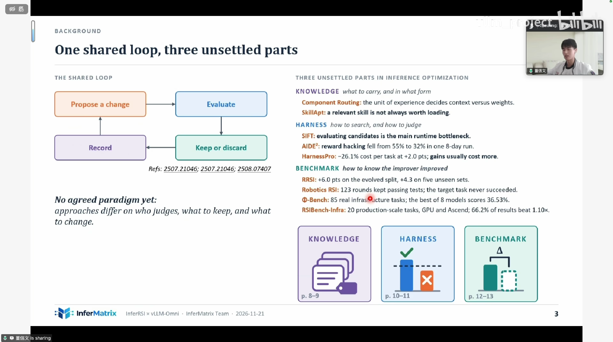
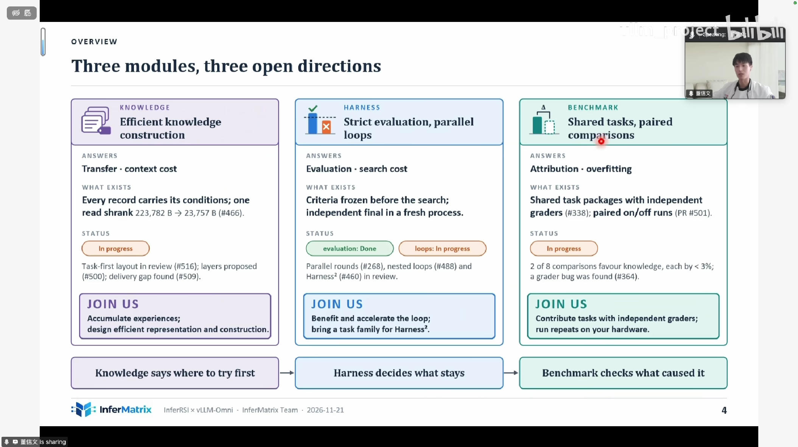
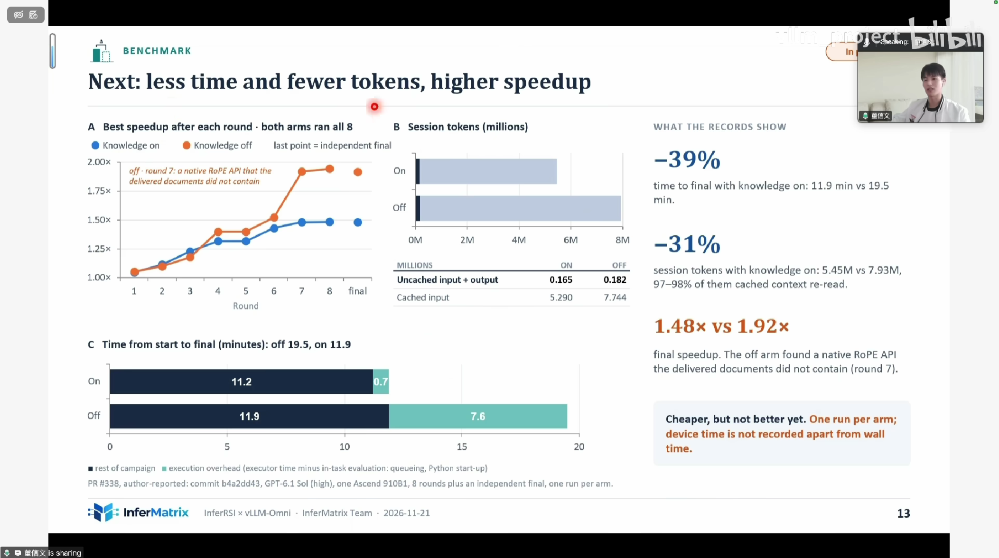
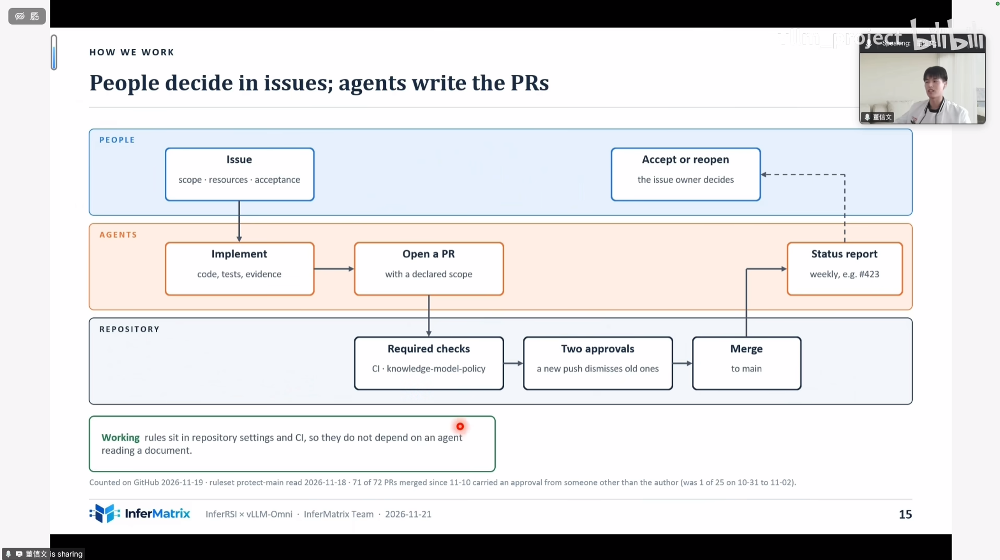

## 深度整理笔记

> **背景与核心命题**：本期 vLLM 小课堂由 InferMatrix 团队（主讲：董信文；讨论：汪志鹏，2026-11-21）分享 **InferRSI × vLLM-Omni** 的一线工程实践，主题是如何用 Agent App 加速新模型 Day-0 接入与推理性能优化。整场报告浓缩为一句话：**AI Infra 未来的发展方向是做推理侧的 RSI（Recursive Self-Improvement，递归自我改进），而落地的两大核心抓手，一个是 Knowledge（经验怎么沉淀与投递），另一个是 Evaluation / Harness（改动怎么严格评测与裁决）。**

---

### 一、演进脉络：RSI 如何从「数学证明」走向「实测驱动」

早期的递归自我改进停留在形式化逻辑证明，今天则全面转向基于真实基准测试（measurements）的闭环迭代；可被修改的对象也从「模型权重」这一黑盒核心，不断向外扩展到人类和 Agent 都能直接编辑的工程产物（editable artifacts）。

#### 1. RSI 发展时间线（1965–2026）

| 年份 | 代表工作 | 修改对象 / 改动被接收的标准 |
| :--- | :--- | :--- |
| **1965** | I. J. Good | 提出「智能爆炸（Intelligence explosion）」思想雏形 |
| **2003** | Gödel Machine | 只有在**数学上证明**自我改写有益之后，才允许重写自身代码 |
| **2022–24** | STaR、LMSI、Self-Rewarding | 修改**模型权重**，在模型自生成的数据上重新训练 |
| **2023** | OPRO、Promptbreeder、STOP、Voyager | 修改 **Prompt、改进器自身代码、技能库（skill library）** |
| **2024–25** | ADAS、Gödel Agent、SICA、DGM | 修改 **Agent 代码**，通过编程基准（coding benchmarks）验证 |
| **2025–26** | AlphaEvolve、SkillOpt、RRSI、AIDE²、Harness² | 修改**算法、技能与 Harness（外围框架）**，在 **held-out 未见任务**上验证后接收 |

> **范式跃迁一句话总结**：*From proofs to measurements. From weights outward to editable artifacts.*

#### 2. 由内向外的六层可修改对象
1. **Weights（模型权重）**：MiMo-V2.6、Terminal-RSI、RSI via on-policy distillation；
2. **Prompts and specifications（提示词与规范）**：OPRO、Promptbreeder、SpecForge；
3. **Skills and memory（技能库与记忆）**：Voyager、SkillOpt、SkillApt；
4. **Harness around the model: flow, tools, context**：RRSI、SoL-Pi、Harness²、HarnessPro；
5. **The agent program's own source code**：SICA、DGM、AIDE²；
6. **Data and training setup**：RSIGym。

对推理引擎（如 vLLM / vLLM-Omni）而言，**第 3 层（Skills & Memory）与第 4 层（Harness）** 是性价比最高、最贴近 AI Infra 现实的发力点。

---

### 二、推理优化的共享循环与三大未解难题

几乎所有 RSI 系统都共享同一个四步基础循环（参考 `arXiv:2507.21046`、`arXiv:2508.07407`）：

```text
+--------------------+       +--------------+
|  Propose a change  | ----> |   Evaluate   |
|    (提出改动)       |       |    (评测)     |
+--------------------+       +--------------+
          ^                         |
          |                         v
+--------------------+       +-------------------+
|       Record       | <---- |  Keep or discard  |
|    (记录经验)       |       |   (保留或丢弃)     |
+--------------------+       +-------------------+
```

但行业目前**尚无统一范式（No agreed paradigm yet）**，推理优化中存在三大尚未定型的核心模块：

| 模块 | 核心追问 | 代表研究与关键发现 | 揭示的工程痛点 |
| :--- | :--- | :--- | :--- |
| **Knowledge** | 沉淀什么经验？以何种形态承载？ | **Component Routing**：经验粒度决定放上下文还是写进权重。；**SkillApt**：一个「相关」的技能并不总是值得加载。 | 经验不是越多越好，盲目堆砌会造成上下文成本飙升与检索干扰。 |
| **Harness** | 如何组织搜索？如何可靠裁决？ | **SIFT**：评测候选方案是最主要运行瓶颈。；**AIDE²**：运行 8 天才把 reward hacking 从 `55%` 降至 `32%`。；**HarnessPro**：单任务成本降 `26.1%` 同时提分 `+2.0 pts`（但收益常伴随更高成本）。 | 评测慢、容易被 Agent 钻空子（reward hacking），搜索成本高。 |
| **Benchmark** | 如何确认「改进器」真的变强了？ | **RRSI**：演化集 `+6.0 pts`，5 个未见测试集 `+4.3 pts`。；**Robotics RSI**：连续 **123 轮** 通过测试却**从未完成目标任务**。；**Φ-Bench**：85 个真实基建任务，8 个模型最高仅 `36.53%`。；**RSIBench-Infra**：20 个 GPU/Ascend 生产级任务，`66.2%` 超过 `1.10×`。 | 测试通过不等于任务成功；过拟合与归因困难是常态，真实基建任务极难。 |

> **关键剪刀差**：Agent 提出假设只需几十秒，但**真机端到端验证极其耗时**（拉起引擎、加载权重、精度校验、A/B 测速动辄十几分钟至数小时）。破局之道是**针对不同优化目标分层设计专项 Benchmark**，而不是每次都跑全量端到端测试。

---

### 三、InferRSI 系统架构：不造新模型、不造新 Agent 的可插拔框架

> **核心定位**：**Your agent edits; InferRSI evaluates and records.** 不训练模型、不新建 Agent，直接接入现有 Coding Agent（Codex、DeepSeek Harness、WorkSwarm），区别于训练侧的 InfraRSI（`arXiv:2611.11558`）。

#### 1. 三大模块分工与进展

| 模块 | 解决的核心问题 | 当前已落地能力 | 当前状态与推进中 PR / Issue |
| :--- | :--- | :--- | :--- |
| **Knowledge** | 经验迁移与上下文成本 | 每条记录带明确适用条件；单次读取体积从 `223,782 B` 压至 `23,757 B`（`#466`） | 任务优先布局审阅中（`#516`）；分层披露提案（`#500`）；发现投递鸿沟（`#509`） |
| **Harness** | 评测可信度与搜索成本 | 搜索前冻结评判标准；最终候选在独立新进程复测 | 评测框架 Done；并行轮次（`#268`）、嵌套循环（`#488`）、Harness²（`#460`）推进中 |
| **Benchmark** | 归因与防过拟合 | 带独立 Grader 的共享任务包（`#338`）；Knowledge On/Off 配对对照（`PR #501`） | 8 组对比中仅 2 组偏向开启 Knowledge（优势 `< 3%`），并暴露一个 Grader Bug（`#364`） |

#### 2. 双层循环与端到端执行流

Outer loop 优化推理引擎本身，Inner loop 优化优化器自身。单次优化战役（campaign）流转如下：

```text
[1. Request] (Codex / DeepSeek Harness / WorkSwarm)
      |
      v
[2. Prepare checks] (编写质量与计时脚本；或复用 Benchmark 包)
      |
      v
[3. start] (冻结任务定义、基线 baseline 与预算 budget)
      |
      v
[4. round × N]
      |   Propose a change (改代码；可选从知识库 find -> read)
      |         |
      |         v
      |   Run and check (先检质量，再做 A/B 计时)
      |         |
      |         v
      |   Judge (PASS / FAIL / INCONCLUSIVE)
      |         |
      |         v
      |   Keep the best (保留失败记录供同轮反馈；绝不覆盖历史最优)
      v
[5. final] (独立新进程复测最优解；支持 On/Off 配对)
      |
      v
[6. Deliver] (输出 patch · verdict · report ——经 PR 审核写回——> Knowledge library)
```

---

### 四、实战案例一：DeepSeek V4.1 Flash Day-0 接入与「踩坑转 Skill」

- **环境**：`8× Ascend 950DT`、`vLLM v0.27.1 + vllm-ascend v0.27.1rc1`、`DP8 × TP1 · EP8`。
- **六步依赖交付链**：`1. Spec（锁定模型/权重/引擎/精度门禁）` → `2. Engram（新记忆模块门控合入）` → `3. Graph decode（固定 buffer / 捕获 / 回放）` → `4. DSpark（接入 draft model）` → `5. Accuracy（GPQA Diamond ≥ 177/198 且 OCRBench ≥ 84.5/1000）` → `6. Accepted`。
- **两次典型误判沉淀为三条 Skill**：

| 误判场景（Agent 的错误推论） | 真实根因 | 沉淀新增的 Skill |
| :--- | :--- | :--- |
| **误判 1**：关闭 Engram 后精度对齐，便归咎于门控（gate） | 从未定位输出首次发生分叉的位置 | **Locate the difference**：严格定位「输入一致、输出首次出现差异」的步骤 |
| **误判 2**：以为值已写入就能被 Attention 读到 | 从未检查读写时序（read/write order） | **Design before coding**（先明确模块边界与数据流向）；**Test target first**（先定义预期输出，使测试具备失败能力） |

---

### 五、Knowledge 模块深水区：按任务路由、分层披露与「投递鸿沟」

1. **一核七入口（`#515, PR #516`）**：先加载唯一对应任务技能（`Day-0 model` / `Performance` / `Debug` / `Accuracy` / `Version alignment` / `Derived engine` / `Independent engine`），再检索 `135` 个证据源（含 `48` 条 records）。排序与主干 `49/49` 完全一致，CLI 中位耗时从 `2.58 s` 降至 `1.81 s`。
2. **四层渐进披露模型（`#500`, proposed）**：`L0 Index card（已有）` → `L1 Decision card：何时用 / 何时不用 / 如何验证（当前缺失）` → `L2 Body` → `L3 Evidence and sources`。
3. **投递鸿沟（`#509`, 2026-11-19）**：默认检索返回 `5` 个通用技能，任务专属卡片从未送达；改为 task-aware 后任务卡片在 `4.7 KB` 上下文中排第 4，且仍存在条件错配（如把 **`W8A8 / Qwen3`** 的指南投递给 **`BF16`** 任务）。

---

### 六、Benchmark 实测与评测纪律：归因实验与反面教材

#### 1. Knowledge On vs Off 配对实测（`PR #338`）
单卡 **Ascend 910B1**、**GPT-6.1 Sol (high)**（`commit b4a2dd43`），`8` 轮迭代 + `1` 次独立新进程 `final`（每组单次运行）：

| 评测指标 | Knowledge On | Knowledge Off | 变化与深层归因 |
| :--- | :--- | :--- | :--- |
| **端到端总耗时（start → final）** | **11.9 min** | **19.5 min** | **-39%**（主体耗时 `11.2` vs `11.9 min`，核心差距在排队/启动等执行开销 `0.7` vs `7.6 min`） |
| **会话总 Token 消耗** | **5.45M** | **7.93M** | **-31%**（`97–98%` 为缓存上下文重读：Cached `5.290M` vs `7.744M`） |
| **最终加速比（Independent Final）** | **1.48×** | **1.92×** | **Off 组上限更高**：Off 组在第 7 轮自主发现了知识库未收录的原生 RoPE API |

> **核心结论**：**Cheaper, but not better yet.** 知识库能显著省时省 Token，但如果覆盖不全，可能产生锚定效应、收窄 Agent 探索底层原生 API 的空间。

#### 2. 评测纪律反面教材：为什么 `7.37×` 被判 `INCONCLUSIVE`？（Backup B2）
`MiniMax-H3 Ref2VA`（`950PR` / `Atlas 150 / A5 · TP4`，`5s 768p 24fps`，记录 `#520` / `PR #527`）虽跑出 `50-step engine-feature stack (4.22×)`、`10-step dense (5.04×)`、`10-step + Cache-DiT 0.12 (7.37×)`，但**未放入主结论页**，原因包括：
1. **混比不同工作负载**：`7.37×` 并非 `5.04×` 叠加 Cache-DiT 的净增益（采样步数负载不同，不可直接连乘）；
2. **质量样本不足且退化**：部分维度每 seed 仅 `1` 条 prompt，某 seed 主体一致性下降 `9.17%`；
3. **关联特性回退**：`9/8 steps`、`RainFusion`、`MXFP8` 均回退，`USP` 初始化失败；
4. **缺乏独立复测**：`448` 条衍生记录并非独立试验（完整归档 `2,684` 个文件）。正确做法是逐层配对对照（`10-step` vs `50-step`，再 `Cache-DiT` vs `10-step`）。

---

### 七、人机协作工程规范：把规矩写进 CI，而不是写进文档

```text
[PEOPLE]      Issue (定义 scope · resources · acceptance)              Accept or reopen (Issue Owner 拍板)
                   |                                                             ^
                   v                                                             :
[AGENTS]      Implement (代码/测试/证据) -> Open a PR (声明 scope)        Status report (周报，如 #423)
                                               |                                 ^
                                               v                                 |
[REPOSITORY]                             Required checks ------------> Two approvals ------------> Merge
                                    (CI · knowledge-model-policy)  (新 push 自动作废旧审批)
```

> **核心铁律**：*Working rules sit in repository settings and CI, so they do not depend on an agent reading a document.* 实施后（11-10 起），合并的 `72` 个 PR 中有 **`71` 个**携带非作者审批（此前 10-31 至 11-02 仅为 `1/25`）。

---

### 复习速记

1. **AI Infra 的 RSI 双支柱**：**Knowledge**（任务路由 + 条件匹配 + 分层披露）与 **Evaluation / Harness**（冻结标准 + 先质后速 + 独立复测）。
2. **最大瓶颈**：提出假设极快，**真机端到端验证极慢**，需分层设计专项 Benchmark。
3. **InferRSI 的克制**：不训模型、不造新 Agent，外挂于现有 Coding Agent 负责评测与记录。
4. **Knowledge 现实边界**：省时 `39%`、省 Token `31%`，但需解决投递鸿沟、条件错配与锚定上限问题，关键是补齐 **L1 Decision card（何时不用）**。
5. **踩坑变资产**：把每次误判抽象为可复用 Skill 并经 PR 审核回写知识库。
6. **评测红线**：严禁混比不同 workload，未经独立复测或质量退化的数字一律判 `INCONCLUSIVE`。
7. **治理铁律**：人在 Issue 做决策，Agent 写 PR，规则写进 CI 与分支保护而非文档。

---

## 原始笔记与截图

# AI Infra未来的发展方向是做RSI 一个是做knowledge 一个是做evaluation




* RSI跑实验的过程是目前的瓶颈，因为RSI提出一个假设很简单，但是在真机上验证很耗费时间，end to end的时间可能是目前的瓶颈。应该针对不同的优化目标，设置不同的benchmark去验证









