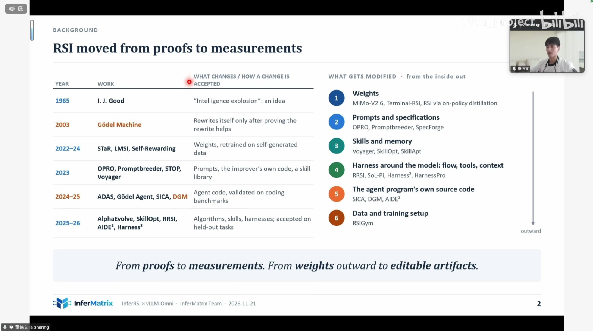
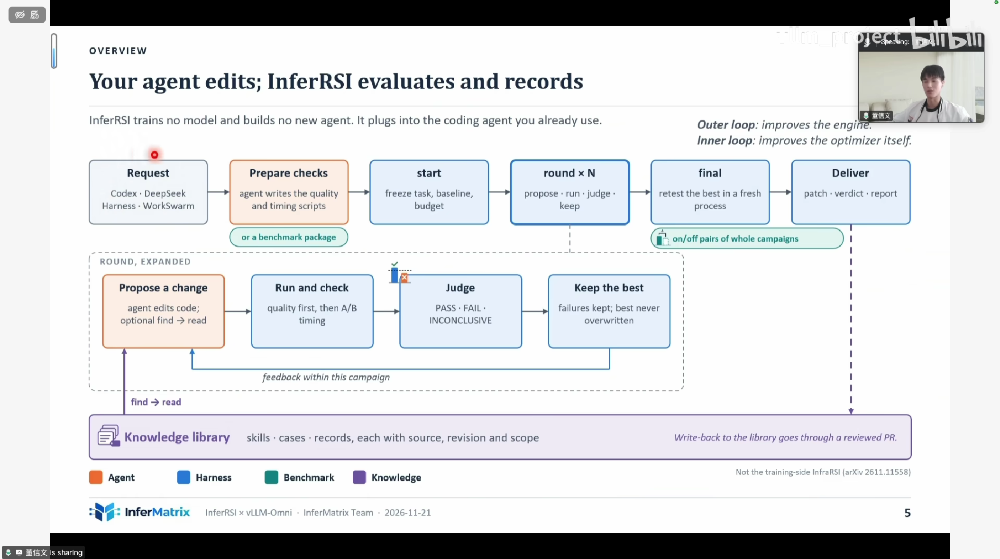
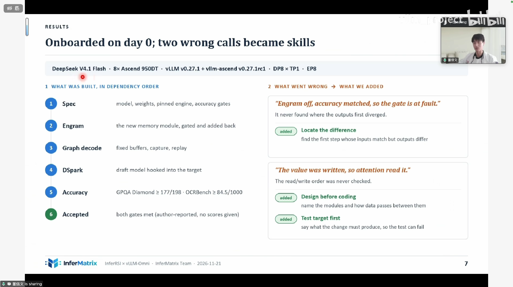
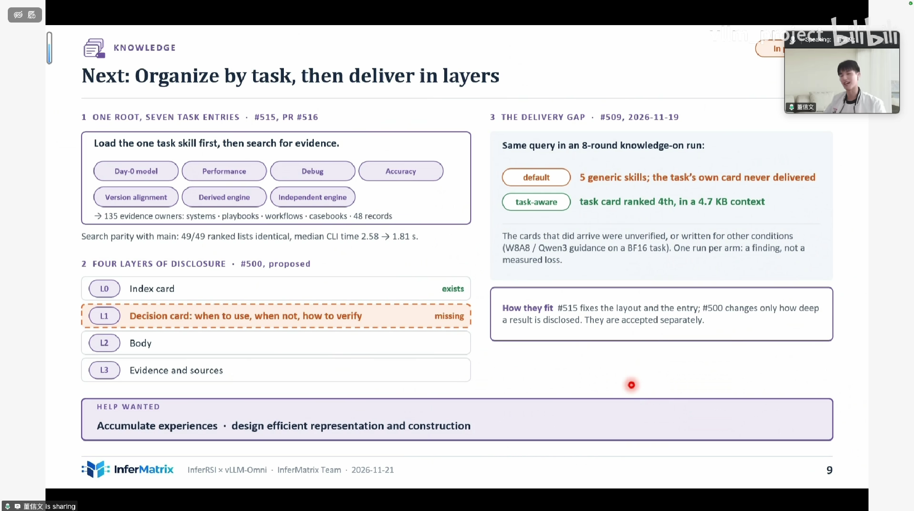
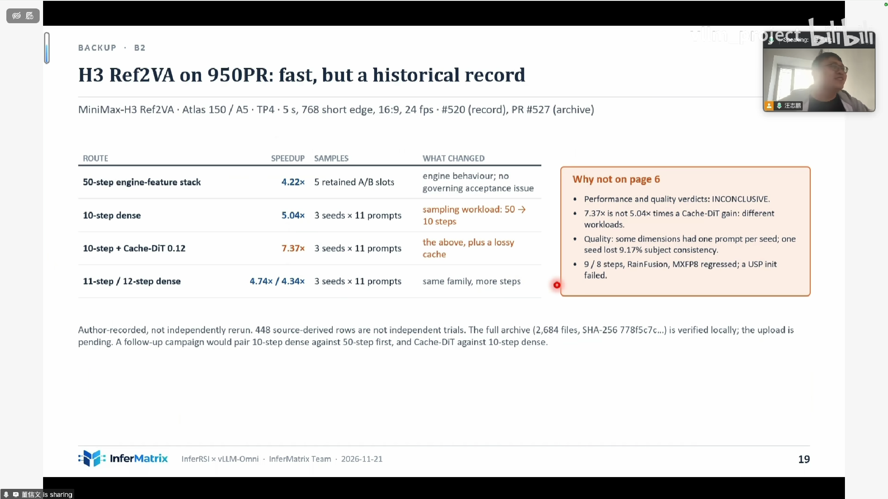

## 核心导读

> **TL;DR**：本次 vLLM 小课堂（InferMatrix 团队，InferRSI × vLLM-Omni）聚焦推理侧 **RSI（Recursive Self-Improvement，递归自我改进）** 在 AI Infra 中的落地实践。核心观点认为：RSI 正从早期理论证明转向**基于实测（measurements）的迭代**，优化对象从模型权重向外扩展至 Prompt、Skill、Harness 与代码。InferRSI 本身不训练新模型、也不造新 Agent，而是作为可插拔框架接入现有 Coding Agent，围绕 **Knowledge（经验构造）、Harness（严格评测与搜索闭环）、Benchmark（归因与防过拟合）** 三大模块，加速新模型 Day-0 接入与推理性能优化。

### 一、RSI 演进脉络与推理优化的三大未解难题

- **演进轨迹**：1965 年 I. J. Good「智能爆炸」→ 2003 年 Gödel Machine（仅在证明改写有益后才自我重写）→ 2022–24 年权重自训练（STaR、LMSI、Self-Rewarding）→ 2023 年 Prompt / 技能库演化（OPRO、Promptbreeder、STOP、Voyager）→ 2024–25 年 Agent 代码自演化（ADAS、Gödel Agent、SICA、DGM）→ 2025–26 年算法 / 技能 / Harness 在 held-out 任务上验证接收（AlphaEvolve、SkillOpt、RRSI、AIDE²、Harness²）。
- **可修改层级（由内向外）**：`1. Weights` → `2. Prompts & specifications` → `3. Skills & memory` → `4. Harness（flow、tools、context）` → `5. Agent 自身源码` → `6. Data & training setup`。
- **共享基础循环**：`Propose a change（提出改动）→ Evaluate（评测）→ Keep or discard（保留或丢弃）→ Record（记录）`，但在推理优化中仍有三大未定环节：

| 模块 | 核心追问 | 代表发现与痛点 |
| :--- | :--- | :--- |
| **Knowledge** | 沉淀什么经验、以何种形态承载？ | Component Routing 指出经验粒度决定放上下文还是权重；SkillApt 表明相关技能并非总是值得加载。 |
| **Harness** | 如何搜索、如何裁决？ | **真机评测是当前最大运行瓶颈**（SIFT）；AIDE² 在 8 天运行中将 reward hacking 从 55% 降至 32%；HarnessPro 单任务成本降 26.1% 同时提分 +2.0 pts（但收益通常伴随更高成本）。 |
| **Benchmark** | 如何确认「改进器」真的变强了？ | Robotics RSI 连续 123 轮通过测试却从未完成目标任务；Φ-Bench（85 个真实基建任务）8 个模型最高仅 36.53%；RSIBench-Infra（20 个 GPU / Ascend 生产级任务）66.2% 结果超过 1.10×。 |

### 二、InferRSI 系统架构与工作流

> **核心定位**：InferRSI **不训练模型、不新建 Agent**，直接接入现有 Coding Agent（如 Codex、DeepSeek Harness、WorkSwarm），由 Agent 负责改代码，InferRSI 负责评测与记录（区别于训练侧的 InfraRSI，arXiv 2611.11558）。

- **三大模块分工**：
  - **Knowledge（高效知识构造）**：决定「先试哪里」，每条记录携带适用条件，单次读取体积已从 `223,782 B` 压缩至 `23,757 B`（#466）。
  - **Harness（严格评测与并行循环）**：决定「留下什么」，搜索前冻结标准，最终在独立新进程中复测；并行轮次（#268）、嵌套循环（#488）与 Harness²（#460）正在推进。
  - **Benchmark（共享任务与配对对照）**：校验「是什么导致了提升」，采用带独立 Grader 的共享任务包（#338）及 Knowledge On/Off 配对实验（PR #501）；8 组对比中仅 2 组偏向开启 Knowledge（优势 < 3%），并据此暴露了一个 Grader Bug（#364）。
- **双层循环与执行链**：Outer loop 优化推理引擎本身，Inner loop 优化优化器自身；流程为 `Request → Prepare checks → start（冻结任务/基线/预算）→ round × N → final（新进程独立复测）→ Deliver（PR 审核写回知识库）`。单轮内遵循**先检质量，再做 A/B 计时**，裁决输出 `PASS` / `FAIL` / `INCONCLUSIVE`，保留失败记录且绝不覆盖历史最优。

### 三、关键实战案例与实验数据

1. **Day-0 新模型接入：DeepSeek V4.1 Flash（8× Ascend 950DT）**
   - 环境：`vLLM v0.27.1 + vllm-ascend v0.27.1rc1`，`DP8 × TP1 · EP8`。
   - 按依赖顺序交付：`1. Spec` → `2. Engram（记忆模块门控）` → `3. Graph decode（固定 buffer / 捕获 / 回放）` → `4. DSpark（draft model）` → `5. Accuracy（GPQA Diamond ≥ 177/198，OCRBench ≥ 84.5/1000）` → `6. Accepted`。
   - 踩坑沉淀为 Skill：**Locate the difference**（寻找输入一致但输出首次分叉的步骤）、**Design before coding**（先明确模块与数据流向）、**Test target first**（先定义预期输出，使测试具备失败能力）。
2. **Knowledge 演进：按任务组织 + 分层披露**
   - **一核七入口（#515, PR #516）**：先加载唯一对应任务技能（`Day-0 model` / `Performance` / `Debug` / `Accuracy` / `Version alignment` / `Derived engine` / `Independent engine`），再检索 135 个证据源（含 48 条记录）；CLI 中位耗时从 `2.58 s` 降至 `1.81 s`。
   - **四层渐进披露（#500）**：`L0 Index card` → `L1 Decision card（何时用 / 何时不用 / 如何验证，当前缺失）` → `L2 Body` → `L3 Evidence & sources`。
   - **投递鸿沟（#509）**：默认检索返回通用技能导致任务专属卡片未送达，且存在条件错配（如将 W8A8 / Qwen3 经验投递给 BF16 任务）。
3. **Benchmark 配对实测：Knowledge On vs Off（PR #338，GPT-6.1 Sol high，单卡 Ascend 910B1）**

| 指标 | Knowledge On | Knowledge Off | 变化与归因 |
| :--- | :--- | :--- | :--- |
| **端到端总耗时（start → final）** | **11.9 min** | **19.5 min** | **-39%**（大幅减少排队 / 启动等执行开销） |
| **会话 Token 消耗** | **5.45M** | **7.93M** | **-31%**（97–98% 为缓存上下文重读） |
| **最终加速比（Final Speedup）** | **1.48×** | **1.92×** | Off 组在第 7 轮发现了知识库未收录的原生 RoPE API |

   - 结论：开启知识库目前做到了**「更便宜、更快（Cheaper），但上限还未更优（not better yet）」**。
4. **评测纪律反面教材（MiniMax-H3 Ref2VA on 950PR，Backup B2）**：虽跑出 `4.22× / 5.04× / 7.37×` 等数字，但因**不同采样步数负载不可混比**、质量评测样本不足且出现主体一致性下降 9.17%、多组特性回退且非独立复测，裁决为 `INCONCLUSIVE` 未纳入主结论。

### 四、人机协作工程规范（How We Work）

- **人在 Issue 中做决策，Agent 写 PR**：人在 Issue 中定 `scope · resources · acceptance` 并最终拍板；Agent 提交代码 / 测试 / 证据并开 PR；仓库用 `Required checks` + `Two approvals（新 push 自动作废旧审批）` 强制兜底。
- **核心理念**：把规则固化在**仓库设置与 CI** 中，而不是指望 Agent 自觉读文档（实施后 72 个合并 PR 中有 **71 个**带非作者审批）。

### 复习速记

1. **AI Infra 的 RSI 两大抓手**：**Knowledge**（按任务路由、带适用条件、分层披露）与 **Evaluation / Harness**（先检质量再测性能、冻结标准、独立新进程复测）。
2. **当前最大瓶颈**：提出假设很便宜，**真机端到端验证非常耗时**，需分层设计专项 Benchmark。
3. **Knowledge 的现状与边界**：显著省时（-39%）省 Token（-31%），但若缺失底层 API 或条件错配，反而可能限制探索上限。
4. **防 Reward Hacking**：绝不混比不同 workload，所有归因依赖独立 Grader 与 On/Off 配对对照。
5. **Agent 工程治理铁律**：规矩写进 CI 和分支保护，而非仅写在文档里。

---

## 原始笔记与截图

# AI Infra未来的发展方向是做RSI 一个是做knowledge 一个是做evaluation

* RSI跑实验的过程是目前的瓶颈，因为RSI提出一个假设很简单，但是在真机上验证很耗费时间，end to end的时间可能是目前的瓶颈。应该针对不同的优化目标，设置不同的benchmark去验证

