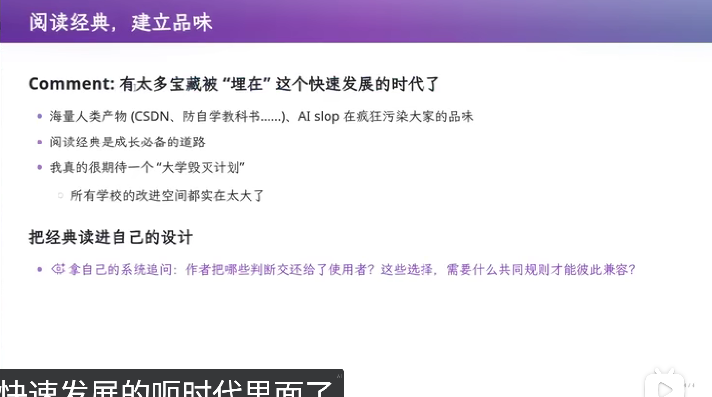
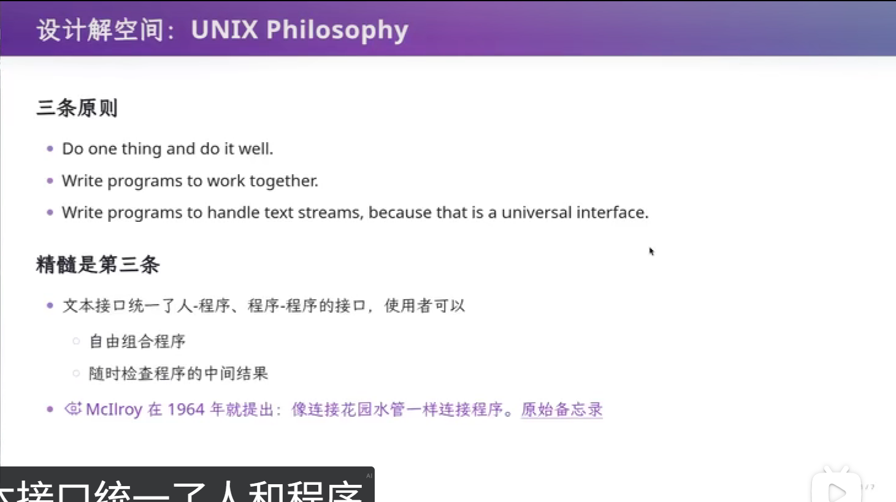
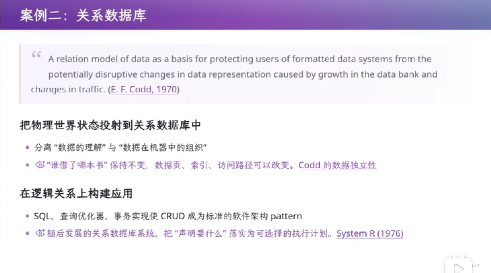
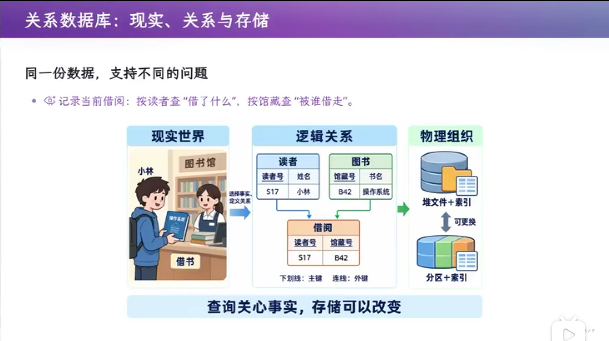
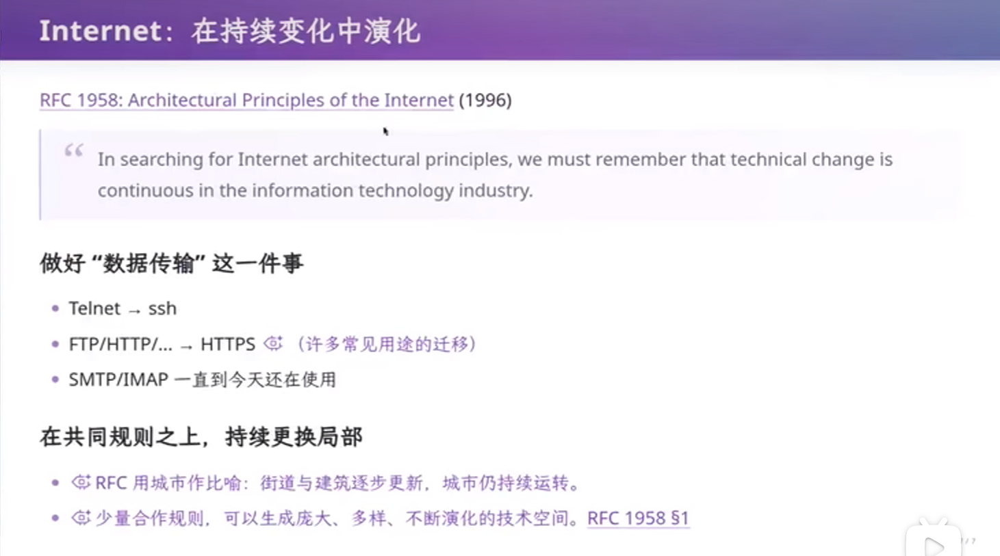
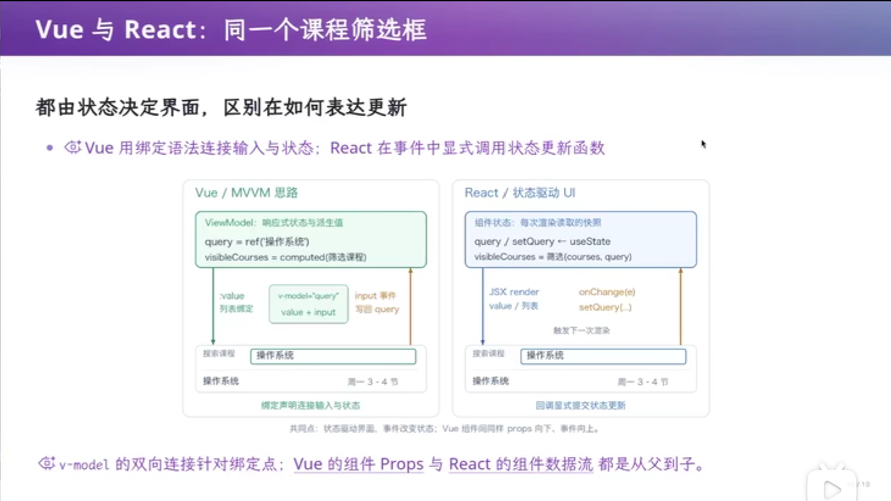
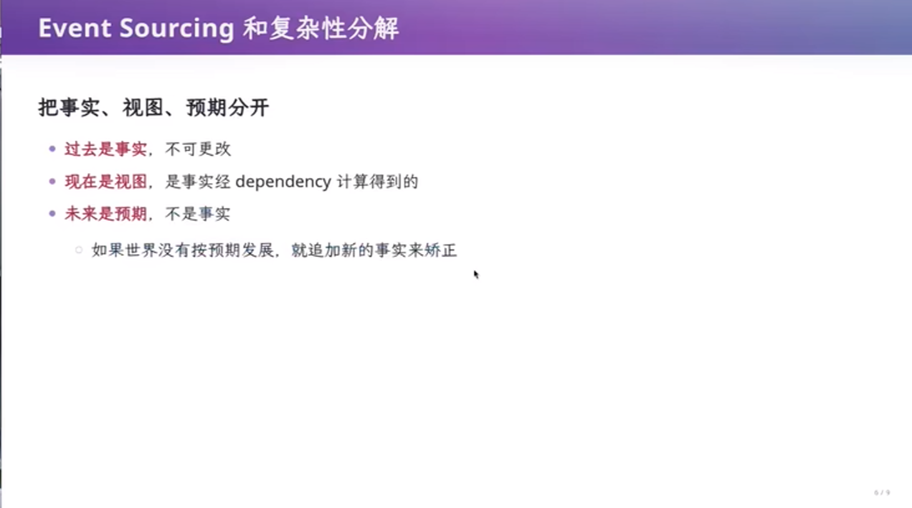
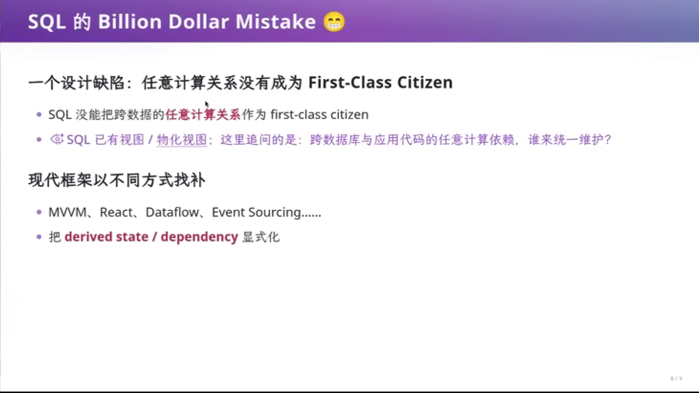

## 核心导读

> **TL;DR**：本节围绕「如何阅读经典、建立架构品味」展开，串讲了 **UNIX 哲学、关系数据库、Internet** 三大经典系统的核心设计原则，随后沿 **Java Web（Servlet/JSP）→ MVC → MVVM（Vue）与状态驱动 UI（React）→ Event Sourcing** 的脉络，揭示现代软件架构的一条底层主线——**隔离变化，并将派生状态（derived state）与数据依赖（data dependency）显式化**。

### 1. 阅读经典与三大基础架构范式

在充斥着低质量内容与 AI slop 的时代，阅读经典是建立工程品味的必经之路。阅读经典时，要拿自己的系统反问两个问题：**作者把哪些判断交还给了使用者？这些选择需要什么共同规则才能彼此兼容？**

| 经典系统 | 核心原则 / 论文 | 关键设计思想 | 典型体现 |
| :--- | :--- | :--- | :--- |
| **UNIX Philosophy** | 单一职责、协同工作、文本流作为通用接口（McIlroy, 1964） | **精髓在第三条**：文本接口统一了「人-程序」与「程序-程序」的边界 | 使用者可像「连接花园水管」一样自由组合程序，并随时检查中间结果 |
| **关系数据库** | E. F. Codd (1970) 数据独立性；System R (1976) | 分离「数据的逻辑理解」与「机器中的物理组织」，**查询关心事实，存储可以改变** | 借阅系统按逻辑关系建模（读者 / 图书 / 借阅），同一份数据支持多维查询；底层可在「堆文件+索引」与「分区+索引」间更换，SQL 与优化器将「声明要什么」转为执行计划 |
| **Internet** | RFC 1958 (1996) *Architectural Principles of the Internet* | 做好「数据传输」这一件事，在**少量共同规则**之上持续更换局部 | Telnet→SSH、FTP/HTTP→HTTPS、SMTP/IMAP 沿用至今；如城市般街道与建筑逐步更新而整体持续运转 |

### 2. Web 应用架构演进：从页面模板到 MVC

- **Java Web 与页面模板（1990s 后期）**：
  - JVM（自动内存管理）兴起；PHP/FI (1995)、ASP (1996) 探索了在页面中嵌入服务端脚本。
  - **Servlet → JSP 1.0 (1999)**：Servlet 是在 Java 中输出 HTML，JSP 则是在 HTML 中嵌入 Java（由容器翻译为 Servlet，改变的是编写方式）。
  - **痛点**：虽然页面结构清楚了，但业务逻辑也很容易「顺手」写进页面，导致耦合。
- **MVC（Models-Views-Controllers, 1979）——让不同的变化各有归属**：
  - 核心原则是 **Separation of Concerns（关注点分离）**，最初面向交互式界面，使同一业务对象可拥有不同的展示与操作方式。
  - **教务系统标准架构示例**：
    - **Model**：封装数据、状态与业务逻辑（课程、选课记录、容量与冲突规则——**不只是数据库里的几张表**）。
    - **View**：展示界面。
    - **Controller**：接收用户输入，协调 Model 与 View。
  - **隔离变化**：课表从列表换成周历主要改 View；选课限制规则变化主要改 Model。

### 3. 前端状态驱动 UI：Vue (MVVM) 与 React 对比

以「课程筛选框」为例，Vue 与 React **都由状态决定界面、事件改变状态**，且都不必把派生列表另存为独立状态（避免手工同步两份状态），区别在于如何表达更新：

| 对比维度 | Vue / MVVM 思路 | React / 状态驱动 UI |
| :--- | :--- | :--- |
| **核心心智模型** | **界面绑定状态**：绑定关系写一次，变化由框架自动追踪 | **用状态快照描述界面**：每次 Render 都描述「此刻应该显示什么」 |
| **状态与派生值** | ViewModel 中用 `ref` 保存 `query`，用 `computed` 派生 `visibleCourses` | `const [query, setQuery] = useState('')`；每次渲染直接根据本轮 `query` 快照计算 `visibleCourses` 并返回 JSX |
| **输入框连接方式** | `<input v-model="query">` 封装了两条连接：状态→控件 `:value="query"`、输入→状态 `@input="query = $event.target.value"` | 受控输入框显式连接事件与更新：`value={query}` 与 `onChange={e => setQuery(e.target.value)}`；流程：事件 → 更新状态 → Render → 界面 |
| **数据流辨析** | `v-model` 的双向连接仅针对单个绑定点；**组件间 Props 依然从父到子、事件向上** | `setQuery` 请求下一次渲染（本轮拿到的仍是旧快照）；**组件数据流同样从父到子** |

### 4. Event Sourcing、数据依赖与 SQL 的遗憾

- **Event Sourcing 与复杂性分解——把事实、视图、预期分开**：
  - **过去是事实**：不可更改。
  - **现在是视图**：是事实经 dependency 计算得到的。
  - **未来是预期**：不是事实；若现实未按预期发展，则**追加新的事实来矫正**。
- **显式建模 Data Dependency（「现在」是「过去」的结果）**：
  - 示例：`选课记录 / 成绩表 → 当前已修课程集合、学分数`；`已通过课程集合 + 培养方案 → 是否满足毕业条件`。
  - 价值：构建可查证、可溯源的计算过程，解决「反悔导致多处修改、遗漏一处即崩溃」的问题；即便复杂性仍可能引发不一致，也**容易发现、容易修复**。
- **SQL 的 Billion Dollar Mistake**：
  - SQL 虽有视图 / 物化视图，但未能把**跨数据库与应用代码的任意计算关系**作为 **First-Class Citizen** 来统一维护。
  - 现代框架（**MVVM、React、Dataflow、Event Sourcing** 等）本质上是在用不同方式弥补这一缺口——**把 derived state / dependency 显式化**。

### 复习速记

1. **UNIX 的精髓**在于「文本流统一了人-程序与程序-程序接口」，使自由组合与检查中间结果成为可能。
2. **关系数据库的核心价值**是 Codd 的数据独立性：逻辑事实与物理存储分离，查询关心事实，存储可以更换。
3. **Internet 演化的启示**：少量共同规则即可支撑庞大且持续局部更替的技术空间。
4. **MVC 中的 Model 不是几张表**，它封装数据、状态与业务规则，目的是让界面变化与业务变化解耦。
5. **Vue 与 React 本质相通**：都只存最小必要状态、由状态派生视图、组件数据流均为单向（父→子），差异仅在声明式绑定（`v-model` / `computed`）与显式快照重渲染（`useState` / `onChange`）。
6. **架构演进的隐性主线**：过去是不可变事实，现在是依赖计算出的视图；MVVM、React、Dataflow、Event Sourcing 都在弥补 SQL 未将跨层计算依赖设为「一等公民」的缺憾。

---

## 原始笔记与截图

