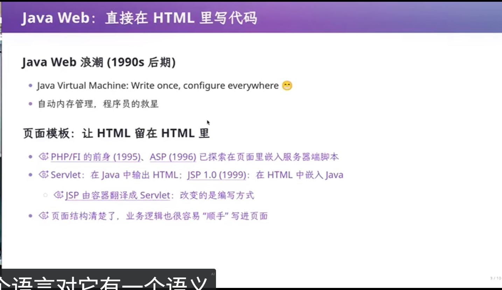
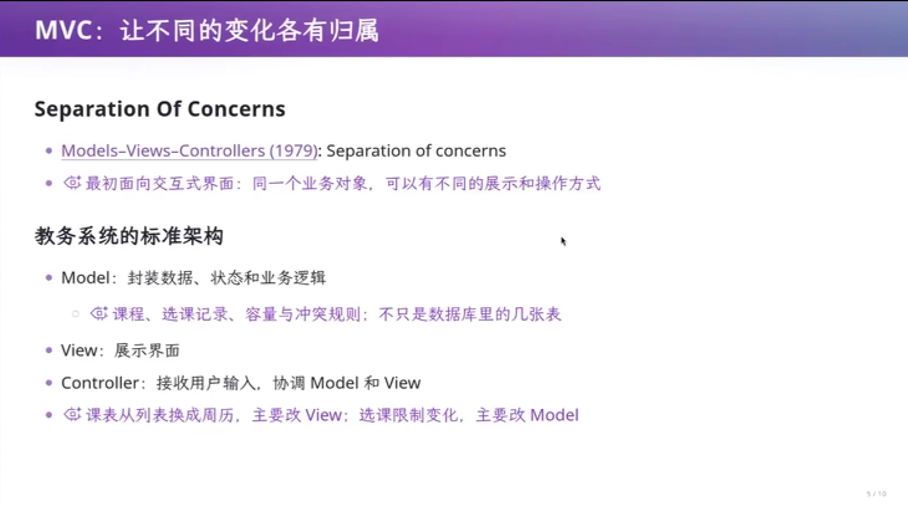
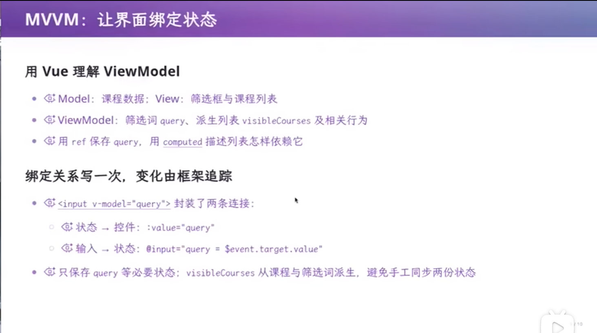
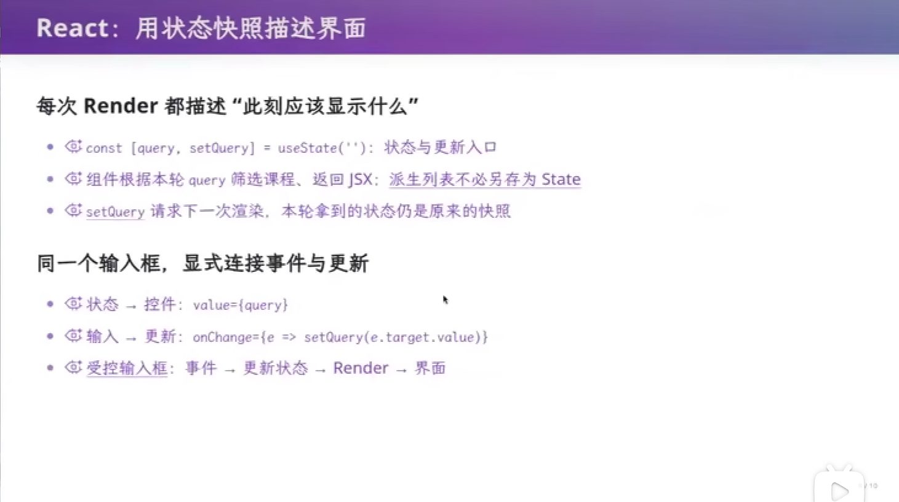
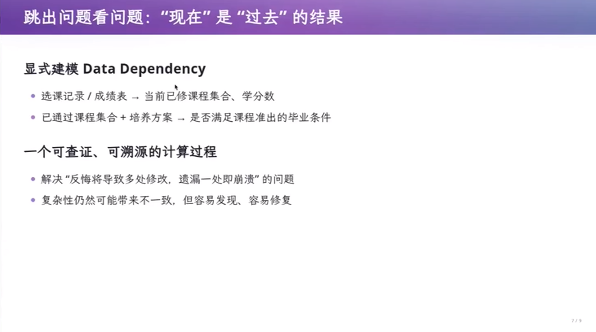

## 深度整理笔记

> **本节主线**：这一讲从「为什么必须读经典」切入，先后剖析了 **UNIX 哲学、关系数据库、Internet** 三大经久不衰的基础系统，提炼出好架构的共同基因——**在少量清晰规则之上，把判断权交还给使用者、把变化隔离在局部**。随后沿着 **Java Web（Servlet / JSP）→ MVC → 前端 MVVM（Vue）与状态驱动 UI（React）→ Event Sourcing** 的工程演进脉络，一步步揭示现代软件架构背后一条隐蔽却贯穿始终的红线：**避免手工同步多份状态，把派生状态（derived state）与数据依赖（data dependency）显式化**。

---

### 一、为什么要读经典：在噪音时代建立架构品味

在技术信息极度膨胀的当下，大量低质量教程（如拼凑的博客文章、被称为「防自学教科书」的教材）以及铺天盖地的 **AI slop（AI 生成的低质垃圾内容）** 正在持续稀释和污染开发者的工程品味。许多真正闪光的思想宝藏，反而被「埋」在了这个快速迭代的时代里。

绿老师强调，**阅读经典是工程师成长的必备道路**，但读经典绝不是背诵年代和术语，而是要「把经典读进自己的设计」里。每当你学习一个经典系统，或者审视自己正在写的系统时，都应该反复追问这两个核心问题：

1. **作者把哪些判断交还给了使用者？**（哪些决策没有被框架或系统写死，而是留给上层自由组合？）
2. **这些选择，需要什么共同规则才能彼此兼容？**（自由组合的前提是什么最小公共约定？）

下面三个跨越半个世纪的经典系统，正是这两个问题的最佳教科书。

---

### 二、三大经典系统的架构基因

#### 1. UNIX Philosophy：通用接口释放组合的自由

UNIX 哲学的三条经典原则耳熟能详：

1. **Do one thing and do it well.**（只做一件事，并把它做好。）
2. **Write programs to work together.**（编写能够协同工作的程序。）
3. **Write programs to handle text streams, because that is a universal interface.**（编写处理文本流的程序，因为文本流是一种通用接口。）

许多人只记住了前两条（「单一职责」「模块化」），但绿老师点出：**真正的精髓在第三条**。

为什么是文本流？因为文本接口同时统一了 **「人—程序」** 和 **「程序—程序」** 这两类原本割裂的边界。由此带来两个极其强大的工程红利：

- **自由组合程序**：早在 1964 年，Douglas McIlroy 就在原始备忘录中提出，要「像连接花园水管一样连接程序」。只要大家都说文本流这一种语言，使用者就可以按需拼接出作者从未预想过的工具链。
- **随时检查中间结果**：因为流经管道的是人类可直接阅读的文本，而非晦涩的私有二进制格式，开发者在任意环节都可以停下来观察中间输出，调试成本极低。

对照开篇的两问：UNIX 把「如何组合工具解决问题」的判断交还给了使用者，而支撑这一切兼容的共同规则，就是「文本流」这个极简的通用接口。

#### 2. 关系数据库：用「数据独立性」隔离逻辑与物理

1970 年，E. F. Codd 在开创性论文中提出了关系模型的核心动机：

> "A relation model of data as a basis for protecting users of formatted data systems from the potentially disruptive changes in data representation caused by growth in the data bank and changes in traffic." (E. F. Codd, 1970)

在关系数据库出现之前，应用程序往往直接绑定底层的数据存储格式与访问路径；一旦数据量增长、访问流量变化、需要调整存储结构，上层业务代码就会遭受破坏性重写。

Codd 的核心突破在于**数据独立性（Data Independence）**——把物理世界的状态投射到关系数据库中，并彻底分离 **「数据的逻辑理解」** 与 **「数据在机器中的物理组织」**。

以**图书馆借书**为例，这一分层非常直观：

```text
[ 现实世界 ]              [ 逻辑关系 ]                         [ 物理组织 ]
小林在图书馆   ──选择事实──> 读者(读者号*, 姓名)                  ┌───────────────┐
借走《操作系统》  定义关系     S17, 小林                         │  堆文件 + 索引 │
                           图书(馆藏号*, 书名)       ─────────> └───────┬───────┘
                             B42, 操作系统                              ↕ 可更换
                           借阅(读者号 -> 读者, 馆藏号 -> 图书)  ┌───────┴───────┐
                             S17, B42                          │  分区 + 索引   │
                           (* 表示主键，-> 表示外键)            └───────────────┘
```

这一设计的威力体现在两点：
- **同一份数据，支持不同维度的问题**：只需记录当前借阅事实，既可以按读者查「小林借了什么书」，也可以按馆藏查「《操作系统》被谁借走了」，无需为每种查询单独维护一套冗余数据结构。
- **查询关心事实，存储可以改变**：「谁借了哪本书」这一逻辑事实保持不变，底层的数据页布局、索引结构、访问路径（例如从「堆文件 + 索引」升级为「分区 + 索引」）都可以透明更换，上层查询无需重写。

随后在 **System R (1976)** 等系统的工程落地中，**SQL、查询优化器、事务机制**进一步把「声明你要什么（What）」自动落实为「可选择的执行计划（How）」，使 **CRUD** 成为了影响至今的标准软件架构模式。

#### 3. Internet：在少量共同规则之上持续演化

1996 年发布的 **RFC 1958**（*Architectural Principles of the Internet*）开宗明义地指出：

> "In searching for Internet architectural principles, we must remember that technical change is continuous in the information technology industry."

互联网架构同样体现了「只做好一件事」的克制——底层网络专注于做好 **「数据传输」** 这一件事，而不把上层应用绑死。几十年来，上层协议经历了剧烈的更替与并存：
- 远程登录：`Telnet → SSH`
- 文件传输与网页访问：`FTP / HTTP / ... → HTTPS`（大量常见用途逐步向安全传输迁移）
- 电子邮件：`SMTP / IMAP` 则一直沿用至今

RFC 1958 第一节用**城市**做了一个极为贴切的比喻：**街道与建筑在不断翻新更替，但整座城市始终持续运转**。它印证了一条深刻的架构规律：**少量合作规则，足以生成庞大、多样、不断演化的技术空间。**

#### 三大经典系统横向对照

| 经典系统 | 核心文献 / 人物 | 交还给使用者的判断 | 支撑兼容的共同规则 | 隔离了什么变化 |
| :--- | :--- | :--- | :--- | :--- |
| **UNIX Philosophy** | McIlroy (1964) 备忘录 | 如何组合多个小工具完成复杂任务 | 文本流作为统一接口 | 单个工具的内部实现与组合方式 |
| **关系数据库** | E. F. Codd (1970)；System R (1976) | 提出任意维度的声明式查询 | 关系模型（表 / 主键 / 外键）与 SQL | 逻辑事实与底层物理存储 / 执行计划 |
| **Internet** | RFC 1958 (1996) | 在网络之上发明和替换各种应用协议 | 少量数据传输与互联协议 | 局部协议与基础设施的持续升级 |

---

### 三、Web 应用架构演进：从页面模板到 MVC

#### 1. Java Web 与页面模板（1990s 后期）：把 HTML 还给 HTML

20 世纪 90 年代后期迎来了 Java Web 浪潮：
- **JVM** 带来跨平台愿景（课堂上也幽默地调侃为 `Write once, configure everywhere`），而**自动内存管理（GC）**更是当时饱受内存泄漏折磨的程序员的救星。
- 早期动态网页开发面临一个很现实的工程尴尬：**Servlet 是在 Java 代码里拼字符串输出 HTML**，页面结构一复杂就难以维护。
- 受 **PHP/FI 前身（1995）** 和 **ASP（1996）** 在页面中嵌入服务端脚本的启发，Java 推出了 **JSP 1.0（1999）**——反过来「在 HTML 中嵌入 Java 代码」，让 HTML 留在 HTML 里。

需要看清的是，**JSP 在运行时本质上仍由容器翻译成 Servlet**，它改变的是开发者的编写方式。但这也引出了新的痛点：**页面结构虽然清楚了，业务逻辑却很容易「顺手」直接写进页面里**。很快，展示层和业务规则再次搅成一团，改页面怕动了业务，改业务又得去翻 HTML 模板。

#### 2. MVC（1979）：让不同的变化各有归属

为了解决「界面与业务耦合」的问题，Web 开发重新请出了早在 **1979 年**就提出的经典模式——**MVC（Models-Views-Controllers）**。它的核心原则就是 **Separation of Concerns（关注点分离）**。

MVC 最初面向的是桌面交互式界面，解决的诉求非常朴素：**同一个业务对象，可以有不同的展示方式和操作方式**。放到经典的**教务选课系统**中，三者的职责划分如下：

- **Model（模型）**：封装**数据、状态和业务逻辑**。
  - **关键纠偏**：在教务系统里，Model 包含课程信息、选课记录、课程容量限制、时间冲突检测规则等——**Model 绝不只是数据库里的几张表！** 把 Model 退化成贫血的数据表映射，就会迫使业务逻辑散落到 Controller 甚至 View 中。
- **View（视图）**：只负责展示界面。
- **Controller（控制器）**：接收用户输入，协调 Model 的状态变更与 View 的更新。

如此划分后，**不同原因引发的变化就各归其位了**：
- 当「课表展示从列表换成周历视图」时，主要修改 **View**；
- 当「选课限制规则变化（例如调整学分上限或冲突规则）」时，主要修改 **Model**。

---

### 四、现代前端状态驱动 UI：Vue (MVVM) 与 React 深度对比

以教务系统中的一个具体组件——**「课程筛选框」**（输入关键词如 `操作系统`，实时过滤下方课程列表 `操作系统 周一 3-4 节`）为例，我们可以看清 **Vue（MVVM 思路）** 与 **React（状态驱动 UI）** 在表象之下的本质共性与设计差异。

#### 1. Vue / MVVM：让界面绑定状态

在 MVVM 中，引入了 **ViewModel** 作为 Model 与 View 之间的桥梁（Model 为原始课程数据，View 为筛选输入框与课程列表，ViewModel 承载筛选词 `query`、派生列表 `visibleCourses` 与交互行为）。

Vue 的核心心智模型是 **「绑定关系写一次，变化由框架自动追踪」**：
- 用 `ref` 保存最小必要状态 `query`；
- 用 `computed` 声明 `visibleCourses` 如何依赖 `courses` 和 `query`——**绝不把过滤后的列表另存为一份独立状态**，从而避免手工同步两份状态导致的不一致；
- 模板中的 `<input v-model="query">` 封装了两条连接：状态 → 控件 `:value="query"`，输入 → 状态 `@input="query = $event.target.value"`。

```html
<script setup>
import { ref, computed } from 'vue'

// 1. 只保存最小必要状态：筛选词
const query = ref('操作系统')

// 2. 用 computed 显式声明派生状态，避免手工同步两份状态
const visibleCourses = computed(() =>
  courses.filter(course => course.name.includes(query.value))
)
</script>

<template>
  <!-- v-model="query" 等价于 :value="query" + @input="query = $event.target.value" -->
  <input v-model="query" placeholder="搜索课程" />
  <ul>
    <li v-for="course in visibleCourses" :key="course.id">
      {{ course.name }} {{ course.time }}
    </li>
  </ul>
</template>
```

#### 2. React：用状态快照描述界面

React 采用了另一种心智模型：**每次 Render 都是一次纯函数式的描述——「基于此刻的状态快照，界面应该长什么样」**。

- 用 `const [query, setQuery] = useState('')` 声明状态与更新入口；
- 组件函数在每次渲染时，直接根据**本轮的 `query` 快照**计算 `visibleCourses` 并返回 JSX——同样，**派生列表不必另存为 State**；
- 调用 `setQuery(...)` 并不会立刻原地改写当前作用域里的 `query` 变量，而是**请求下一次渲染**，本轮执行中拿到的依然是原来的快照；
- 在同一个输入框上，React 选择**显式连接事件与更新**，形成标准的**受控输入框**闭环：`事件 → 更新状态 → Render → 界面`。

```jsx
import { useState } from 'react'

function CourseFilter({ courses }) {
  // 1. 状态与更新入口
  const [query, setQuery] = useState('操作系统')

  // 2. 根据本轮 query 快照直接派生列表，不必另存为 State
  const visibleCourses = courses.filter(course =>
    course.name.includes(query)
  )

  return (
    <div>
      {/* 受控输入框：显式连接 状态->控件 与 输入->更新 */}
      <input
        value={query}
        onChange={e => setQuery(e.target.value)}
        placeholder="搜索课程"
      />
      <ul>
        {visibleCourses.map(course => (
          <li key={course.id}>
            {course.name} {course.time}
          </li>
        ))}
      </ul>
    </div>
  )
}
```

#### 3. 拨开迷雾：Vue 与 React 的核心对比与常见误区澄清

| 对比维度 | Vue / MVVM 思路 | React / 状态驱动 UI |
| :--- | :--- | :--- |
| **核心心智模型** | **界面绑定状态**：绑定声明写一次，依赖变化由框架自动追踪 | **状态快照描述界面**：每次 Render 用当前快照完整描述 UI |
| **状态与派生值** | `query = ref('操作系统')`；`visibleCourses = computed(筛选课程)` | `const [query, setQuery] = useState('操作系统')`；渲染时直接计算 `visibleCourses = 筛选(courses, query)` |
| **输入框连接方式** | 绑定语法 `<input v-model="query">`（封装 `:value` + `@input`） | 回调显式提交：`value={query}` + `onChange={e => setQuery(e.target.value)}` |
| **更新触发机制** | `input` 事件直接写回响应式 `query`，自动触发依赖视图更新 | `onChange` 调用 `setQuery(...)` 请求触发下一次渲染 |
| **本质共同点** | **都由状态决定界面、事件改变状态；都只存最小必要状态，派生值不另存为独立状态** | **同左** |

> **关键误区澄清**：很多人误以为「Vue 是双向数据流，React 是单向数据流」。幻灯片特意纠正了这一点：**`v-model` 的双向连接仅仅针对单个绑定点（语法糖）；在组件层级上，Vue 的 Props（向下）与事件（向上）和 React 的组件数据流一样，都是从父到子的单向数据流。**

---

### 五、跳出问题看问题：Event Sourcing、数据依赖与 SQL 的遗憾

#### 1. Event Sourcing 与复杂性分解：把事实、视图、预期分开

- **过去是事实，不可更改**：已经发生的事件（如提交选课、录入成绩、完成扣款）是不可篡改的历史记录。
- **现在是视图，是事实经 dependency 计算得到的**：当前系统呈现的任何状态，都不是凭空独立维护的，而是由历史事实沿着依赖关系推导出来的投影。
- **未来是预期，不是事实**：计划或预约只是预期；**如果现实世界没有按预期发展，不要去篡改历史，而是追加新的事实来矫正**。

#### 2. 显式建模 Data Dependency：「现在」是「过去」的结果

```text
选课记录 / 成绩表 ──(dependency)──> 当前已修课程集合、学分数
已通过课程集合 + 培养方案 ──(dependency)──> 是否满足课程准出的毕业条件
```

当我们将这种 **Data Dependency（数据依赖）** 显式建模为一个**可查证、可溯源的计算过程**时，就能从根本上解决传统命令式修改中 **「反悔将导致多处修改，遗漏一处即崩溃」** 的顽疾；即便复杂性仍可能带来局部不一致，也**容易被发现，容易通过重算来修复**。

#### 3. SQL 的「Billion Dollar Mistake」与现代框架的共同归宿

课程最后给出了一个极具洞察力的总结：**SQL 的 Billion Dollar Mistake（十亿美元级设计缺陷）**——**SQL 没能把跨数据的「任意计算关系」作为一等公民（First-Class Citizen）**。

虽然 SQL 有视图和物化视图，但**跨数据库与应用代码的任意计算依赖，究竟由谁来统一维护？** 正因为底层数据系统没有提供这一统一抽象，现代框架才在不同层次上「各自找补」——**MVVM、React、Dataflow、Event Sourcing** 本质上都在做同一件事：**把 `derived state`（派生状态）与 `dependency`（数据依赖）显式化**。

---

### 复习速记

1. **读经典的自检两问**：作者把哪些判断交还给了使用者？这些选择需要什么共同规则才能彼此兼容？
2. **UNIX 哲学的精髓在第三条**：文本流统一了「人—程序」与「程序—程序」接口，既能像接花园水管一样自由组合，又能随时检查中间结果。
3. **关系数据库的核心是数据独立性（Codd, 1970）**：「查询关心事实，存储可以改变」；逻辑关系与物理组织解耦，System R (1976) 让声明式查询落地为可选执行计划。
4. **Internet（RFC 1958）的启示**：做好「数据传输」一件事，少量合作规则即可支撑如城市般局部持续更新、整体永续运转的庞大技术空间。
5. **Servlet → JSP → MVC**：JSP 解决了在 Java 里拼 HTML 的痛苦，却容易把业务逻辑顺手写进页面；MVC（1979）让不同变化各有归属，且 **Model 封装数据、状态与业务规则，不只是几张数据库表**。
6. **Vue 与 React 本质相通**：都只存最小必要状态、派生状态不另存、组件数据流均为父到子单向；区别仅在 Vue 用绑定语法（`v-model` / `computed`）自动追踪，React 用状态快照（`useState` / `onChange`）显式触发下一次渲染。
7. **整堂课的隐性红线**：Event Sourcing 区分过去事实、现在视图与未来预期；MVVM、React、Dataflow、Event Sourcing 都在弥补 SQL 未将跨层任意计算依赖设为「一等公民」的缺憾。

---

## 原始笔记与截图














