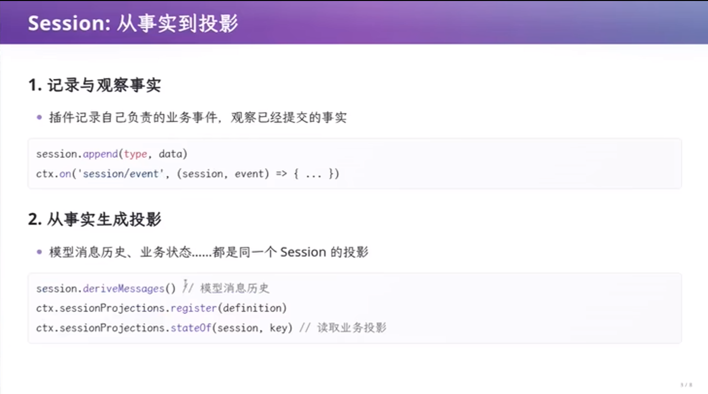
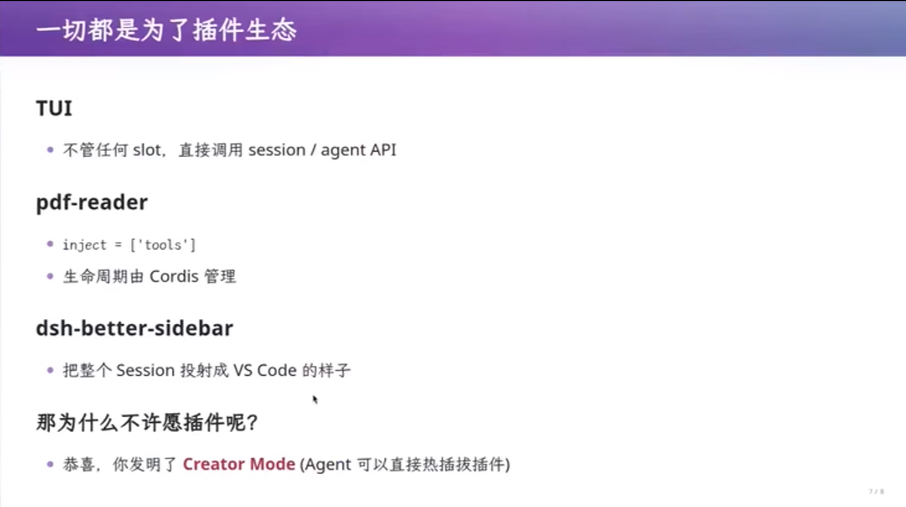
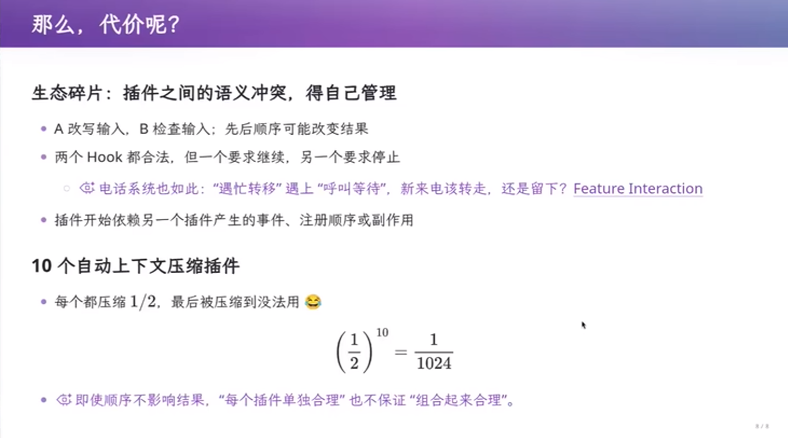
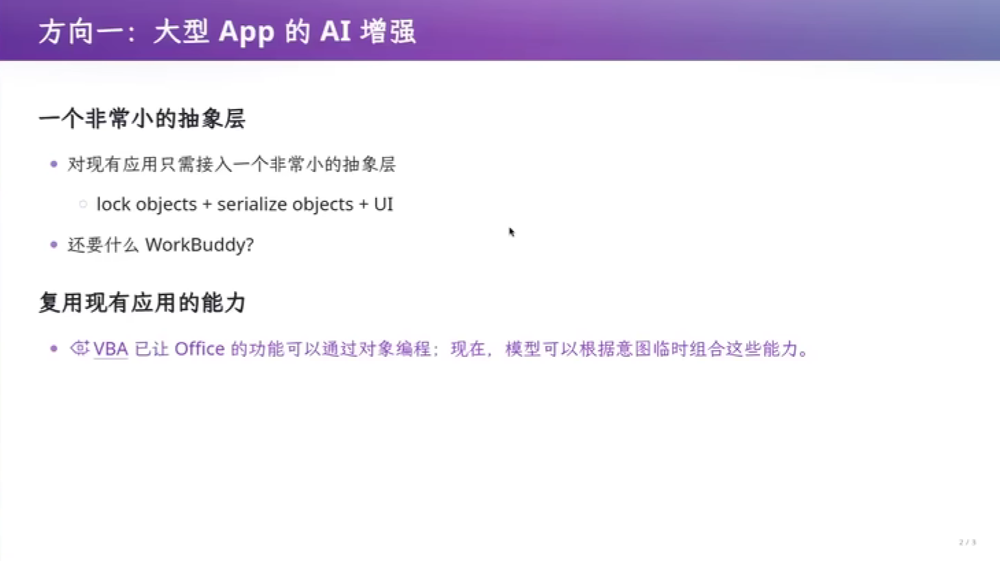
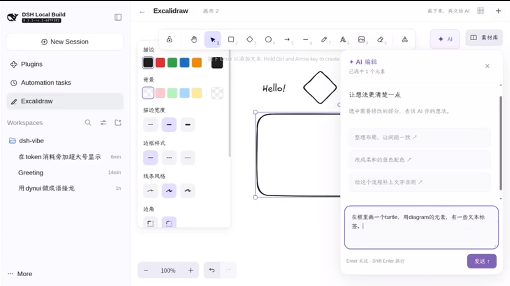
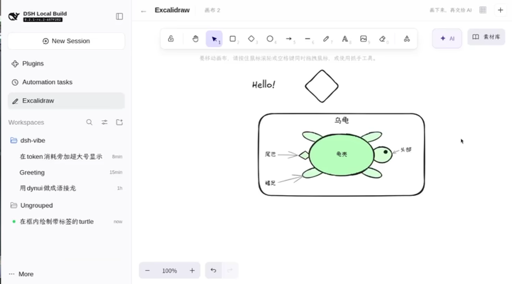
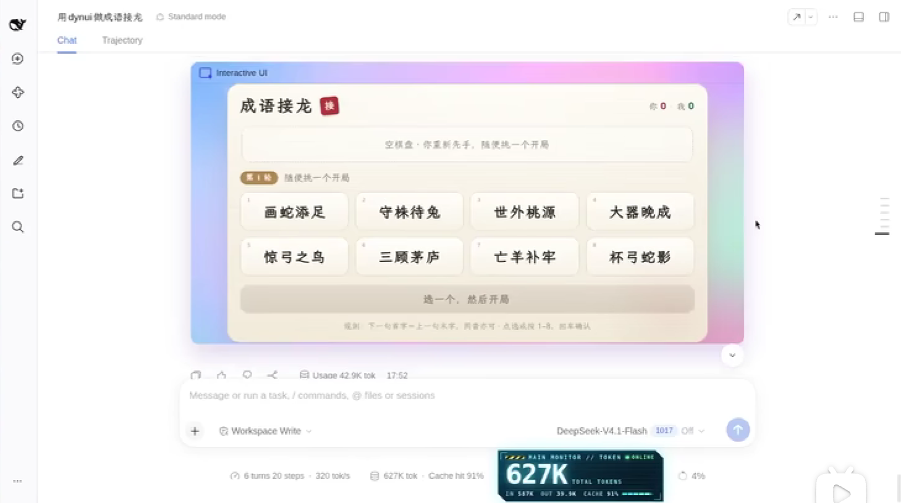

## 核心导读

> **TL;DR**：DeepSeek Harness（DSH）以 **「Everything Is a Plugin」** 为第一性原理，在 Cordis 插件底座之上用 **Event Sourcing（事件溯源）** 建模 `Session = list[Event]`，仅通过少量标准化协作接口串联业务插件、Agent Loop、LLM / Tools 与 UI，从而以极低复杂度支撑「许愿式」热插拔插件（Creator Mode）、大型应用 AI 增强与双向交互式 GenUI。

### 1. 架构第一性原理：Everything Is a Plugin 与总线协同

- **彻底解耦**：每个模块 / 插件只维护自己的私有状态（private state），彼此不必了解内部实现；需要对外暴露的信息挂在事件总线上，通过消息与公开接口协作。
- **底座能力（Cordis）**：负责服务解析、依赖激活、作用域隔离与卸载（effects），类似操作系统的进程生命周期与访问控制。
- **核心难题在于协同**：不协同 = 没用，随便协同 = 没法用。DSH 将插件挂在同一条「总线」上，围绕 **Session（只追加事实日志）** 与 **Agent Loop（执行推进）** 定义清晰边界：

| 架构组件 | 核心职责 | 协作方式 |
| :--- | :--- | :--- |
| **业务插件**（记忆 / 上下文压缩 / 计划 / 子 Agent 等） | 维护私有状态、实现垂直业务逻辑 | 向 Session `append` 事实并监听已提交事件；向 Agent 提供输入 / 上下文，或通过 `agent/pre-step` 改写待执行决策 |
| **Agent / Loop** | 接收输入、推动执行循环 | 调用 LLM / Tools 插件并将执行结果记入 Session 日志；暴露 `agent/pre-step` 供插件介入决策 |
| **LLM / Tools 插件** | 模型适配与工具执行（同样可替换） | 接收来自模型消息投影的请求上下文，返回调用结果给 Agent Loop |
| **Session（`list[Event]`）** | 记录已提交的客观事实（只追加） | 单一事实源（Event Sourcing），类比 Pacioli（1494）日记账 → 分类账的组织方式 |
| **投影层（模型投影 / 业务投影）** | 将事件流折叠为不同视图 | `deriveMessages()` 重建模型所见上下文；`sessionProjections` 折叠业务状态供给 UI |
| **UI 插件** | 界面呈现与交互 | 通过 `slots` 装配界面，消费业务投影状态 |

### 2. 五大核心协作接口（世界模型 API）

DSH 将插件协作收敛为 5 类简洁接口，严格区分**「已经发生的事实」**与**「尚未执行的决策」**：

1. **记录与观察事实（Session Events）**：`session.append(type, data)` 与 `ctx.on('session/event', ...)`；只追加新事件，不篡改历史。
2. **从事实生成投影（Projections）**：`session.deriveMessages()` 生成模型上下文；`ctx.sessionProjections.register / stateOf` 维护业务投影。
3. **向 Agent 提交输入（三种触发语义）**：
   - `agent.followup(message)`：新一轮用户输入，**唤醒执行**。
   - `agent.inject(message)`：补充上下文，等待后续 step，**不唤醒**。
   - `agent.steer(message)`：尽快进入后续 step，**可以唤醒**。
4. **持续贡献动态上下文**：`ctx.systemPrompt.context({ text: () => describeCurrentState() })`，每步动态注入最新状态。
5. **在执行前介入决策（Pre-step Hook）**：`ctx.on('agent/pre-step', async (payload, next) => ...)`，参与待执行决策并按需委托 `next()`。

### 3. 插件生态、Creator Mode 与架构代价

- **多样化插件形态**：`TUI`（无 UI slot 直接调 API）、`pdf-reader`（声明 `inject = ['tools']` 由 Cordis 托管生命周期）、`dsh-better-sidebar`（将 Session 投影渲染成 VS Code 风格侧边栏）。
- **Creator Mode（许愿式热插拔插件）**：
  - 接口简单、复杂度低，Agent 可直接现场编写并热插拔 Cordis 插件（例如对话中要求「加大号 token 面板」→ 继续演进为「高达驾驶舱监控面板」）。
  - 呼应 von Hippel（2001）**用户创新工具包**理念：把试错留在用户现场，减少需求转述成本。
- **架构代价（语义冲突与组合失效）**：
  - **顺序敏感**：插件注册顺序不同可能改变最终结果。
  - **特征交互冲突（Feature Interaction）**：两个合法 Hook 意图相反（如要求继续 vs 要求停止），类似电话系统「遇忙转移」与「呼叫等待」冲突。
  - **隐式依赖**与**局部合理 ≠ 组合合理**：例如同时挂载 10 个各压缩 1/2 的上下文压缩插件，叠加后变成 `(1/2)^10 = 1/1024`，导致上下文不可用。

### 4. 应用方向与扩展愿景

- **大型 App 的 AI 增强**：只需极小抽象层 `lock objects + serialize objects + UI`，即可复用 WPS、Excalidraw 等存量应用能力（类似 VBA 对象化编程，由模型按意图临时组合）。
- **GenUI（卡片与模型的双向通道）**：模型输出 **HTML + JS 交互卡片**，卡片内 JS 将用户点击反向写入上下文，实现直接操纵与自然语言对话融合（如下棋、成语接龙 `dynui` 卡片）。
- **个人 DSH 世界**：将个人数据库与各类工具封装为插件挂到 DSH 总线上统一调度。

### 复习速记

- **一个核心原则**：Everything Is a Plugin，私有状态内聚，公共协作走总线（Cordis 管生命周期）。
- **一个数据模型**：`Session = list[Event]`（Event Sourcing），模型上下文与业务 / UI 状态全是它的投影。
- **两组关键区分**：输入分 `followup` / `inject` / `steer`；钩子分 `session/event`（已发生事实）与 `agent/pre-step`（未执行决策）。
- **一个权衡提醒**：低复杂度换来 Creator Mode，但生态碎片与 Feature Interaction（如 `(1/2)^10` 过度压缩）需靠生态与使用者治理。
- **两大落地路径**：`lock + serialize + UI` 改造大型应用；HTML+JS 双向通道实现 GenUI。

---

## 原始笔记与截图

* 每一个模块都有自己的private state 封装在模块里面 当模块与模块之间需要交互的时候 通过发消息来实现
* 有一个event bus 把别人希望看到的放在event bus上 其他的state放在自己的内部

* Create mode 可以许愿式插件

可以接入super app中 类似wps 给超级应用赋予AI原生的能力 （把super App中指定的对象给锁住 然后把这个对象送给dsh dsh处理之后再回来）

* 可以把UI的点击与模型的上下文进行交互 点击UI按钮 javascript可以向模型的上下文里面注入一句话 下面的例子实现了与AI进行成语接龙

* 可以把个人数据库 加入dsh形成一个自己的dsh世界 把和你有关的所有东西 做成插件 接入dsh的总线上 让他调用 可以衍生出很多东西
