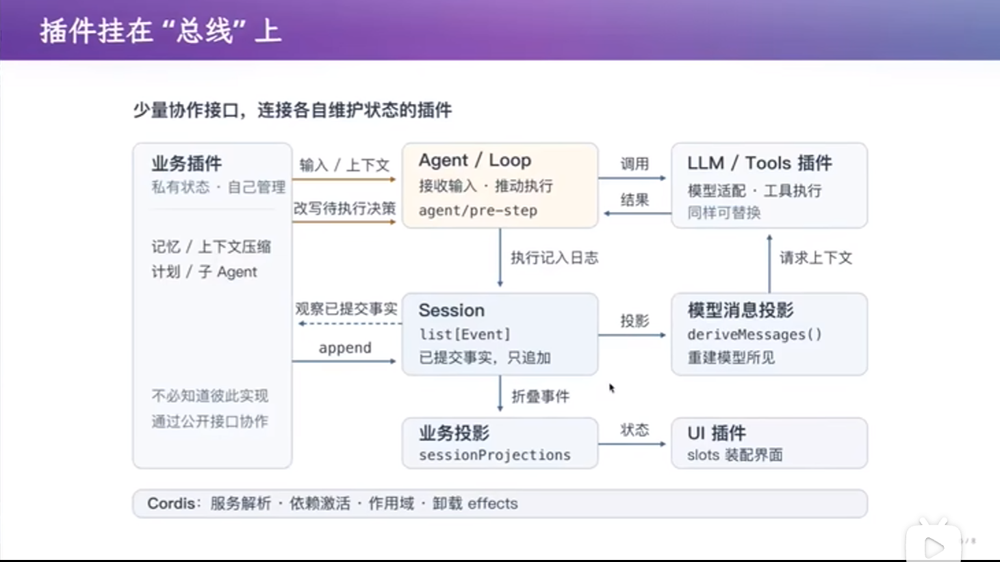
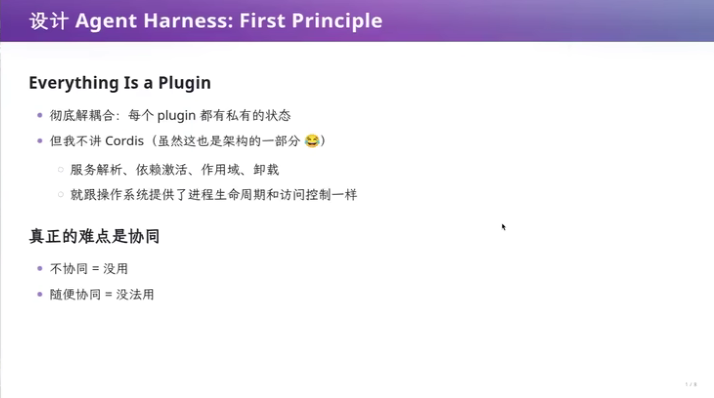
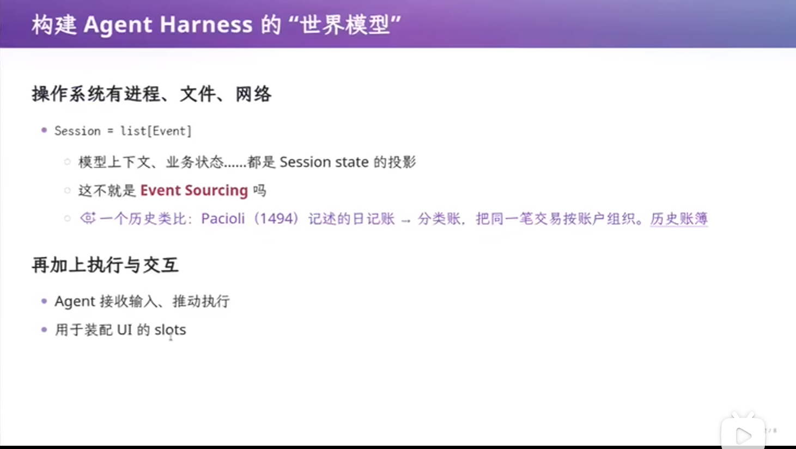
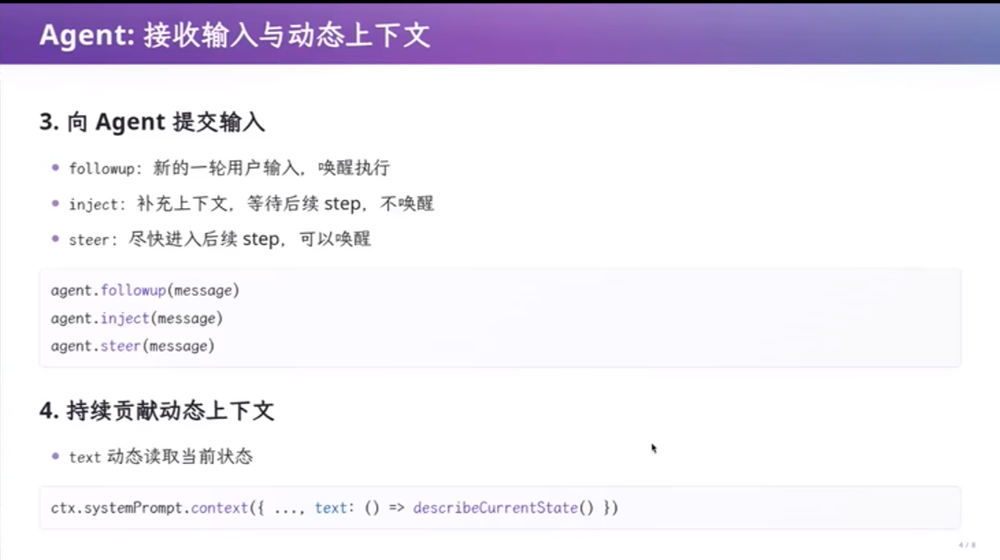
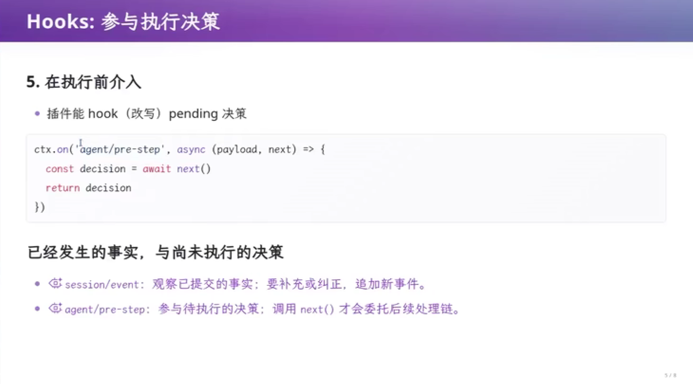
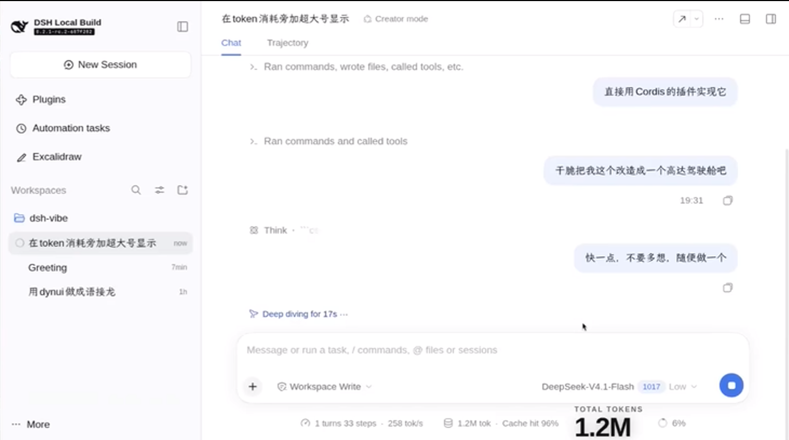
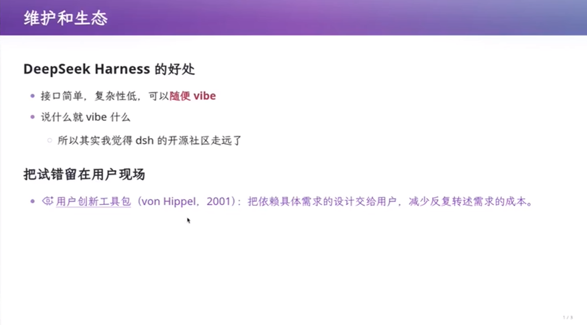
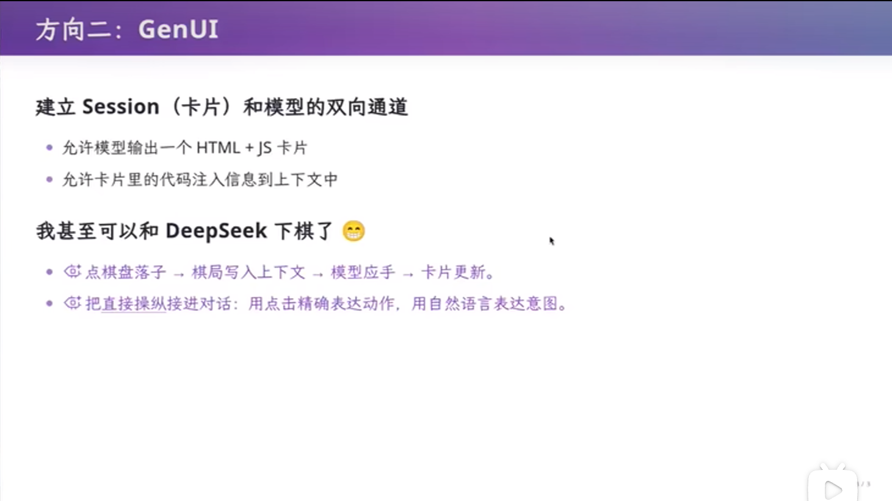
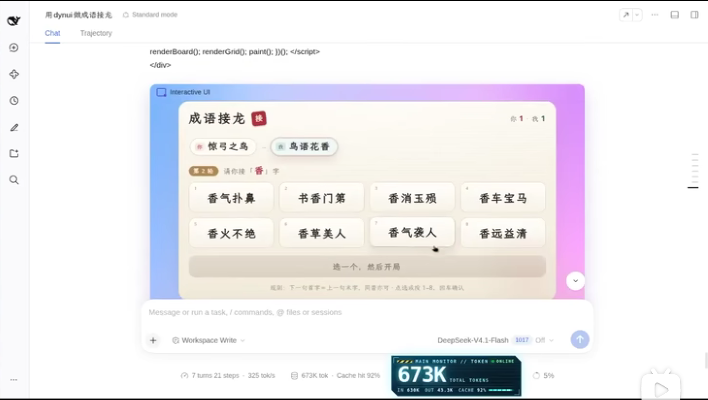

## 深度整理笔记

> **核心定位**：DeepSeek Harness（DSH）是一套以 **「Everything Is a Plugin」** 为第一性原理的 Agent 运行时架构。它通过极简的插件总线 + 事件溯源（Event Sourcing）抽象，把原本高度耦合的 Agent Loop、记忆、上下文压缩、工具、UI 彻底拆开，不仅让 Agent 自己可以「许愿式」热插拔插件（Creator Mode），还能用极小的抽象层改造 WPS / Excalidraw 等大型存量应用，并打通模型与前端卡片的双向 GenUI 通道。

---

### 一、架构第一性原理：为什么是「插件总线」？

#### 1. Everything Is a Plugin：彻底解耦的起点
设计一个 Agent Harness 时，最容易踩的坑是把对话循环、记忆管理、上下文压缩、计划拆分、UI 渲染全部硬编码在一起，很快就会变成谁也改不动的「大泥球」。

DSH 给出的第一性原理非常极端也很干净：**一切皆插件（Everything Is a Plugin）**。
- **私有状态内聚**：每个模块 / 插件只维护自己的 `private state`，完全封装在内部，不需要也不应该了解其他插件的内部实现。
- **底座能力由 Cordis 承接**：Cordis 负责**服务解析、依赖激活、作用域隔离、卸载清理（effects）**——讲者把它类比为**操作系统提供的进程生命周期管理与访问控制**，业务插件只需要关心自己的逻辑，不用操心「什么时候启动、依赖没就绪怎么办、卸载后怎么清理副作用」。

#### 2. 真正的难点：如何协同？
插件化本身不难，真正的难点在于协同：
- **不协同 = 没用**（每个插件各玩各的，拼不出完整能力）；
- **随便协同 = 没法用**（插件之间互相直接读写内部状态，耦合度瞬间爆炸）。

DSH 的解法是：**把所有插件挂在同一条「事件总线」上，只暴露极少量的公开协作接口**。别人希望看到的信息放到总线上，其余状态留在各自内部。整套系统的流转关系如下：

| 核心角色 | 职责定位 | 在总线上的数据流向 |
| :--- | :--- | :--- |
| **业务插件**<br>（记忆 / 上下文压缩 / 计划 / 子 Agent 等） | 维护自身私有状态，实现各类垂直能力 | ① 通过 `append` 向 Session 写入事实；<br>② 观察 Session 已提交事件；<br>③ 向 Agent 提交输入 / 动态上下文，或通过 `agent/pre-step` 改写待执行决策 |
| **Agent / Loop** | 接收输入，推动推理与工具调用循环 | 调用 LLM / Tools 插件拿回结果，并将执行过程记入 Session 日志；在每步执行前暴露 `agent/pre-step` 供插件介入 |
| **LLM / Tools 插件** | 模型适配与工具执行（同样可插拔替换） | 从「模型消息投影」获取本轮请求上下文，执行推理或工具调用后将结果交回 Agent Loop |
| **Session（`list[Event]`）** | **单一事实源**，只追加（append-only） | 记录系统里所有已经发生的客观事实，绝不直接篡改历史 |
| **模型消息投影**（`deriveMessages()`） | 将事件流折叠为模型能看懂的对话历史 | 读取 Session 事件流，重建模型本轮看到的上下文并送给 LLM / Tools 插件 |
| **业务投影**（`sessionProjections`） | 将事件流折叠为结构化业务状态 | 供业务插件和 UI 插件消费 |
| **UI 插件** | 界面呈现与用户交互 | 消费业务投影状态，通过 `slots` 装配到界面对应区域 |

---

### 二、Agent Harness 的「世界模型」与五大协作接口

操作系统之所以能支撑无穷无尽的应用，是因为它提炼出了「进程、文件、网络」这几个极少的核心抽象。DSH 同样为 Agent Harness 构建了一套极简的「世界模型」：
- **`Session = list[Event]`**：本质就是 **Event Sourcing（事件溯源）**——模型上下文、业务状态、侧边栏视图全都是同一份 Session 事件流的投影。讲者引用了会计史上的经典类比：**Luca Pacioli（1494）** 记述的复式记账法中「**日记账（按时间逐笔记录）→ 分类账（按账户重新组织视图）**」的思路。
- **执行与交互**：再加上 **Agent（接收输入、推动执行）** 和 **slots（装配 UI）**，整套世界模型就完整了。

落到具体代码层面，所有插件之间的协作只依赖 **5 个简洁的 API**：

#### 1. 记录与观察事实（Session Events）
```ts
// 写入自己负责的业务事实（只追加）
session.append(type, data)

// 监听已经提交的客观事实
ctx.on('session/event', (session, event) => { ... })
```

#### 2. 从事实生成投影（Projections）
```ts
// 投影 1：重建发给大模型的消息历史
session.deriveMessages()

// 投影 2：注册并读取自定义的业务状态投影（如统计、任务树、侧边栏数据）
ctx.sessionProjections.register(definition)
ctx.sessionProjections.stateOf(session, key)
```

#### 3. 向 Agent 提交输入（三种精细的触发语义）
同样是给 Agent 发消息，不同业务场景对「要不要立刻唤醒 Agent 执行」的需求完全不同，DSH 将其清晰拆成三种语义：
```ts
agent.followup(message) // 新一轮用户输入：会立刻唤醒 Agent 执行
agent.inject(message)   // 补充上下文信息：静默写入，等待后续 step 读取，不唤醒
agent.steer(message)    // 方向纠偏/插话：尽快进入后续 step，可以唤醒
```

#### 4. 持续贡献动态上下文（Dynamic System Prompt）
```ts
ctx.systemPrompt.context({ ..., text: () => describeCurrentState() })
```
不是一次性把静态提示词写死，而是传一个回调函数 `text`，让 Agent 在每一步都能实时读取插件当前的最新状态。

#### 5. 在执行前介入决策（Pre-step Hook）
```ts
ctx.on('agent/pre-step', async (payload, next) => {
  const decision = await next()
  return decision
})
```
采用类似洋葱模型的中间件写法：插件可以在执行前拦截或改写 `pending` 状态的决策，且只有主动调用 `next()` 才会继续委托后续处理链。

> **关键设计辨析：已发生的事实 vs 尚未执行的决策**
> - `session/event` 面向**过去**：观察已经提交的事实；如果发现需要补充或纠正，只能追加新事件，不能改写历史。
> - `agent/pre-step` 面向**未来**：参与尚未执行的待定决策，可以在真正执行前拦截、修改或中止。

---

### 三、插件生态与「许愿式」Creator Mode

#### 1. 不同形态的插件都能自然生长
因为底层不绑死任何特定 UI 或业务形态，社区可以长出风格迥异的插件：
- **`TUI`**：完全不管任何 UI `slot`，直接调 `session / agent` API 就能做出终端界面。
- **`pdf-reader`**：只需声明 `inject = ['tools']`，生命周期完全交由 Cordis 托管。
- **`dsh-better-sidebar`**：直接把整个 Session 投影渲染成 VS Code 风格的侧边栏。

#### 2. Creator Mode：Agent 现场热插拔造插件
既然接口这么少、复杂度这么低，一个自然而然的想法就诞生了：**「那为什么不许愿插件呢？」**——这就是 **Creator Mode**，允许 Agent 在对话过程中直接编写并热插拔 Cordis 插件。

- **现场演示过程**：
  1. 用户在 `DSH Local Build`（Creator Mode）里提出需求：「在 token 消耗旁加超大号显示」，并指示「直接用 Cordis 的插件实现它」；Agent 现场写完插件热加载后，底部状态栏立刻出现醒目的 `TOTAL TOKENS 1.2M`。
  2. 用户继续加码：「干脆把我这个改造成一个高达驾驶舱吧」——后续界面底部真的演化成了一个科技感十足的机甲仪表盘（`MAIN MONITOR // TOKEN ONLINE | 627K TOTAL TOKENS | IN 587K OUT 39.9K CACHE 91%`）。
- **背后的产品哲学——把试错留在用户现场**：
  - 呼应 **Eric von Hippel（2001）** 提出的 **用户创新工具包（User Innovation Toolkits）**：把高度依赖具体个人偏好的设计权交给用户自己，省去用户和开发者之间反复转述需求的巨大沟通成本。
  - 因为接口极简，用户可以「说什么就 vibe 什么」，极大降低了生态的参与门槛。

---

### 四、架构代价：自由组合背后的「语义冲突」

没有任何架构是没有代价的。当所有人（和 Agent）都能随手写插件挂到总线上时，**生态碎片与插件间的语义冲突**就必须由系统使用者和生态来承担：

1. **顺序敏感**：插件 A 负责改写输入，插件 B 负责检查输入；A 和 B 注册的先后顺序不同，最终结果可能完全不同。
2. **Feature Interaction（特征交互冲突）**：两个 Hook 各自都完全合法，但意图截然相反——一个要求继续执行，另一个要求立刻停止。这在电信系统里是经典难题：**「遇忙转移」遇上「呼叫等待」时，新来电到底该转走还是留下？**
3. **隐式依赖**：插件可能不知不觉依赖了另一个插件发出的特定事件、注册顺序或副作用，一旦卸载或升级就会莫名失效。
4. **局部合理 ≠ 组合合理**：讲者举了一个非常形象的例子——假设你同时装了 10 个「自动上下文压缩插件」，每个插件各自都很合理地把上下文压缩成原来的 `1/2`，但 10 个叠在一起后就变成了 `(1/2)^10 = 1/1024`，上下文直接被压到完全没法用。

---

### 五、两大延伸应用方向与「个人 DSH 世界」

#### 方向一：大型存量 App（Super App）的 AI 增强
传统做法是为办公软件重写一套 AI 客户端，成本极高；DSH 给出的思路是**只需在现有应用上接入一个极小的抽象层**：

```text
lock objects（锁定选中对象） + serialize objects（序列化对象数据） + UI（唤起入口）
```

- **工作流程**：用户在 WPS、Excalidraw 等应用里选中某个对象 → 应用把该对象锁住并序列化后送给 DSH → DSH 理解意图、调用模型处理 → 把结果写回原应用并解锁。
- **历史类比**：当年 **VBA** 让 Office 的各种功能变成了可编程的对象；如今有了大模型，模型可以根据用户的一句话意图，临时组合这些对象能力，完全复用存量软件几十年的积累。
- **Excalidraw 实测案例**：在画布里画一个圆角矩形并选中（`已选中 1 个元素`），点开右侧「AI 编辑」输入「在框里画一个 turtle，用 diagram 的元素，有一些文本标签」；DSH 直接在框内生成了由原生可编辑矢量图形组成的绿色乌龟示意图，并自带 `乌龟`、`头部`、`龟壳`、`尾巴`、`鳍足` 箭头标注。

#### 方向二：GenUI（前端卡片与模型的双向通道）
普通对话界面只能用文字一问一答，很多精确操作（如下棋落子、多选决策）用自然语言描述极其别扭。DSH 的 GenUI 方案建立了 **Session（交互卡片）与模型之间的双向通道**：
1. 允许模型直接输出一个包含 **`HTML + JS`** 的交互式卡片；
2. 允许卡片里的 **JS 代码把用户的点击动作反向注入模型上下文**。

- **核心交互范式——把直接操纵接进对话**：**用点击精确表达动作，用自然语言表达意图**。比如和 DeepSeek 下棋：`点棋盘落子 → 棋局状态写入上下文 → 模型思考应手 → 卡片刷新`。
- **`dynui` 成语接龙实测案例**：
  - 第 1 轮：模型生成一张 8 选 1 的精美卡片（`画蛇添足 / 守株待兔 / 世外桃源 / 大器晚成 / 惊弓之鸟 / 三顾茅庐 / 亡羊补牢 / 杯弓蛇影`）。
  - 用户直接点击「惊弓之鸟」，卡片内的 JS 自动向模型上下文注入这一选择；
  - 第 2 轮：模型立刻应手「鸟语花香」，并渲染出下一轮「请你接『香』字」的新 8 选 1 交互卡片（`香气扑鼻 / 书香门第 / 香消玉殒...`）。

#### 终极愿景：个人 DSH 世界
把你的个人数据库，以及所有与你工作生活相关的工具和数据源，全部做成插件挂到自己的 DSH 总线上——Agent 统一通过这套极简总线调用它们，就能不断衍生出高度个性化的能力。

---

### 复习速记

1. **第一性原理**：Everything Is a Plugin，私有状态严格封装，公共协作走总线（Cordis 管生命周期）。
2. **世界模型**：`Session = list[Event]`（事件溯源，类比 1494 复式记账的日记账 → 分类账），模型上下文与所有业务 / UI 状态都是它的投影。
3. **五个接口记两组边界**：
   - 输入三语义：`followup`（新轮次，唤醒）/ `inject`（静默补充，不唤醒）/ `steer`（尽快切入，可唤醒）；
   - 过去 vs 未来：`session/event` 只能观察并追加事实，`agent/pre-step` 可以拦截和改写待执行决策。
4. **最大红利与最大代价**：红利是复杂度极低、支持用户现场「许愿式」vibe 插件（Creator Mode）；代价是生态碎片与 Feature Interaction（如 10 个 1/2 压缩插件叠加成 `1/1024`）。
5. **两个杀手级扩展**：用 `lock + serialize + UI` 极小抽象层给大型存量 App 注入 AI 原生能力；用 `HTML + JS` 双向通道把「直接操纵」无缝接进自然语言对话（GenUI）。

---

## 原始笔记与截图




* 每一个模块都有自己的private state 封装在模块里面 当模块与模块之间需要交互的时候 通过发消息来实现
* 有一个event bus 把别人希望看到的放在event bus上 其他的state放在自己的内部









* Create mode 可以许愿式插件







可以接入super app中 类似wps 给超级应用赋予AI原生的能力 （把super App中指定的对象给锁住 然后把这个对象送给dsh dsh处理之后再回来）



* 可以把UI的点击与模型的上下文进行交互 点击UI按钮 javascript可以向模型的上下文里面注入一句话 下面的例子实现了与AI进行成语接龙



* 可以把个人数据库 加入dsh形成一个自己的dsh世界 把和你有关的所有东西 做成插件 接入dsh的总线上 让他调用 可以衍生出很多东西
