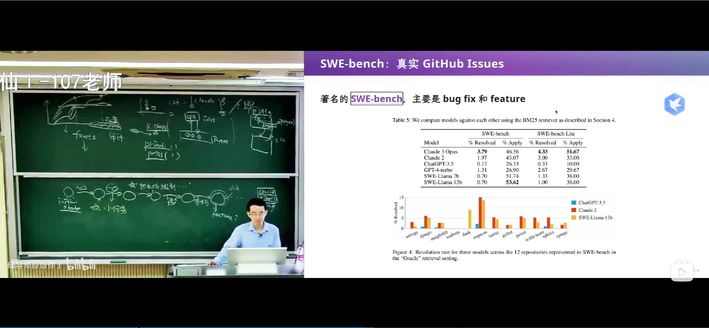
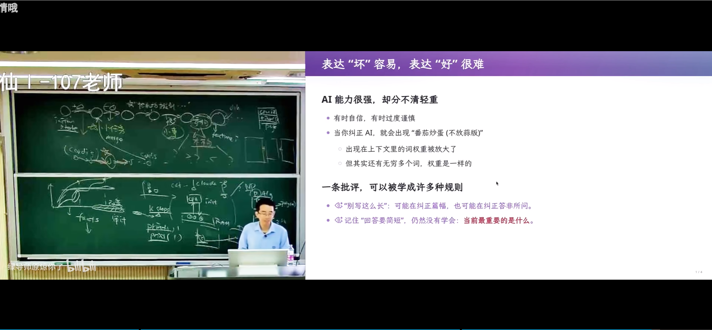
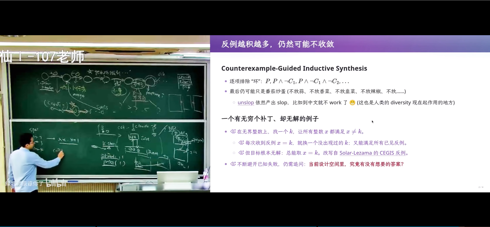
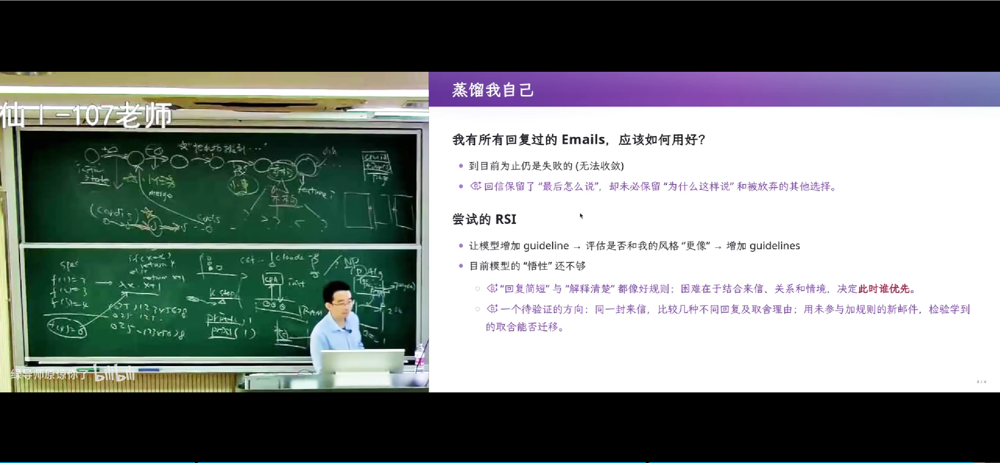

# 深度整理笔记

> **本节主线：** 复杂软件和航母一样，不是一天造出来的，而是在时间轴上通过一次次小改动演化而来的「状态机」。本节课从**第一性原理与简化版本**切入，沿着 `SWE-bench`（大模型能否做对一件小事）→ `Taste-bench`（如何评判「好」代码）→ `DeepSeek Harness` 提交历史与分层把关实践，一路追问到 AI 辅助软件工程的深层瓶颈——**表达「坏」容易，表达「好」很难**、反例引导归纳合成（CEGIS）可能不收敛，以及「蒸馏我自己」时的语境权衡难题。

---

## 一、从航母到软件：用演化视角与简化版本理解复杂系统

### 1. 软件演化本质上依然是状态机模型

- 航母不是一天造出来的，庞大复杂的软件同样如此：每一次 `fix`、`feature`、`chore`、`refactor` 都是一次状态迁移，推动项目从一个版本进入下一个版本。
- **时间轴视角：** 把一个项目的 `git commit` 画成一条时间轴，能够把静态、庞大的代码库还原为动态的演化路径，比直接硬啃最新版本更容易理解系统全貌。

### 2. 用「简化版本」理解机制，用「版本历史」解释例外

- 面对复杂系统时，有效的学习方式是**拆解并回退到它的初始版本**：例如 `Linux 0.11 → Linux 2.4 → Linux 2.6 → ...`，以及用 `nano-gpt`、`nano-vllm` 等精简实现去学习操作系统、编译器、数据库与大模型推理引擎。
- **两者的互补分工：**
  - **简化版本**帮你剥离噪声，快速抓住核心机制；
  - **版本历史**帮你解释真实工程中那些看似怪异的「例外」和补丁究竟从何而来。

---

## 二、软件工程的「小任务」假设：从 SWE-bench 到 Taste-bench

### 1. 用 SWE-bench 评估大模型做「一件小事」的能力

- 所有的软件都是由一个个小任务（主要是 `bug fix` 和 `feature`）堆叠演化而成的；如果 AI 能把这些小事做好，在整个软件演化过程中就会产生决定性价值。
- `SWE-bench` 基于真实的 GitHub Issues 评估模型解决实际工程问题的能力（包括 `SWE-bench` 与 `SWE-bench Lite`，考察 `% Resolved` 与 `% Apply` 等指标）。
- **现状与直觉：** 截至 2025 年 7 月，`mini-SWE-agent` 已在 `SWE-bench Verified` 上达到 65%（评测集与设置区别于前代）。按照 Scaling Law 的直觉，任何一个「有一点点希望做到」的 benchmark，最终都会被解决——今天已经跨过了「能不能做」的门槛（**Language Models Definitely Can**）。

### 2. 从解题能力走向「Taste-bench」：多维度的相对比较

- 当「通过测试」不再是唯一区分度，评测需要从 `Yes / No / Score` 转向**多维度的相对比较**（呼应 Thurstone 1927 年关于通过成对比较度量难以直接计量属性的研究）。
- **如何衡量代码的「Taste」：**
  - 给出两份都能通过测试的实现，放在相同需求下对比：**是否贴合问题、是否容易理解、下一次修改有多贵？**
  - 再叠加一个新的后续需求，观察两份实现原本的优劣是否发生反转。

---

## 三、真实项目演化样本：DeepSeek Harness 的提交历史与工程把关

### 1. 提交历史里的四层工程纪律（DeepSeek Harness）

查看 `deepseek-harness` 从第一天起的 `git log`（从初始化 `README`、`AGENTS.md`、`CLAUDE.md`，到在 `AGENTS.md` 中关联 MVP 需求与微内核架构文档、搭建 `yarn 4 workspaces` + `tsc -b` + `tsdown` + `vitest` 的 monorepo 基础设施），可以看到一套成熟的 AI 协作工程范式：

- **设计有来由：** `RFC`（Request for Comments，征求意见稿）→ `ADR`（Architecture Decision Record，架构决策记录）与 `Agent Notes`，清晰记录设计取舍与验收标准。
- **协作有边界：** 坚持原子提交、一个 PR 对应一个 `worktree`、存在依赖时使用堆叠 PR。
- **验收有层次：** 逐文件 100% 覆盖率、`Session` 回放，以及真实产品与发布产物级验证。
- **经验能积累：** 事故后补齐回归测试；被采纳的评审意见经维护者审核后沉淀进入 `Skill`。

### 2. AI 在大空间采样容易迷失，项目仍需由人驾驭

- 在庞大的解空间中放任 AI 采样，很容易偏离架构意图甚至破坏项目；此前通过文档（如 `i18n`）做约束虽然起到了效果，但也付出了仓库膨胀、产生大量意义不明的 YAML 文件等代价。
- 借助 IDE 与工程工具链进行中和，也是「软件项目不该单纯用目录存储」理念的体现。

### 3. 生产「与人类对齐」的「好」代码：分层规则与重新采样

- 工程上的直接路径是**穷举「不好」的特征并强行排除**：检验不通过就重新采样，并配合引导提示词（例如在 `dsh` 项目中触发 `dsh-prose-standard skill`）。
- 以课堂讲义 `dsh-checks.html`（《项目如何把关一次代码改动》）为例，规则按 `检查类别 → 抽象规则 → 具体规则` 组织（展示 7 类共 68 条规则，每条配套验收要求、动机、正反例与执行条件），覆盖：
  - `01 代码与类型质量`、`02 架构与依赖约束`、`03 行为正确性与回归`
  - `04 持久化与可靠性`、`05 文档与文本表达`、`06 构建、交付与运行质量` 等维度。

---

## 四、排错法的根本局限：表达「坏」容易，表达「好」很难

### 1. AI 分不清轻重与「番茄炒蛋（不放蒜苗）」效应

- AI 能力很强，却经常分不清轻重——有时盲目自信，有时又过度谨慎。
- **上下文权重放大：** 当你纠正 AI 时，出现在上下文里的负面词权重会被急剧放大，出现「番茄炒蛋（不放蒜苗）」的现象——但现实中「不该放的东西」其实有无穷多个。
- **批评的歧义性：** 同一条批评可以被学成许多种不同的规则。例如「别写这么长」，可能是在纠正篇幅，也可能是在纠正答非所问；模型记住了「回答要简短」，却依然没有学会判断**当前最重要的是什么**。

### 2. 反例引导归纳合成（CEGIS）可能永远不收敛

- 不断排除已知坏特征的过程，本质上是 `Counterexample-Guided Inductive Synthesis`：
  `P → P ∧ ¬C₁ → P ∧ ¬C₁ ∧ ¬C₂ → ...`
- 即使一路加上「不放蒜、不放香菜、不放韭菜、不放辣椒……」，结果仍可能只是低质输出（`unslop` 依然产出 `slop`，例如换到中文语境下就不 work，这正是人类多样性发挥作用的地方）。
- **Solar-Lezama 的无解反例：** 在无界整数上找一个 `k`，让所有整数 `x` 都满足 `x ≠ k`。每次收到反例 `x = k` 就换一个新 `k`，看似总能满足所有已见反例，但目标本身根本无解。不断打补丁避开已知失败时，必须追问：**当前设计空间里，究竟有没有我们想要的答案？**

---

## 五、「蒸馏我自己」的困境：从显式规则到语境权衡

### 1. 历史记录只保留了「结果」，丢失了「取舍」

- 即便手里有自己过去回复过的所有邮件，尝试用它们来「蒸馏我自己」至今仍是失败的（无法收敛）。
- 根本原因在于：历史回信只保留了**「最后怎么说」**，却未必保留**「为什么这样说」**以及当时被放弃的备选方案。

### 2. RSI 迭代瓶颈与待验证的比较学习方向

- 在尝试的 RSI 循环中（`让模型增加 guideline → 评估是否与我的风格「更像」 → 继续增加 guidelines`），当前模型的「悟性」还不够。
- 「回答简短」与「解释清楚」看起来都是正确规则，真正的困难在于**结合来信内容、人际关系与当下语境，决定此时谁优先**。
- **待验证方向：** 针对同一封来信，让模型比较几种不同回复及其取舍理由；再用未参与规则提炼的新邮件，检验学到的权衡能力能否真正迁移。

---

## 复习速记

1. **软件演化 = 状态机 + 时间轴：** 每次 `fix` / `feature` / `chore` / `refactor` 都是状态迁移；把 `git commit` 画成时间轴并回退到简化版本（如 `Linux 0.11`、`nano-vllm`），简化版讲清机制，版本历史解释例外。
2. **从 `SWE-bench` 到 `Taste-bench`：** 大模型解决单一小任务的能力已被验证（`mini-SWE-agent` 在 `SWE-bench Verified` 达 65%）；下一代评测需转向成对相对比较，看代码是否贴合问题、易理解，以及「下一次修改有多贵」。
3. **提交历史是工程范式的富矿：** `DeepSeek Harness` 体现了 `RFC → ADR` 留痕、原子提交与单 PR 单 `worktree`、逐文件 100% 覆盖率与回放验收，以及事故补回归测试、评审意见入 `Skill` 的积累闭环。
4. **工程把关靠分层检查与重采样：** AI 在大空间采样容易迷失，项目仍需由人驾驭；可通过 `检查类别 → 抽象规则 → 具体规则`（如 `dsh-checks.html` 的 7 类 68 条规则）排除坏特征并触发重新采样。
5. **表达「坏」容易，表达「好」很难：** 负向纠偏易触发「番茄炒蛋（不放蒜苗）」式的局部权重放大，且同一条批评（如「别写这么长」）可能被误学成表层规则而丢失真正重点。
6. **CEGIS 排错未必收敛：** 持续累加 `P ∧ ¬C₁ ∧ ¬C₂ ...` 不保证收敛到理想解（如无界整数 `x ≠ k` 的无解反例），需要反思当前设计空间里是否存在目标答案。
7. **「蒸馏我自己」缺的是语境权衡：** 历史邮件缺少「为什么这么说」和被放弃的选项；比起不断堆叠 `guidelines`，更值得探索「同一来信的多回复对比 + 取舍理由」能否迁移到新场景。

---

# 原始笔记与截图

### 航母不是一天造出来的，遇见复杂的东西，可以拆解，回退到它的初始版本再去学。

### 所有的软件都是通过一个一个小任务构成的，那么既然是小任务，可以通过AI来完成吗。
### swe-bench 可以用来评估大模型做一件小事的能力，软件演化的过程，绝大部分都是小事，如果能把小事做好，在整个软件演化的过程是非常重要的。

### 把一个项目的commit 画成一个时间轴 可以帮助更好的理解

