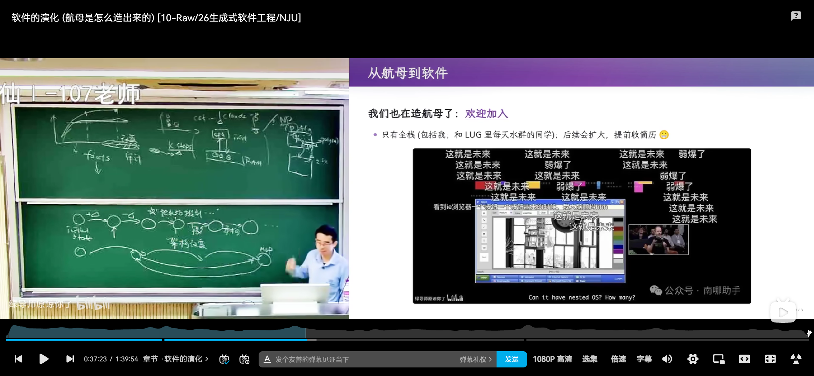
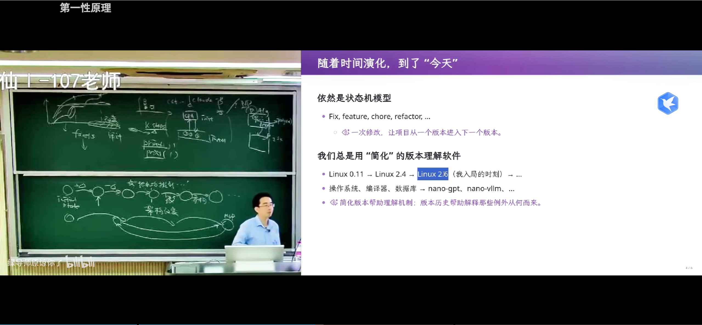
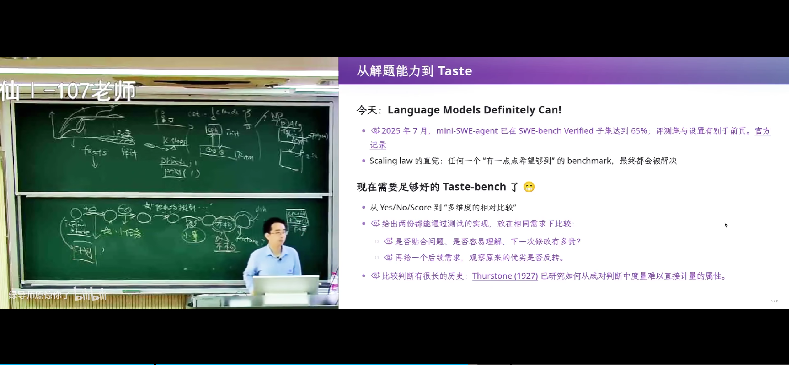
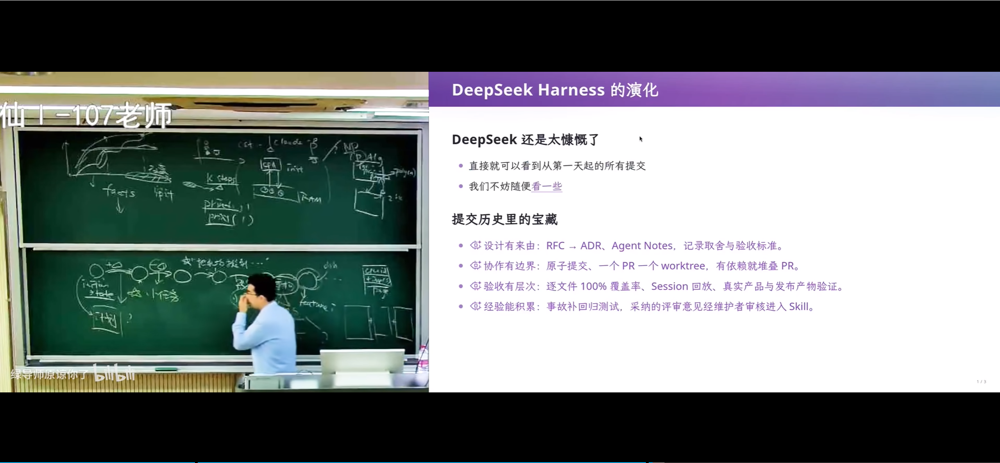
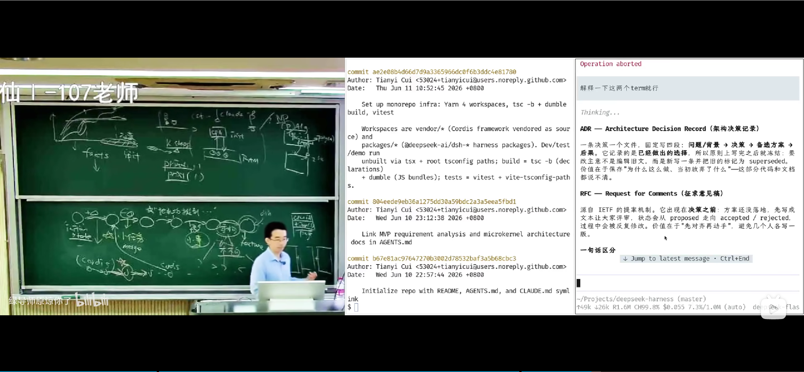
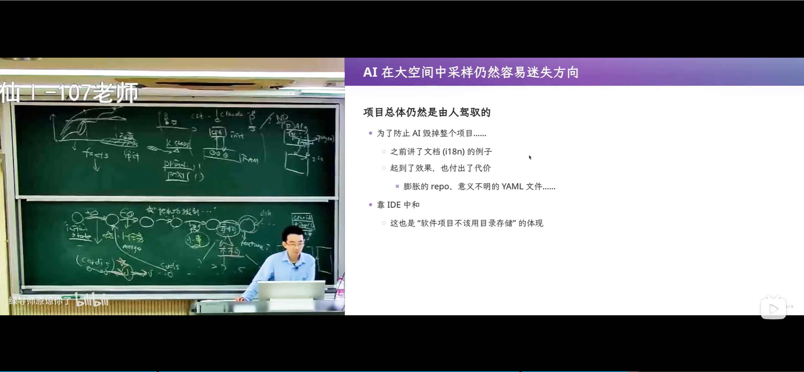
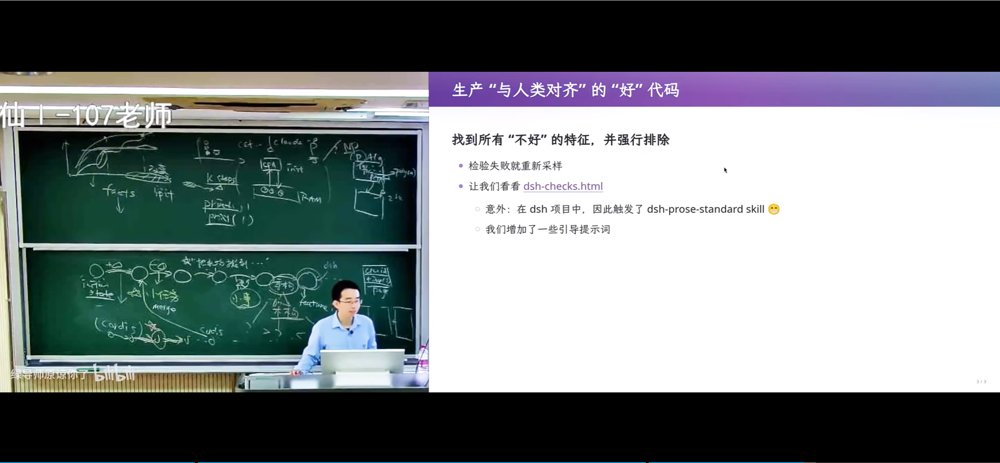
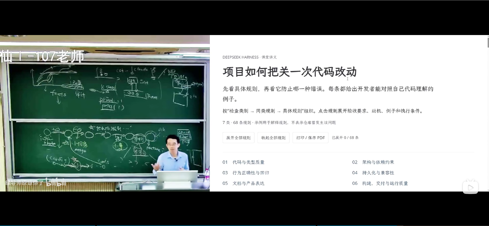

### 航母不是一天造出来的，遇见复杂的东西，可以拆解，回退到它的初始版本再去学。

### 所有的软件都是通过一个一个小任务构成的，那么既然是小任务，可以通过AI来完成吗。
### swe-bench 可以用来评估大模型做一件小事的能力，软件演化的过程，绝大部分都是小事，如果能把小事做好，在整个软件演化的过程是非常重要的。

### 把一个项目的commit 画成一个时间轴 可以帮助更好的理解

