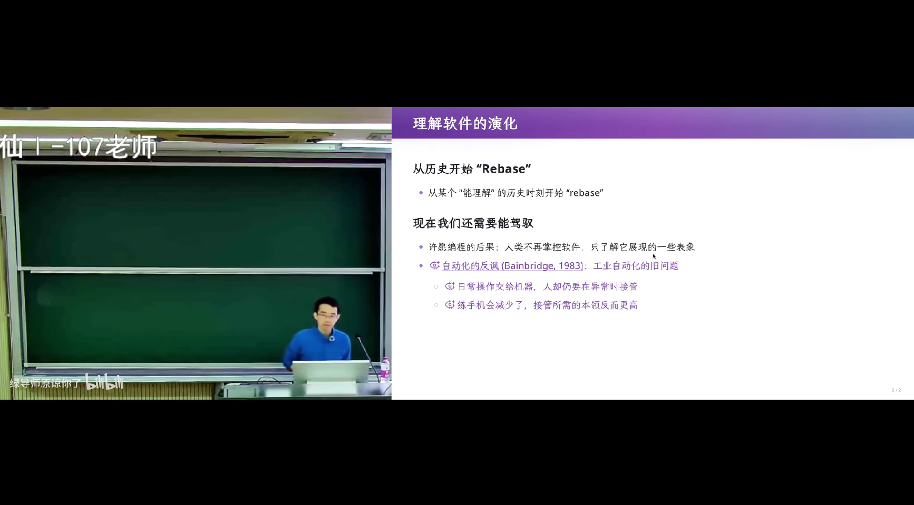
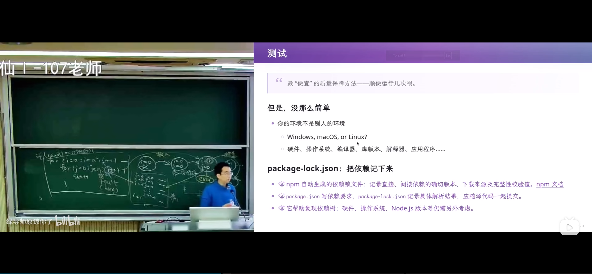
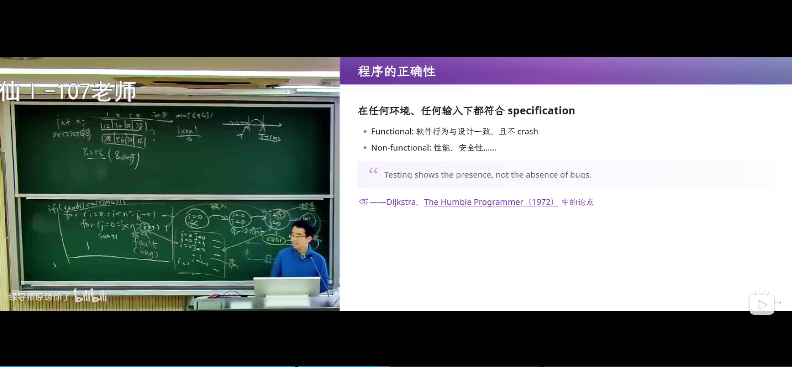
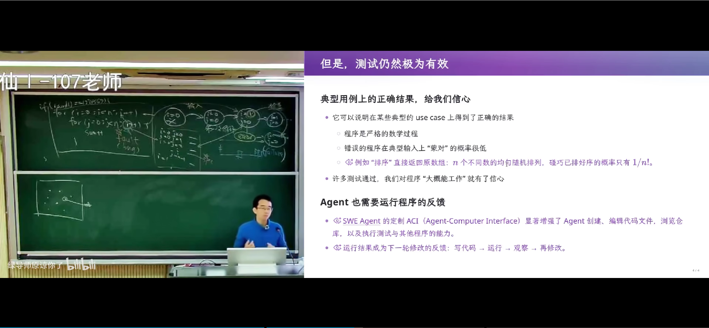
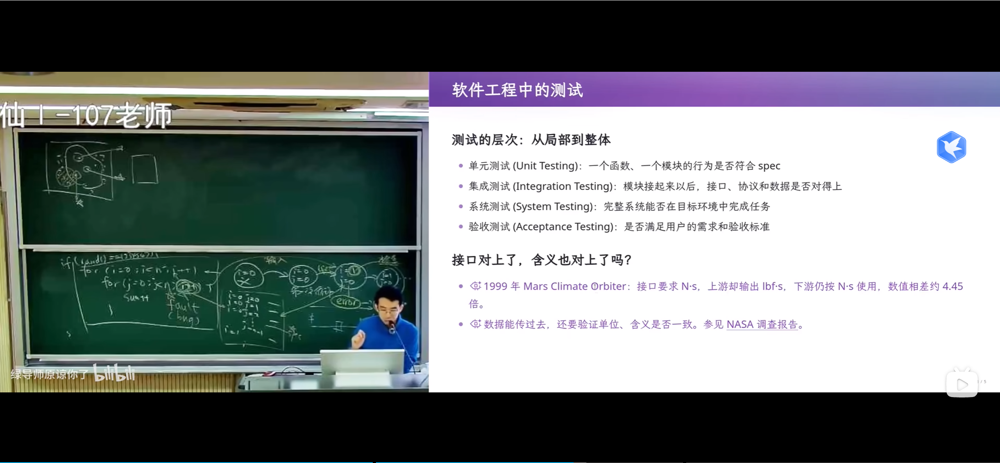
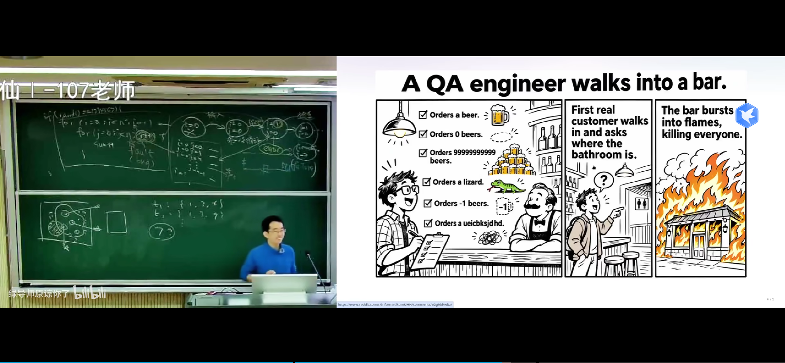
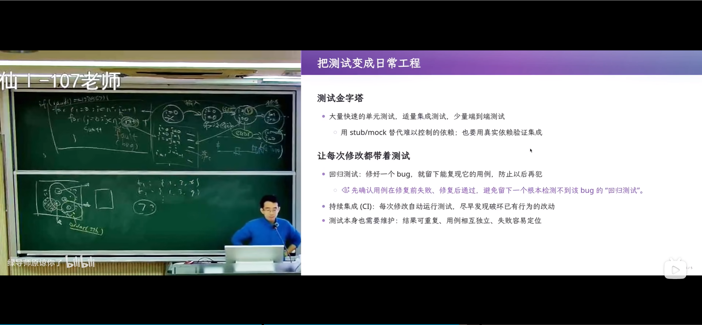
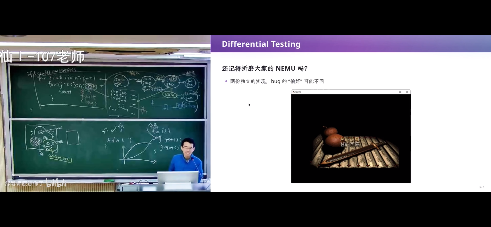
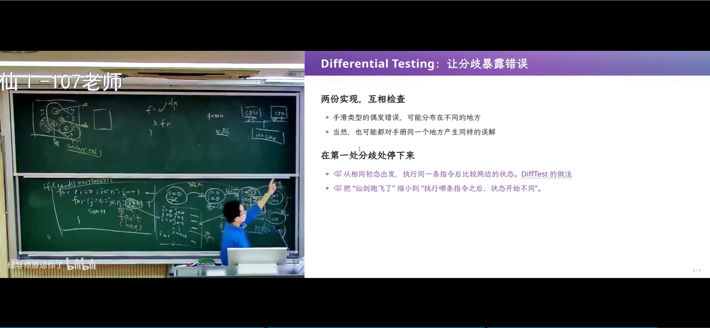
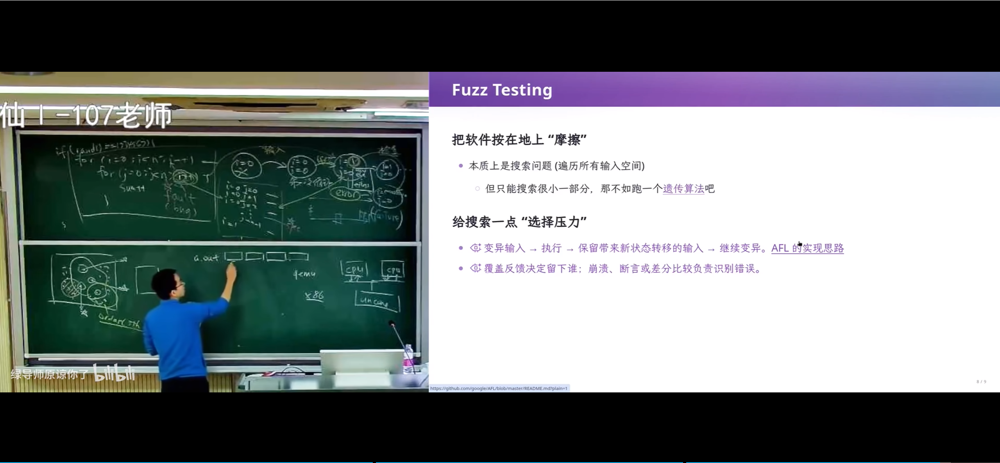

# 深度整理笔记

> **本节主线：** 承接上一讲的软件演化模型，本节课聚焦软件工程的老大难问题——**软件质量保障（`spec-impl gap`）**。课程从「自动化的反讽」与 `Fault → Error → Failure` 经典链路出发，系统梳理**测试的局限与价值**、**测试层次与黑/白盒用例设计**、**测试金字塔与日常工程实践**，进一步点出「架构决定可测试性」（纯函数、依赖可控与确定性模拟），最后引出 `Differential Testing`（差分测试）与 `Fuzz Testing`（模糊测试）两把自动化找 Bug 利器。

---

## 一、从「自动化的反讽」到 Fault / Error / Failure

### 1. 许愿编程的隐患与「自动化的反讽」

- 承接上一讲的航母演化模型：由于存在 `intent-spec-impl gap`，「许愿编程」仍有本质困难；理解复杂软件需要从某个「能理解」的历史时刻开始 `rebase`。
- **自动化的反讽（Bainbridge, 1983）：** 工业自动化的经典困境在 AI 编程时代重演——日常操作交给机器，人类却仍要在异常时接管；练手机会越来越少，但异常接管所需的本领反而更高。如果人类只了解实现的表象，就会彻底失去对软件的驾驭能力。
- **写代码不可能不出错：** 无法仅靠「感觉」得到正确代码，即便是前沿模型（如 `GPT-6 Astro`、`Claude Opus 5.5`）在一次写几百行代码时也难免犯错（例如把双层循环误写成 `for (int j = 0; j < n; i++)`）。

### 2. Fault、Error 与 Failure 的传播链

- **三个核心概念：**
  - `Fault`：程序代码里潜伏的 bug；
  - `Error`：程序运行到了违反 `spec` 的内部状态；
  - `Failure`：用户或外部可观察到的异常（如 `crash`、`hang`、错误输出等）。
- **两个箭头都不是必然：** 程序存在 `Fault` 不代表一定会触发 `Error`，触发 `Error` 也不代表一定能观察到 `Failure`。讨论时必须先选定**观察边界**（一个函数、一个进程还是整个应用）——某个组件的 `Failure`，在更大系统的视角下可能只是内部 `Error`。

### 3. 质量保障的三道防线

- **源头减少 `Fault`：** 更好的架构、更不容易伤人的编程语言（Java 消灭了指针 undefined behavior，Safe Rust 消灭了几乎所有内存安全问题）、防御性编程。
- **假设 bug 无法彻底消除时的两把钥匙：**
  - `Fault → Error` 靠**测试**（遍历 `spec` 空间，把潜伏的 bug 触发为错误状态）；
  - `Error → Failure` 靠**断言（assert）**（即时检查各种 `spec`，让内部错误尽早暴露）。

---

## 二、测试的本质：为何既不能证明无错，又极其有效

### 1. 环境与运行的不可控性：同一份程序，不同的运行

- **你的环境不是别人的环境：** 硬件、操作系统（Windows / macOS / Linux）、编译器、库版本、解释器与应用配置都会造成差异。以 `package-lock.json` 为例，它记录直接与间接依赖的确切版本、下载地址和完整性校验值，随源码提交可帮助复现依赖树，但硬件、操作系统和 Node.js 版本仍需另外控制。
- **你的运行不是别人的运行：** 系统负载、文件内容、`gettimeofday()`、网络延迟与中断、**线程调度**全都是隐式输入。同样代码和显式输入下，两个线程读写共享变量的先后顺序就能改变结果（`CHESS (2008)` 通过主动探索线程交错，在久经测试的软件中依然发现了并发 bug）。

### 2. Dijkstra 论断与测试依然有效的数学直觉

- **程序的正确性：** 在任何环境、任何输入下都同时满足功能性（Functional：行为与设计一致且不 crash）与非功能性（Non-functional：性能、安全性等）`specification`。
- **Dijkstra (1972) 经典论断：** 「Testing shows the presence, not the absence of bugs.」——测试只能证明 bug 的存在，无法证明不存在 bug。
- **为何测试仍极其有效：**
  - 程序是严格的数学过程，错误的程序在典型用例上「蒙对」的概率极低（例如对 $n$ 个不同数的均匀随机排列，未正确排序却碰巧有序的概率仅为 $1/n!$）。
  - **AI Agent 也需要运行反馈：** 如 `SWE Agent` 通过定制 `ACI`（Agent-Computer Interface），把运行结果变成下一轮修改的反馈，形成 `写代码 → 运行 → 观察 → 再修改` 的闭环。

---

## 三、测试体系、用例设计与工程化落地

### 1. 从局部到整体的四层测试

- **单元测试（Unit Testing）：** 验证单个函数或模块的行为是否符合 `spec`；
- **集成测试（Integration Testing）：** 验证模块拼接后接口、协议与数据是否对得上；
- **系统测试（System Testing）：** 验证完整系统能否在目标环境中完成任务；
- **验收测试（Acceptance Testing）：** 验证是否满足用户的需求与验收标准。
- **接口对上了，含义也对上了吗？** 1999 年 `Mars Climate Orbiter` 事故中，接口要求 `N·s`，上游却输出 `lbf·s`，下游仍按 `N·s` 解析（数值相差约 4.45 倍），提醒我们不仅要测数据能否传通，更要验证单位与语义一致。

### 2. 黑盒测试与白盒测试的互补

- **黑盒测试（从 `spec` 出发，不关心内部实现）：**
  - 等价类划分、边界值分析（如数组长度为 `0`、`1`、上限以及超过上限时的行为）；
  - 决策表与状态转换（如选课的 `有无余量 × 先修要求` 决策表，以及 `未选 → 已选 → 退课` 的状态流转）。
  - **预期结果也是用例的一部分：** 超上限时究竟是拒绝、截断还是报错，必须先从 `spec` 明确再写 `assert`。
- **白盒测试（从代码出发）：**
  - 关注语句覆盖、分支覆盖、路径覆盖，但**覆盖率高不等于正确**——若 `add(a, b)` 误写成 `return a - b;`，调用 `add(1, 2)` 就能覆盖该行，唯有 `assert add(1, 2) == 3` 才能抓出错误。
- **「QA 工程师走进酒吧」的警示：** 即使测遍了 `0`、`99999999999`、`-1`、乱码等各种边界点单，第一个真实顾客进来问「洗手间在哪」仍可能导致系统崩溃——测试不能脱离真实用户需求。

### 3. 把测试变成日常工程

- **测试金字塔：** 大量快速的单元测试 + 适量集成测试 + 少量端到端测试；用 `stub / mock` 替代难以控制的依赖，同时保留真实依赖的集成验证。
- **回归测试与持续集成（CI）：**
  - 修好一个 bug 就留下能复现它的回归用例，且必须验证**修复前失败、修复后通过**；
  - 借助 `CI` 在每次修改时自动运行测试，尽早拦截破坏已有行为的改动；
  - 测试本身同样需要维护：结果可重复、用例相互独立、失败易于定位。

---

## 四、架构决定质量：可测试性设计与「灵光一闪」

### 1. 系统越大越难做全系统整合测试，绝大部分问题靠架构避免

- 真实软件系统越庞大，端到端整合测试越困难。高质量的核心前提是：**所有模块都应能容易地脱离其他部分单独测试**，并拥有边界明确的接口。
- **函数式编程与纯函数（`Pure functions / stateless`）：** 无状态、无隐藏副作用的函数（以及如 `Rust` 所倡导的清晰状态与所有权边界）自己就能为自己的正确性负责，显著降低测试成本。

### 2. 让依赖可控制，让接口有保证（工程中的「灵光一闪」）

- **游戏逻辑状态化：** 把扣血、弹药和胜负判定写成纯状态转换，测试「开枪后少一发子弹」无需启动渲染器。
- **时间与随机性注入：** 把时钟作为依赖传入以直接推进冷却和超时时间；控制随机数序列让整场战斗可重放。
- **支付幂等设计（Stripe）：** 同一笔操作沿用同一幂等键，由服务器识别重复请求。
- **确定性模拟（FoundationDB）：** 把整个集群放进确定性模拟器，可控地模拟网络、磁盘和机器故障，使任何失败都可以精准重放。

---

## 五、自动化找 Bug 利器：Differential Testing 与 Fuzz Testing

### 1. Differential Testing（差分测试）：让分歧暴露错误

- **两份独立实现互相检查：** 例如在 `NEMU` 与 `QEMU / x86` 之间做对比，手滑类型的实现错误往往分布在不同位置（不过仍需警惕两份实现对手册同一处产生相同误解）。
- **在第一处分歧处停下来（`DiffTest`）：** 从相同初态出发，执行同一条指令后比较两边状态（如 `memcmp`），把「《仙剑奇侠传》跑飞了」这种宏观现象精准定位到「执行哪条指令之后，状态开始不同」。

### 2. Fuzz Testing（模糊测试）：给输入搜索加上「选择压力」

- **本质是搜索问题：** 无法穷举整个输入空间，因此引入类似**遗传算法**的进化搜索策略把软件「按在地上摩擦」。
- **AFL 核心闭环：** `变异输入 → 执行 → 保留带来新状态转移的输入 → 继续变异`。由覆盖率反馈决定留下哪些输入，再配合崩溃、断言或差分比较识别错误。

---

## 复习速记

1. **质量保障的核心链路：** `Fault`（代码 bug）→ `Error`（违反 `spec` 的内部状态）→ `Failure`（可观测异常）；**测试**负责推动 `Fault → Error`，**断言**负责推动 `Error → Failure`，讨论前需先选定观察边界。
2. **自动化的反讽：** 依赖「许愿编程」会让人在日常失去练手机会，却在异常时面对更高难度的接管任务，因此必须保持对软件演化与实现的掌控力。
3. **环境与调度都是隐式输入：** `package-lock.json` 能锁定依赖树但锁不住硬件/OS；线程调度交错也会改变结果（`CHESS`）。测试只能证明「有 bug」而非「无 bug」（Dijkstra），但对人类和 AI Agent（`ACI` 反馈闭环）都极其有效。
4. **分层测试与黑白盒互补：** 单元测试 → 集成测试 → 系统测试 → 验收测试层层推进（警惕 `Mars Climate Orbiter` 式的接口单位错配）；黑盒靠等价类/边界值/状态转换定预期，白盒看覆盖率但必须配套 `assert`。
5. **日常工程化防线：** 遵循测试金字塔、修 bug 必补「修复前失败、修复后通过」的回归测试、通过 `CI` 自动执行，并维护用例的独立性与可重复性。
6. **架构决定可测试性：** 让每个模块都能脱离外部依赖单独测试（纯函数/无状态、注入时钟与随机数、幂等键、`FoundationDB` 确定性模拟），绝大部分问题靠架构避免。
7. **两把自动化找 Bug 利器：** `Differential Testing` 靠双实现逐指令对比锁定第一处状态分歧；`Fuzz Testing`（如 `AFL`）靠覆盖率反馈引导变异搜索，持续暴露深层边界缺陷。

---

# 原始笔记与截图

*** 最好每一个模块都能单独测试 函数式编程 什么是函数式编程呢 比如rust

