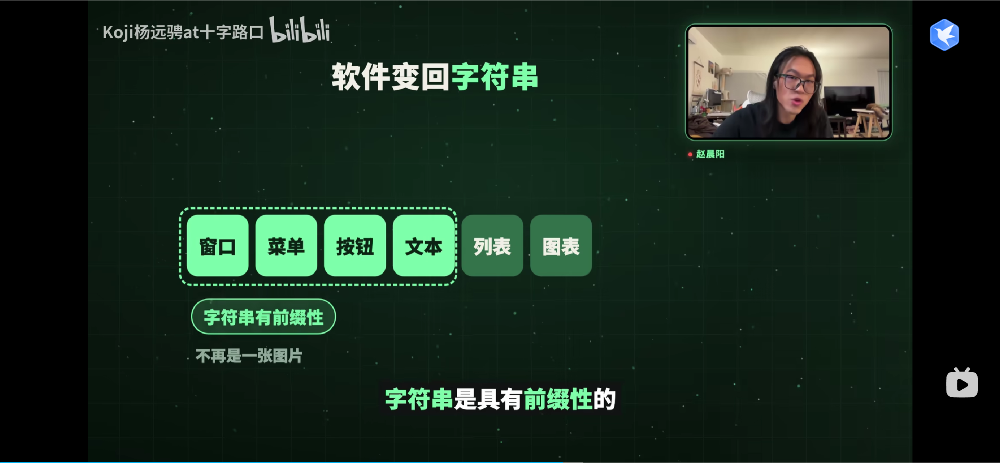

## 深度整理笔记

这期《十字路口》年终复盘播客（Koji 杨远骋对话 AI Infra 从业者赵晨阳，主题为《用 Kimi 加速 Kimi：RSI 前夜，一个 AI infra 人的 10 个 Aha Moments》），记录了一组跨度很大却底层高度同构的思考。前半段落在 **AI 研发与工程一线**（RSI 评估瓶颈、AI 编码规范、Computer Use Agent 的界面表征、推崇的研究者特质），后半段则借 **《大明王朝》** 引申出关于**系统腐化、权责对等与制度观**的反思。

如果把这两部分放在一起看，它们其实指向同一条底层主线：**无论是让 AI 自主迭代、管理代码仓库，还是维系一个组织与个人生活，真正防止系统走向失控和腐化的，从来不是模糊的自觉，而是清晰、硬性、可验证的规则与反馈闭环。**

---

### 一、RSI 的核心瓶颈：低成本、可明确的评估体系

播客标题提到了「RSI（递归自我改进）前夜」，而笔记中给出的第一条核心判断直指要害：

> **评估极其重要。当前 RSI 的 bottleneck（瓶颈）可能是「低成本的评估」；只要是能有明确评估标准的东西，模型都可以自动迭代优化。**

这条判断把 AI 能力跃迁的焦点，从单纯的「模型够不够聪明」拉回到了「反馈闭环能不能低成本地转起来」：

- **有明确评估，就能形成自动迭代飞轮**：一旦任务的好坏可以被清晰、客观地判定，模型就不需要事事依赖人工逐条纠偏，而是能够沿着评估信号持续试错、搜索与自我优化。
- **「低成本」决定迭代上限**：如果评估一次需要极高的人力、时间或算力代价，哪怕评估本身很准确，迭代次数也跑不上去。只有把评估成本打下来，高频、大规模的自动优化才真正具备可行性。
- **对工程与研发的启发**：在很多看似「模型还做不好」的场景里，真正的卡点往往不是生成能力不够，而是缺少一套低成本、可自动执行的验证标准。把模糊目标转化为可评估的指标，本身就是极高杠杆的工作。

---

### 二、AI 编程是工程能力的「放大器」：为什么必须设置强制性 Requirements

在 AI Coding 越来越普及的当下，笔记里有一句非常犀利的对照：

| 组合 | 产出结果 |
| :--- | :--- |
| **顶尖工程师 + 顶尖 AI** | 写出**顶尖代码** |
| **垃圾工程师 + 顶尖 AI** | 写出**灾难性代码** |

很多人误以为顶尖 AI 会自动把不同水平工程师的产出「拉平」，但实际情况恰恰相反——**AI 是吞吐量的极致放大器，它会把你原有的工程习惯成倍放大**：

1. **代码仓库绝不能乱**：AI 生成代码的速度极快，如果仓库本身缺乏清晰的结构与边界约束，AI 只会以远超人类的速度堆积出冗余、耦合、难以维护的代码。
2. **缺乏约束的必然结局是「没人能看懂」**：无论是人写代码，还是让 AI 写代码，都必须存在某种**强制性的规则**。如果不加限制地放任 AI 自由发挥，短期看似跑通了功能，但很快就会演变成谁也看不懂、谁也不敢改的烂摊子，整个项目随之失控。
3. **解法在于人为设置 Requirements**：工程师的核心职责之一，正从「逐行手写实现」转向「定义硬性约束」。通过人为设好明确的 requirements（例如清晰的模块边界、接口规范、代码风格、必须通过的检查与测试要求），把隐性的工程品味变成显性的准入门槛，AI 的高产能才不会变成灾难的加速器。

---

### 三、技术洞察：Computer Use Agent 与「软件变回字符串」的前缀性

在讨论 Computer Use Agent 时，播客展示了一张极具启发性的图示——**《软件变回字符串》**，核心观点是：**把图片变成字符串，让软件不再是一张图片，因为字符串是具有前缀性的。**

#### 图示拆解

视频中的结构示意图将软件界面拆解为一条有序的元素序列：

```text
[ 窗口 → 菜单 → 按钮 → 文本 ]  →  列表  →  图表
  └───── 虚线框高亮：前缀部分 ─────┘
        标签：字符串有前缀性 / 不再是一张图片
```

#### 为什么「前缀性」如此重要？

把软件界面从「整张图片」还原为「有序字符串」，不只是数据格式的变化，更是表征范式的切换：

- **图片是整体式的，局部变化容易牵一发而动全身**：如果 Agent 只是把软件当成一张截图来「看」，界面上哪怕只有一小块内容更新，在像素层面往往仍是一张新图，结构层次不够显式，处理与理解成本也更高。
- **字符串天然具备有序结构与前缀性**：当界面被表达为 `窗口 → 菜单 → 按钮 → 文本 → 列表 → 图表` 这样的序列化字符串时，软件界面的层次关系被直接摊开。如图示中被虚线框选出的前四项（`窗口`、`菜单`、`按钮`、`文本`），在多次交互或页面局部刷新中往往保持稳定，构成可复用的**共同前缀**；后续变化较频繁的内容（如 `列表`、`图表`）则接在前缀之后展开。
- **更贴合大模型与 Agent 的原生工作方式**：大语言模型本身就是围绕 token 序列与前缀预测构建的。具备前缀性的字符串表征，不仅让上下文里的公共部分更容易被复用与缓存（从 Infra 视角看能显著降低重复计算成本），也让 Agent 能够更稳定地按结构定位界面元素，而不是每次都从零「看图猜按钮」。

---

### 四、值得关注的研究者特质：推崇「honest 的研究者」

播客中专门用一张卡片列出了赵晨阳非常佩服的一组研究者，并强调了其中一个关键词——**`honest`**：

- **标签**：`honest 的研究者`（`有的在 Frontier，有的创业`）
- **提及名单**：**天宝**、**谷雨**、**苏煜**
- **原话评价**：*「这些都是我非常佩服的研究者 again」*

在技术迭代极快、叙事和噪音都很密集的 AI 行业里，把「honest（诚实/求真）」作为最高赞誉之一，其实很有分量：无论身处一线 Frontier 实验室还是走出舒适区创业，敢于直面真实数据、不夸大结论、不被短期风向带着跑，才是真正能把研究和系统做扎实的底色。

---

### 五、以《大明王朝》为镜：系统腐化规律与个人制度观

笔记的后半部分从技术转向了组织治理与个人处世，源自播客中对《大明王朝》的两点高度凝练的总结，以及由此延伸出的三条个人行动准则。

#### 1. 《大明王朝》的两点系统规律

- **第一点：系统从顶向下烂**  
  复杂系统的失序，很少只是底层偶发的执行偏差；真正致命的腐化往往始于顶层——当上位者开始破坏规矩、逃避约束或释放错误信号时，这种失范会逐层向下传导、变形并放大，最终拖垮整个系统。
- **第二点：烂的系统一定是权责不对等的**  
  只要一个系统里出现「掌权者不必为后果买单」或「背锅者没有对应决策权」的错位，理性个体就会本能地走向推诿、敷衍、寻租或摆烂，系统变烂几乎是必然结果。

#### 2. 由此落地的三条制度观

基于这两点观察，笔记总结了三条非常清醒的处事原则：

1. **权责必须对等**：享受什么样的权力，就要承担什么样的责任。把权力与责任牢牢绑定，是任何健康系统得以长期运转的前提。
2. **制度制定者必须先守制度**：自己制定的制度，首先自己要完全遵守，绝不能亲自去践踏。制度一旦被制定者自己开特例，它的权威就会立刻瓦解——这也正是防止「系统从顶向下烂」的第一道防线。
3. **按规则做事，而不是靠道德**：无论是工作协作还是日常生活，都要有清晰、不模糊的制度。道德依赖个人自觉，边界模糊且容易在利益冲突或状态不佳时失效；而规则是明确、可预期、可执行的，用规则代替道德，才能把事情真正稳定地运转起来。

---

### 复习速记

| 主题 | 核心洞察 | 关键落点 |
| :--- | :--- | :--- |
| **RSI 迭代** | 当前 RSI 的瓶颈可能是**低成本的评估** | 只要有明确、低成本的评估标准，模型就能自动迭代优化 |
| **AI 编程** | 顶尖工程师 + 顶尖 AI = 顶尖代码；垃圾工程师 + 顶尖 AI = 灾难性代码 | 代码仓库不能乱，必须人为设置强制性规则与 requirements |
| **Computer Use Agent** | **软件变回字符串**，不再是一张图片 | 利用**字符串的前缀性**（如 `窗口→菜单→按钮→文本` 作为稳定前缀），更利于结构化理解与复用 |
| **研究者审美** | 推崇 **honest 的研究者**（如天宝、谷雨、苏煜） | 无论在 Frontier 还是创业，求真与诚实是最稀缺的长期底色 |
| **系统与制度观** | 借《大明王朝》总结：**系统从顶向下烂**；**烂系统权责不对等** | 坚持权责对等、自己定的制度自己绝不践踏；生活与做事靠清晰规则，不靠模糊道德 |

---

## 原始笔记与截图

* 评估很重要 现在RSI的bottle neck可能是低成本的评估，只要是能有明确评估的东西，模型都可以自动迭代优化
* 代码仓库不能乱，顶尖工程师和顶尖AI写出顶尖代码，垃圾工程师和顶尖AI写出灾难性代码
* 写代码要有某种强制性的规则，让AI写代码也是这样，否则AI写出来的代码没人能够看懂，后面这个项目就乱了，需要人为设置requirements。
* 下面是一些优秀的研究者


* computer use agent 把图片变成字符串




* 权力和责任应该对等，享受什么样的权力，就要承担什么样的责任。
* 自己制定的制度，首先自己要完全遵守，不能去践踏
* 生活要有制度，不能模糊，按照规则来做事，不是道德
