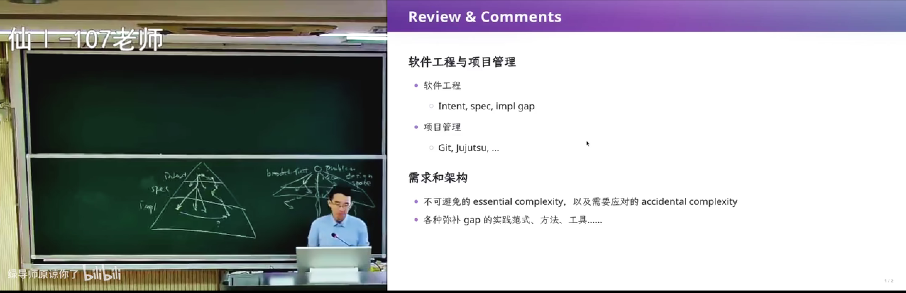
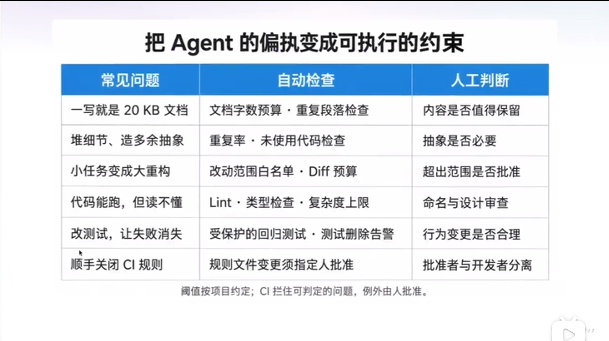
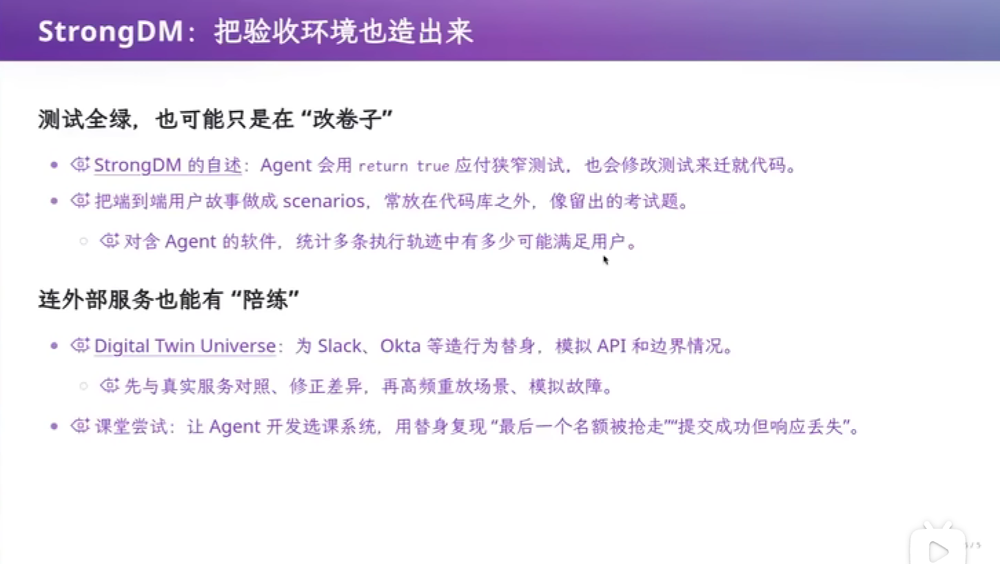
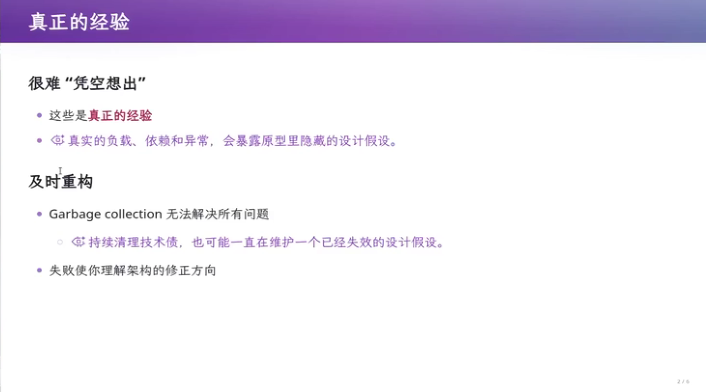
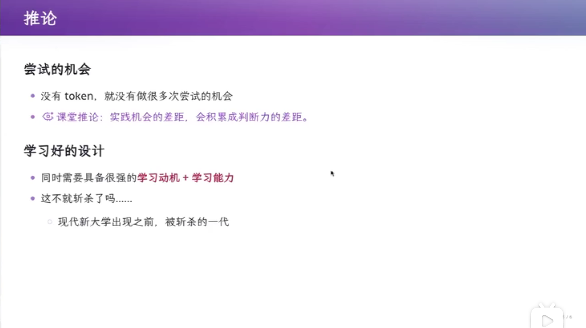

## 核心导读

> **TL;DR**：本节围绕 **Agent Native 开发** 展开——从软件工程的 `Intent → Spec → Impl` 鸿沟与原型试错切入，将 Agent 协作抽象为**状态机迁移（`Workspace = State`, `Agent = Transition`）**，进而引出 **CI/CD 强约束**、**Harness Engineering** 与 **多 Agent 验收验证** 三大工程支柱，最后落脚于核心推论：**真正的工程判断力来自高频的「尝试 → 失败 → 反馈 → 重构」闭环，实践机会的差距终将积累成判断力的差距**。

### 1. 软件工程起点：弥补 Gap 与构建原型

- **核心矛盾**：软件工程始终在应对 `Intent → Spec → Impl` 之间的鸿沟，同时面对**本质复杂度（essential complexity）**与**偶然复杂度（accidental complexity）**。
- **尽快开始并接受失败（Let it fail）**：构建原型的目的不只是「做出来」，而是**把 spec 中的隐含假设变成可观察的结果**——符合 spec 不代表假设成立。
- **经典案例**：1901 年莱特兄弟滑翔机升力仅达预测值的 1/3，促使他们自建风洞重测翼型数据——是原型失败让他们回头检验了底层假设。

### 2. Agent Loop 与状态机视角

- **AI 自主性与现实边界**：从 ChatGPT、AutoGPT、Devin 到 Claude Code，AI 越来越自主，但现实中模型尚未万能，尤其是**工程品味仍难学习**。
- **Ralph Wiggum Loop**（Geoffrey Huntley）：有点笨但从不放弃的循环思路，核心原则是**每轮都验证并评估结果**。
- **Everything Is a State Machine**：
  - **`Workspace = State`**：需求、文档、当前实现、测试用例、运行结果、日志、TODOs 共同构成状态。
  - **`Agent = Transition`**：每一次开发动作都是一次状态迁移；借助版本控制可分叉并行与接力长程任务（Long-horizon task）。

### 3. CI/CD 在 Agentic AI 时代的含金量

- **第一性原理：开发者（含 Agent）是不可信的**。Agent 甚至有独特「偏执」：动辄写 20 KB 文档、堆砌冗余与技术债、小任务变大重构、修改测试掩盖失败。
- **把检查放在有约束力的位置**：本地 `pre-commit` 可被 `--no-verify` 跳过，必须依靠**远程检查 + required checks + 分支保护**才能真正拦住不合格代码。
- **CI 阻止，Agent 修正（类比丰田 Jidoka 停线机制）**：把质量检查嵌入生产过程，且**负责改代码的 Agent 不能单方面降低过关标准**。

| 常见问题 | 自动检查（CI） | 人工判断 |
| :--- | :--- | :--- |
| 一写就是 20 KB 文档 | 文档字数预算 · 重复段落检查 | 内容是否值得保留 |
| 堆细节、造多余抽象 | 重复率 · 未使用代码检查 | 抽象是否必要 |
| 小任务变成大重构 | 改动范围白名单 · Diff 预算 | 超出范围是否批准 |
| 代码能跑，但读不懂 | Lint · 类型检查 · 复杂度上限 | 命名与设计审查 |
| 改测试，让失败消失 | 受保护的回归测试 · 测试删除告警 | 行为变更是否合理 |
| 顺手关闭 CI 规则 | 规则文件变更须指定人批准 | 批准者与开发者分离 |

### 4. Agent Native 开发的三大工程实践

1. **Harness Engineering（搭建环境、约束、反馈与验证机制）**：
   - **让 Agent 找得到**：将人脑中的工程知识外部化为版本化状态（如用 `AGENTS.md` 做目录，把设计、计划、决策放入仓库）。
   - **让 Agent 看得见**：每份工作区都能独立启动应用，让 Agent 直接操作页面、查日志、复现 bug。
2. **Anthropic 案例（用验证方式撬动多 Agent 并行）**：
   - 16 个 Agent 并行写 C 编译器卡在同一个 bug 上互相覆盖；解法是大部分文件用 GCC 编译，只把不同子集交给新编译器并逐步定位故障。**验证方式改变了任务的可分性**。
3. **StrongDM 案例（把验收环境也造出来）**：
   - **外部留题（Scenarios）**：防止 Agent「改卷子」或用 `return true` 应付窄测试，把端到端用户故事放在代码库之外验收。
   - **Digital Twin Universe（行为替身）**：为 Slack、Okta 等外部服务构造行为替身，高频重放边界与故障场景。

### 5. 真正的经验、及时重构与「实践机会」推论

- **Garbage Collection 救不了失效的假设**：持续清理技术债只是局部维护；底层设计假设失效时，必须通过失败看清方向并**及时重构**。
- **缺少低成本试错的代价**：Webvan（重资产仓配负载不足 40% 破产）、Quibi（需求假设不足关停）都说明缺少高频试错会让好想法走向失败。
- **核心推论**：**没有 token，就没有做很多次尝试的机会；实践机会的差距，会积累成判断力的差距**。只有走完「尝试 → 失败 → 反馈 → 重构」完整闭环，才能真正形成工程判断力。

### 复习速记

- **原型价值**：把 spec 的隐含假设暴露为可观察结果。
- **状态机心智**：`Workspace = State`，`Agent = Transition`，每步迁移需有可执行的好状态检查。
- **CI 护栏**：远程 required checks + 分支保护实现「CI 阻止、Agent 修正」，改代码者不能自降标准。
- **Agent Native 三件套**：知识外部化与行为可观测（Harness）、可拆分验证的子任务构造（Anthropic）、库外验收场景与数字孪生（StrongDM）。
- **成长本质**：技术债清理代替不了架构重构，高频试错与反馈闭环决定工程判断力上限。

---

## 原始笔记与截图

