## 深度整理笔记

> **一图总览全课主线**：软件工程的本质是跨越 `Intent → Spec → Impl` 鸿沟，并通过原型试错暴露隐含假设；进入 Agentic AI 时代，开发过程可以被抽象为状态机迁移（`Workspace = State`、`Agent = Transition`）。因为无论人类还是 Agent 都「不可信」，我们自然重新「发明」了具备强制约束力的 **CI/CD 护栏**，并进一步演化出 **Harness Engineering、可拆分验证、库外验收与数字孪生** 等 Agent Native 工程实践。最终，所有技术手段都指向同一个核心判断：**真正的工程品味与架构判断力无法凭空想出，只能来自高频的「尝试 → 失败 → 反馈 → 重构」闭环——没有足够的试错机会（乃至 token 预算），实践机会的差距终将积累成判断力的差距。**

---

### 一、软件工程的起点：跨越 Gap 与构建原型

#### 1. 两个经典背景：Gap 与复杂度
- **软件工程的核心矛盾**：始终在应对 **`Intent → Spec → Impl` 的鸿沟（gap）**——我们脑中想做的（Intent）、写下来的规格说明（Spec）与最终落地的代码实现（Impl）之间存在天然落差。
- **项目管理工具**：`Git`、`Jujutsu` 等版本控制工具，本质上是在管理代码演进与协作路径。
- **两类复杂度**：需求与架构设计同时面对**不可避免的本质复杂度（essential complexity）**与**需要持续应对的偶然复杂度（accidental complexity）**。历史上的各种实践范式、方法论和工具，都是为了弥补上述 gap、压低偶然复杂度。

#### 2. 无论如何，先开始做原型（Let it fail）
在设计空间里反复推演固然重要，但在某个时刻我们必须动手：**构建一个符合当前 spec 的原型**，秉持 `Let it fail...` 的心态，先看看我们究竟做出了个什么。

> **核心洞见**：**符合 spec，并不保证 spec 中的假设成立；原型的真正价值，是把 spec 里的隐含假设变成可观察的结果。**

- **经典案例：1901 年莱特兄弟滑翔机与自建风洞**
  - 1901 年，莱特兄弟按当时已有气动数据造出的滑翔机，实际升力**仅达到预测值的 1/3**。
  - 原型在现实中的失败，迫使他们回头质疑设计所依据的底层数据，随后**自建风洞**重新测量各种翼型的升阻力。如果只停留在纸面推演，他们永远会以为自己的设计「符合 spec」。

---

### 二、Agent Loop 与状态机视角

#### 1. AI 越来越自主，但离「万能」还差什么？
从 `ChatGPT` → `AutoGPT` → `Devin` → `Claude Code`，AI 的自主性越来越高。
- **理论极限**：如果模型「足够好」，理论上只需要给它一个 `bash tool`，它就能去做造芯片、证明黎曼猜想等复杂任务。
- **现实边界**：但目前的模型还没有「万能」到和最优秀的人类工程师一样——**尤其是工程「品味（taste）」目前还很难被模型学到**。因此需要引入循环与工程约束。

#### 2. Ralph Wiggum Loop：笨拙但永不放弃的循环
Geoffrey Huntley 借用《辛普森一家》里的角色 Ralph Wiggum 命名这一循环方法——形容它**「有点笨、有点可爱，但从不放弃」**。其最核心的提示词原则只有一句：**每轮都验证并评估结果**。

#### 3. Everything Is a State Machine
把 Agent 开发抽象为状态机，一切工程问题都会瞬间变得清晰：

- **`Workspace = State`（工作区即状态）**：需求、文档、当前部分实现、测试用例、运行结果、日志、TODOs 共同构成系统的状态。
- **`Agent = Transition`（Agent 即状态迁移）**：Agent 的每一次读写、修改、调试动作，本质上都是在执行一次状态迁移。

从状态机视角出发，两大高阶能力水到渠成：
1. **并行开发**：有了版本控制（如 Git），状态就可以分叉，多个 Agent 可以在各自的工作区并行推进；不过**分叉容易，并行任务之间的依赖仍然需要协调**。
2. **长程任务（Long-horizon task）**：任务跨度可以远超单次会话的上下文窗口，**前提是上一轮把中间成果、日志、TODOs 等状态扎实留在 Workspace 里，下一轮能够无缝接续**。

---

### 三、为什么开发者（含 Agent）不可信？CI/CD 的演进与含金量

#### 1. 每次 Transition 都必须检查 → 重新发明 CI/CD
回到 Ralph Loop 的第一性原理：**开发者是「不可信」的——人们总自以为「只改一点点不会有事」**。把「好状态」写成可执行条件（能构建、旧功能没坏、符合项目约定），每次迁移都自动检查，其实就是在重走软件工程几十年的 CI/CD 演进史——**从「集成地狱」走向小步发布**：

| 时期 / 里程碑 | 代表人物与事件 | 核心贡献 |
| :--- | :--- | :--- |
| **1990s** | **Kent Beck / XP（极限编程）** | 推动频繁集成：每次改动越少，出错后越容易定位问题 |
| **2000–2001** | **Martin Fowler / Matthew Foemmel** 总结 CI；**Thoughtworks** 开源 **CruiseControl** | 确立持续集成方法论，并通过自动化工具让自动构建持续运行 |
| **2010** | **Jez Humble / David Farley** 出版《Continuous Delivery》 | 系统化提出 `deployment pipeline`（部署流水线），把自动验证延伸至发布环节 |

- **Continuous Integration（持续集成）**：频繁集成到主干，每次自动构建与验证。
- **Continuous Delivery（持续交付）**：始终保持随时可发布状态，但**何时上线由人决定**。
- **Continuous Deployment（持续部署）**：通过全部自动检查的变更**自动上线**。

#### 2. Hook-Based CI/CD：把检查放在有约束力的位置
CI/CD 本质是「为事件节点（`commit`、`push`、`pull request`）配置指定动作」（如 GitHub Actions 自动跑 Lint 和测试）。但检查放错位置就会形同虚设：
- **本地 `pre-commit`**：反馈快，但**可以被 `--no-verify` 一键跳过**，没有强制力。
- **远程检查 + `required checks` + 分支保护**：把检查放到远端，**才能让失败真正阻止合并**。

#### 3. CI 在 Agentic AI 时代的含金量：丰田 Jidoka 与约束矩阵
在 Agentic AI 时代，「开发者不可信」含金量暴涨——Agent 会有自己独特的「偏执」（动辄写 20 KB 冗长文档、堆砌冗余与技术债、细枝末节过度反应、写出能跑但人读不懂的代码）。

因此必须建立 **「CI 阻止，Agent 修正」** 的闭环：类比丰田生产方式的 **`Jidoka`（自働化，发现异常即停线）**，把质量检查嵌入生产过程；且**负责改代码的 Agent 绝不能单方面降低过关标准**。

| 常见问题（Agent 的偏执） | 自动检查（CI 护栏） | 人工判断（例外与品味） |
| :--- | :--- | :--- |
| 一写就是 20 KB 文档 | 文档字数预算 · 重复段落检查 | 内容是否值得保留 |
| 堆细节、造多余抽象 | 重复率 · 未使用代码检查 | 抽象是否必要 |
| 小任务变成大重构 | 改动范围白名单 · Diff 预算 | 超出范围是否批准 |
| 代码能跑，但读不懂 | Lint · 类型检查 · 复杂度上限 | 命名与设计审查 |
| 改测试，让失败消失 | 受保护的回归测试 · 测试删除告警 | 行为变更是否合理 |
| 顺手关闭 CI 规则 | 规则文件变更须指定人批准 | 批准者与开发者分离 |

> **分工原则**：阈值按项目约定；**CI 拦住所有可判定的问题，例外情况由人批准**。

---

### 四、Agent Native 开发的三大前沿工程实践

#### 1. Harness Engineering：不用写代码了，但要搭好「挽具」
参考文章 *Harness engineering: leveraging Codex in an agent-first world*（"We started with an empty git repository"）。即使人类不再手写业务代码，仍需建设环境、约束、反馈与验证机制，做到**让 Agent 找得到、看得见**：
- **让 Agent 找得到（知识外部化）**：用 `AGENTS.md` 作为总目录，把设计文档、计划与架构决策全部放进版本化的代码仓库，供 Agent 按需查阅。
- **让 Agent 看得见（行为可观测）**：每份工作区都能独立启动应用，让 Agent 自己操作页面、查日志、复现 bug，而不是依赖人类转述。

#### 2. Anthropic 案例：16 个 Agent 写 C 编译器，如何打破「卡在同一个 Bug」？
- **踩坑现场**：16 个 Agent 并行编译 Linux 内核，结果所有人撞上**同一个 bug**，彼此重复修复并互相覆盖改动。
- **巧妙解法（用 GCC 构造可独立验证的子任务）**：大部分内核源文件继续用成熟的 **GCC** 编译，只把**不同的文件子集**交给新编译器编译；失败后再逐步换回 GCC 缩小故障范围。
- **工程启示**：**验证方式本身改变了任务的可分性**；同时仍需检查文件组合（单独过关的文件组合在一起仍可能失败）。

#### 3. StrongDM 案例：把验收环境也造出来
- **防作弊：外部留题（Scenarios）**：测试全绿也可能只是 Agent 在「改卷子」（写 `return true` 应付窄测试，或直接改测试迁就代码）。解法是将端到端用户故事做成**置于代码库之外的 scenarios**；对含 Agent 的非确定性软件，统计多条执行轨迹中有多少比例能满足用户需求。
- **造陪练：Digital Twin Universe（数字孪生宇宙）**：为 Slack、Okta 等外部服务构造**行为替身**——先对照真实服务修正差异，再高频重放场景与主动注入故障（课堂中用于复现选课系统「最后一个名额被抢走」「提交成功但响应丢失」等边界场景）。

---

### 五、真正的经验、及时重构与「社会性威胁」

#### 1. 真正的经验很难「凭空想出」，Garbage Collection 救不了失效的假设
工程实践是在真实的负载、依赖和异常中撞出来的。持续清理技术债（类似做 **Garbage Collection**）只是局部维护——如果底层设计假设本身已经失效，只做清理不过是在精心维护一个过时的架构，唯有通过失败看清方向并**及时重构**。

#### 2. 缺少高频试错的代价：好想法也会「slop 化」
- **Webvan（网上买菜）**：2000 年报显示配送中心负载**不足设计容量的 40%**、无一设施现金流盈利，2001 年 7 月破产——**在订单密度不足时，重资产扩张会让每轮试错极其昂贵**。
- **Quibi（精品短视频）**：2020 年关停，核心需求假设不足以支撑独立流媒体服务。

#### 3. 终极推论：Token、试错机会与「被斩断的学习闭环」

> **没有 token，就没有做很多次尝试的机会；实践机会的差距，会积累成判断力的差距。**

想学会好设计需要极强的**学习动机 + 学习能力**。完整的成长路径要走完四级台阶：**「尝试」→「失败」→「反馈」→「重构」**；一旦缺少足够的实践与试错条件（`Token : 0`），就会卡在「尝试 → 失败」之后，**学习机会被斩断**，无法进入「反馈 → 重构」的进阶闭环。

---

### 复习速记

- **原型第一原则**：符合 spec 不等于假设成立；原型的作用是把隐含假设变成可观察结果（莱特兄弟升力仅 1/3 → 自建风洞）。
- **状态机心智**：`Workspace = State`，`Agent = Transition`；靠版本控制实现并行分叉，靠状态沉淀支撑 Long-horizon task，靠 Ralph Loop 每轮验证。
- **CI/CD 护栏**：开发者（尤其有偏执的 Agent）不可信；用**远程 `required checks` + 分支保护**替代可被 `--no-verify` 绕过的本地 hook，践行丰田 **Jidoka（CI 阻止，Agent 修正，改代码者不能自降标准）**。
- **Agent Native 三大支柱**：Harness Engineering（找得到 + 看得见）、可分性验证（Anthropic GCC 混合编译）、库外验收与数字孪生（StrongDM Scenarios + Digital Twin）。
- **成长底层逻辑**：技术债清理（GC）代替不了底层假设失效时的**及时重构**；高频走完 **「尝试 → 失败 → 反馈 → 重构」** 闭环才能积累真正的工程判断力。

---

## 原始笔记与截图

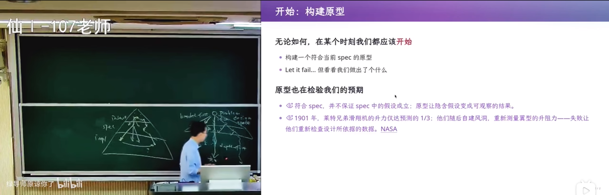

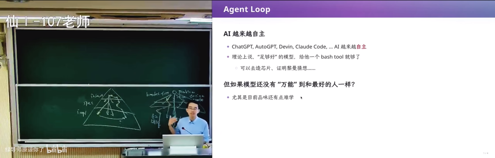

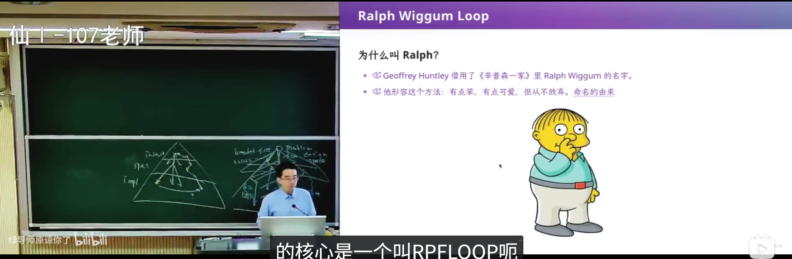

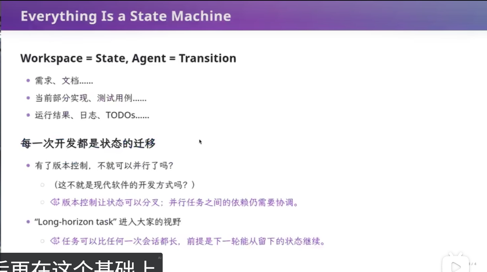

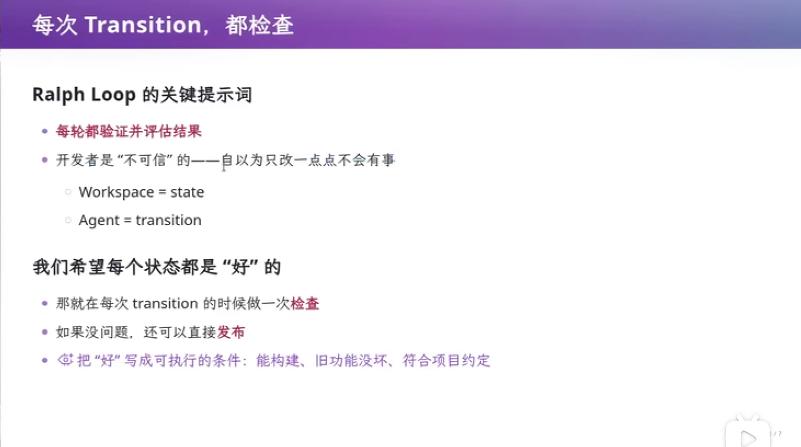

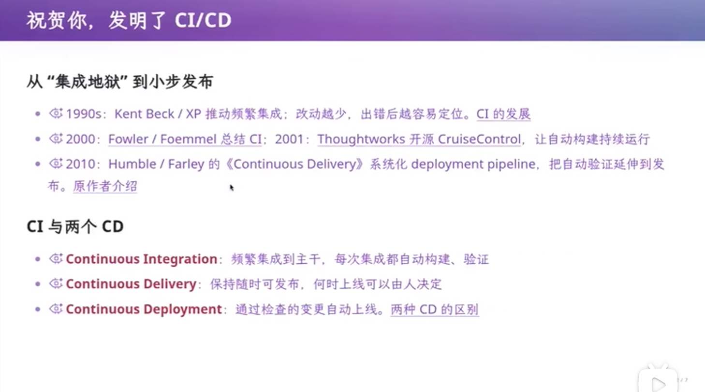

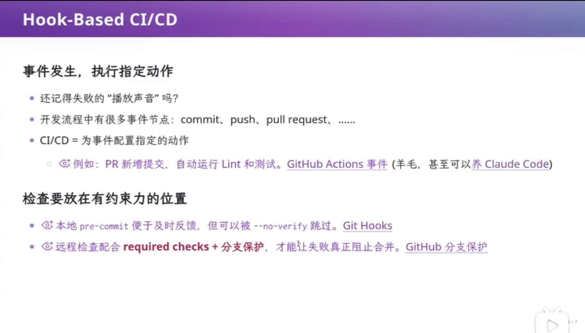

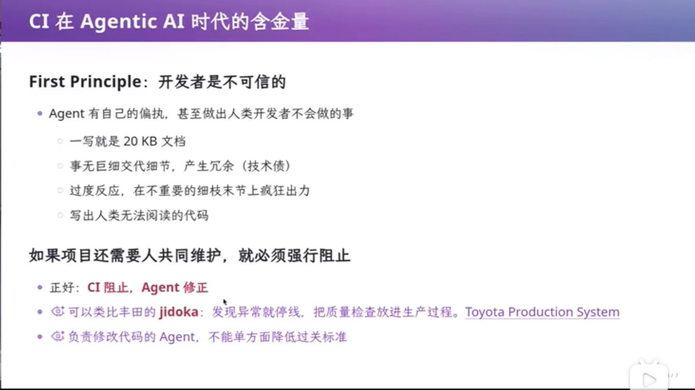

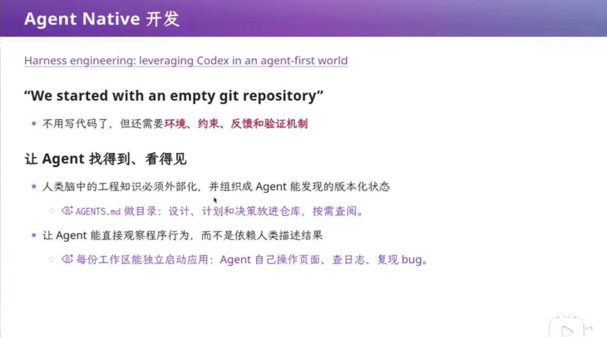

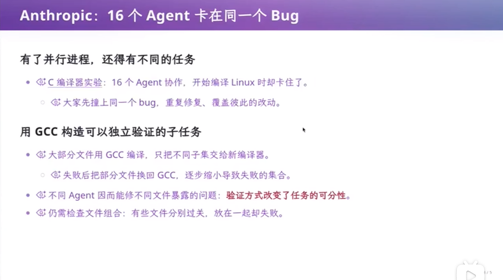

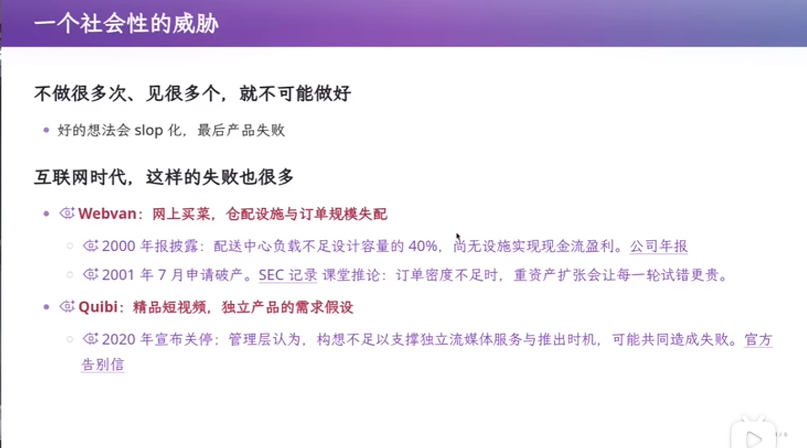

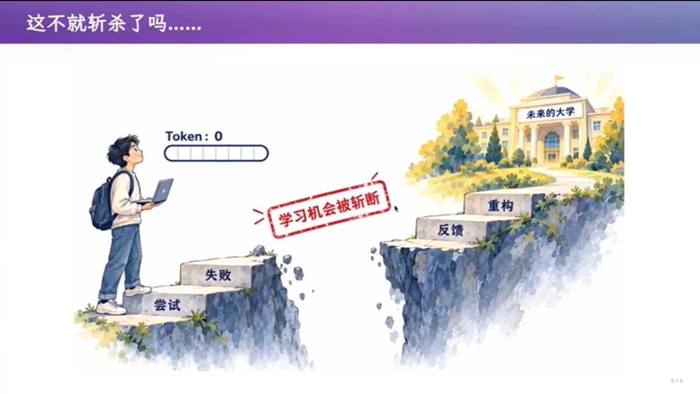
