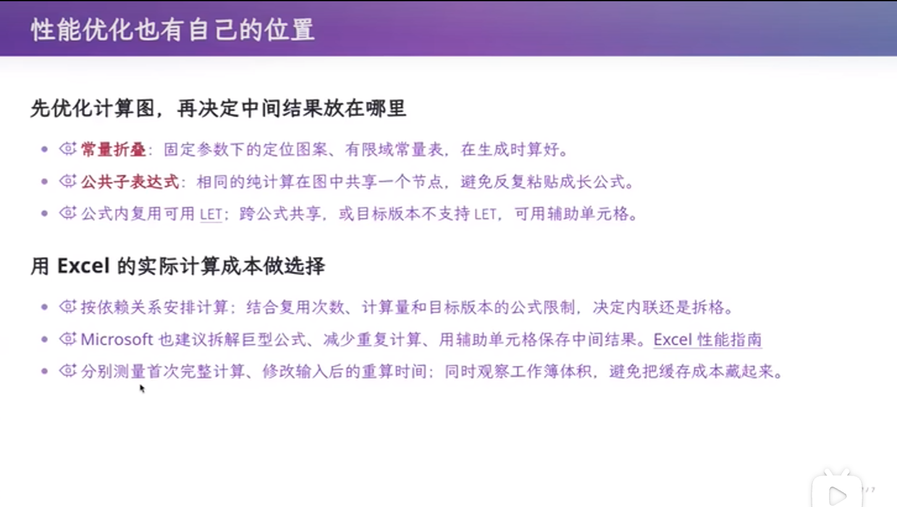
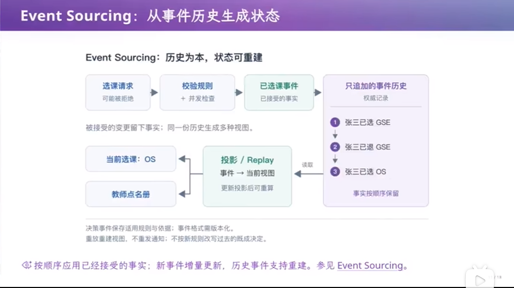

## 深度整理笔记

> **主线导读**：这堂课围绕一个贯穿软件工程与架构设计的核心追问展开——**「复杂性与依赖，究竟应该放在哪里？」**
>
> 整节课沿着五级阶梯层层推进：
> 1. **表示方式**：同一个汉诺塔的四种写法，揭示「选择一种表示，就是选择把哪些事情变得容易、改需求时哪些知识能保留」；
> 2. **架构视角**：跳出代码看问题（代码 → 客户 → 社会 → 宇宙的规律）；
> 3. **工程落地**：性能优化也有自己的位置——先优化计算图，再用真实成本（如 Excel）决定中间结果放哪里；
> 4. **经典反例**：CRUD 架构为何会演变成数据依赖的灾难（用「当前状态」覆盖了事实、规则与决定）；
> 5. **破局之道**：把依赖变成一等公民（First-Class Citizens），自然推导出 **Event Sourcing** 架构及其工程底线。

---

### 一、同一个汉诺塔，四种表达：复杂性被放在哪里？

> **核心命题**：选择一种表示（Representation），本质上就是在选择**把哪些事情变得容易**，以及更关键的——**「改需求时，哪些知识能保留？」**

同样是解决汉诺塔问题，PPT 对比了四种截然不同的实现思路，它们的运行结果完全等价，但把「复杂性」安放到了完全不同的位置：

| 表达方式 | 核心机制 | 复杂性被放在哪里？ | 优势与局限 |
| :--- | :--- | :--- | :--- |
| **1. GPT-6｜数学规律** | 利用 `position + step` 映射，按步号直接算出当前要移动的盘号 | **把递归树压缩成数学规律** | 代码极简、无需维护调用过程；但**强依赖汉诺塔自身的特殊结构**，一旦规则改动（例如加限制条件），整套公式可能瞬间失效 |
| **2. DeepSeek｜任务栈** | 将单个任务拆成 `左子任务 -> 移动 -> 右子任务`，用 **LIFO 反序压栈**（先压右子任务，最后压左子任务，从而先执行左子任务） | **把递归展开成待办事项（To-do List）** | **显式管理尚未完成的工作**，脱离了语言调用栈的隐式魔法，更容易做暂停、调度或扩展 |
| **3. 绿导师｜抽象机器** | 维护显式调用栈帧 `n / from / to / aux \| pc`；函数调用时「调用 -> 压入新帧」，返回时「返回 -> 旧帧从 `pc` 继续」 | **把函数执行机制显式化** | 通用性最强，本质是在模拟机器如何执行递归；不仅解决汉诺塔，还保留了「控制流与状态保存」的通用知识 |
| **4. 搜索截图｜分支与细节** | 针对 1、2、3 号柱子的具体位置，把移动逻辑硬展开为 `case 1` / `case 2` / `case 3` | **把原本对称的规则展开成多个分支** | 最容易写出「能跑的代码」，但结构知识被打散在细节里——**代码能运行之后，仍需要额外解释规则** |

其中几个关键图示细节值得单独记住：

1. **数学规律（GPT-6）的步号-盘号对应表**（3 阶汉诺塔共 7 步）：

```text
步号:   1   2   3  [4]  5   6   7
盘号:   1   2   1  [3]  1   2   1
                   ↑
         通过 position + step 直接定位第 4 步移动 3 号盘
```

   这种写法的惊艳之处在于「用数学洞察消灭了显式状态」，代价是把问题的通用递归结构特化成了汉诺塔独有的数论 / 位运算规律。

2. **任务栈（DeepSeek）的反序压栈逻辑**：
   - 原本的执行顺序是：`左子任务` -> `移动` -> `右子任务`。
   - 因为栈是 **LIFO（后进先出）**，所以必须**反序压栈**：先压「右子任务」，再压「移动」，最后压「左子任务」，出栈时就能保证**先执行左子任务**。

3. **抽象机器（绿导师）的栈帧模型**：

```text
+--------------------------+----+
| n / from / to / aux      | pc |  <-- 调用 -> 新帧（压栈）
+--------------------------+----+
| n / from / to / aux      | pc |  <-- 返回 -> 旧帧继续（按 pc 恢复）
+--------------------------+----+
            ...
+--------------------------+----+
| n / from / to / aux      | pc |
+--------------------------+----+
```

   这里引入了程序计数器 `pc`，把「函数执行到哪一步」也变成显式数据。它体现的是一种非常典型的系统思维：当你理解了抽象机器，任何递归都能机械地翻译成状态机。

> **架构启示**：判断一种表示或设计好不好，不能只看「现在能不能跑」「行数短不短」，而要问**「当需求变化时，你之前投入的思考与领域知识，有多少还能留下来继续复用？」**

---

### 二、跳出问题看问题：2,000 行架构例子背后的视野层级

在讨论完具体代码表示后，课堂通过「2,000 行的架构例子」把视野拉高到了**问题边界之外**：

```text
  [ 代码的规律 ]
        ↓  跳出一层
  [ 客户的规律 ]   ← 业务场景、真实使用方式、利益诉求
        ↓  再跳出一层
  [ 社会的规律 ]   ← 组织协作、制度流程、责任归属、合规与审计
        ↓  再跳出一层
  [ 宇宙的规律 ]   ← 信息论、计算复杂性、物理与数学约束
```

- **这种「跳出问题看问题」的能力从哪里来？**
  - 不是靠死磕单一语法或框架刷出来的，而是**你在学校的学习、社会上积累的经验……共同赋予了你这个能力**。
  - 绿老师在这里留了一句很犀利的冷幽默：*「（如果有一天这个能强化学习，就真见证人类完蛋了）」*——潜台词很明确：在当前阶段，跨层级洞察现实世界规律、重新定义问题边界，仍然是人类工程师最难被替代的核心护城河。

---

### 三、性能优化也有自己的位置：以计算图与 Excel 为例

谈架构不是只谈抽象概念，**性能优化同样有它清晰的位置**——核心原则是：**先优化计算图，再决定中间结果放在哪里**。

#### 1. 第一步：在「计算图」层面消除多余计算

在考虑缓存、拆表、调参之前，先把计算本身的依赖图理顺：

- **常量折叠（Constant Folding）**：
  - 凡是固定参数下就能确定的东西——例如（二维码生成场景里的）**定位图案**、**有限域常量表**——直接在生成 / 编译阶段预先算好，不要留到运行时反复算。
- **公共子表达式消除（CSE）**：
  - 相同的纯计算在计算图中应该**共享同一个节点**，避免把同一段逻辑反复复制粘贴成难以维护的巨型公式。
- **中间结果的安放选择（`LET` vs 辅助单元格）**：
  - **公式内局部复用**：使用 `LET` 绑定中间变量，既消除重复计算又不污染表格布局。
  - **跨公式共享，或目标 Excel 版本不支持 `LET`**：落到**辅助单元格**里保存中间结果。

#### 2. 第二步：用 Excel 的实际计算成本做工程权衡

决定「内联（写进一个公式）」还是「拆格（写到辅助单元格）」时，不能拍脑袋，而要看真实运行成本：

1. **按依赖关系安排计算**：综合考量**复用次数**、**单次计算量**以及**目标版本的公式限制**（如公式长度、嵌套深度、函数兼容性），决定内联还是拆格。
2. **印证官方最佳实践**：Microsoft 官方的《Excel 性能指南》同样建议**拆解巨型公式、减少重复计算、用辅助单元格保存中间结果**。
3. **建立完整的度量视角（避免隐性代价）**：
   - 必须**分别测量**两个时间指标：
     - **首次完整计算时间**（冷计算 / 全量重算）；
     - **修改输入后的重算时间**（增量重算）。
   - 同时**观察工作簿体积**——不要只盯着单次重算变快了，却把大量中间缓存塞进文件里导致体积暴涨，**避免把缓存成本藏起来**。

---

### 四、CRUD 架构的灾难：失控的数据依赖

回到最常见的业务系统架构 **CRUD（Create / Read / Update / Delete）**，它为什么在系统变复杂后会频频失控？根本原因在于：CRUD 只关心并覆盖写入「当前状态」，而忽略了「当前状态」背后的复杂构成。

#### 1. 「当前状态」里混杂了三类完全不同的东西

```text
当前状态  =  历史事实  +  当时适用的规则  +  根据规则作出的决定
```

- 在传统数据库表里，大量单点字段其实并不是原始输入，而是带有 **Data Dependency（数据依赖）** 的派生「结果」。
- **Data Dependency 意味着：前面改了会摧毁后面。**
- 更糟糕的是，在真实工程里（尤其是「草台班子嘛」），这些隐含的依赖关系往往根本没有被系统化地管理起来——它们散落在各个接口代码、定时脚本和人工订正里。

#### 2. 经典案例：一个「允许毕业」，究竟依赖什么？

以教务系统里的「允许毕业」状态为例，它看似只是一个布尔值字段，背后却交织着多条依赖链：

```text
  课程成绩  ──────┐
                  ├──→  学分认定  ──→  毕业结论（允许毕业）
  课程替代审批 ───┤
                  │
  培养方案版本 ───┘
```

一旦某天发生了**「成绩更正」**，CRUD 表立刻陷入两难：
- **哪些结论需要重新审核？**（比如还没发证、仍在审核流中的）
- **哪些已经成为正式决定？**（比如学位已经授予、具有法律 / 制度效力的历史决议，不能因为后台悄悄改了一条数据就被无声推翻）
- **最致命的丢失**：即使你的数据库表设计得非常规范、**表中没有任何重复字段**，只要你用覆盖写的方式存结果，依然会彻底丢掉**「这个结论当年究竟是怎么算出来的」**。

---

### 五、把依赖变成一等公民：Event Sourcing

> **核心转折**：*「如果我们跳出问题看问题：既然都知道 dependency 是问题，为什么不能直接把它们变成 first-class citizens（一等公民）？」*

#### 1. 数据结构的两面与「账本直觉」

同一个业务，数据结构其实有两种记录方式：
- **记录「当前状态」**：例如「张三当前课表 = OS」。
- **记录「操作历史」**：例如「张三选修了《生成式软件工程》」。

生活中最经典的类比就是**银行账本**：
- **余额只是结果**，真正权威的是**逐笔交易记录**；
- 正因为保留了逐笔记录，我们永远知道余额是怎么来的、每一笔变动发生在何时、依据是什么。

把这套思路搬进软件架构，就是：**当前状态不再是直接手改的权威源，而是由 Replay（重放）事件序列决定**：

```text
当前状态 = Replay( 历史事件序列 )      本质：语义 = 状态机
```

> 祝贺，你发明了 **Event Sourcing（事件溯源）**！
>
> 当语义变成「作用在事件序列上的状态机」后，面对业务规则或统计口径变化，我们就有了底气（可以重新计算视图）；当然，随之而来也有很多问题必须小心处理，例如**语义的版本**。

#### 2. Event Sourcing 的完整架构链路：历史为本，状态可重建

以「学生选课」为例，PPT 清晰地把系统拆成了**写入链路（事实沉淀）**与**读取 / 投影链路（视图衍生）**两条路径：

```text
【写入链路：校验意图 -> 沉淀不可变事实】

  选课请求          校验规则            已选课事件           只追加的事件历史（权威记录）
 (可能被拒绝) ──→ (+ 并发检查) ──→    (已接受的事实) ──→  +--------------------------+
                                                          | 1. 张三已选 GSE          |
                                                          |        ↓                 |
                                                          | 2. 张三已退 GSE          |
                                                          |        ↓                 |
                                                          | 3. 张三已选 OS           |
                                                          |  (事实按顺序保留)        |
                                                          +------------+-------------+
                                                                       │ 读取
                                                                       ↓
【读取与投影链路：同一份历史 -> 生成多种视图】
                                                          +--------------------------+
                        ┌──→  当前选课：OS                |      投影 / Replay       |
                        │                                 |    事件 -> 当前视图      |
                        ├──→  教师点名册       ←──────────|   (更新投影后可重算)     |
                        │                                 +--------------------------+
                        └──→  (未来新增的其他报表/视图...)
```

这条链路中有四个关键区分：
1. **请求（Command）不是事件（Event）**：`选课请求` 只是意图，**可能被拒绝**；只有通过了 `校验规则 + 并发检查` 后，才会产出一个 `已选课事件`（已接受的事实）。
2. **事件历史是只追加（Append-only）的权威记录**：事实按发生顺序永久保留（`1. 张三已选 GSE` -> `2. 张三已退 GSE` -> `3. 张三已选 OS`），绝不原地涂改。
3. **一源多视图（Projection）**：被接受的变更留下事实，**同一份事件历史可以投影出多种不同视图**（如学生看到的 `当前选课：OS`、老师看到的 `教师点名册`）。
4. **增量与重建兼得**：按顺序应用已经接受的事实——平时新事件到来时**增量更新**视图；当投影逻辑修复或新增报表需求时，基于历史事件**重放重建**。

#### 3. 落地 Event Sourcing 的三条工程底线

事件溯源不是银弹，PPT 底部专门强调了必须守住的三条工程约束：

1. **留存依据与版本化**：**决策事件必须保存当时适用的规则与依据**（呼应前面「允许毕业」的教训），同时**事件格式与语义必须版本化**，否则未来读不懂历史事件。
2. **重放不得触发副作用**：**重放（Replay）只用于重建视图，绝不重发外部通知**（例如重放历史选课记录时，不能再给学生和老师重发一遍选课成功短信 / 邮件）。
3. **尊重历史既成决定**：**不能用新规则去改写过去的既成决定**——新规则只应用于新事实或生成新的审视视角，不能把历史上合法生效的决议悄悄抹掉。

---

### 复习速记

- **复杂性安放**：同一个汉诺塔有数学规律、任务栈、抽象机器、分支展开四种表示；选架构就是选「把什么变容易」以及「**改需求时哪些知识能保留**」。
- **跳出问题**：代码之外有客户规律、社会规律、宇宙规律；跨层抽象能力来自长期学习与社会经验积累。
- **优化次序**：先做计算图优化（**常量折叠、公共子表达式**），再按依赖与成本决定 `LET` 内联还是辅助单元格拆格；必须同时测量**首次全量计算、修改后增量重算、工作簿体积**。
- **CRUD 痛点**：`当前状态 = 历史事实 + 当时规则 + 既成决定`；直接覆盖写当前状态会破坏 Data Dependency，即使表无冗余字段，也会丢失「结论是怎么算出来的」。
- **Event Sourcing**：把依赖变成一等公民，用**只追加的权威事件日志**替代覆盖写；通过 `投影 / Replay`（`语义 = 状态机`）支持增量更新与多视图重建。
- **三条底线**：**决策事件存规则与依据 + 事件/语义版本化**；**重放只建视图不重发通知**；**不用新规则改写历史既成决定**。

---

## 原始笔记与截图


## 不同的架构






