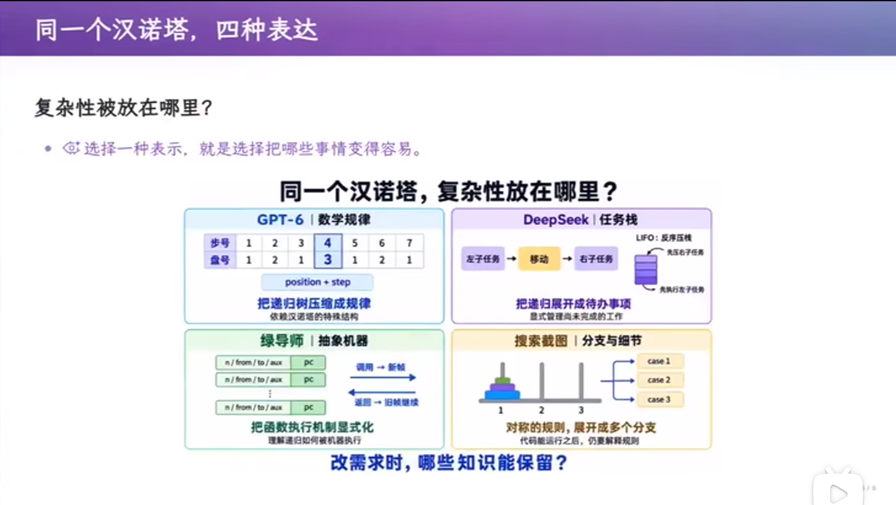
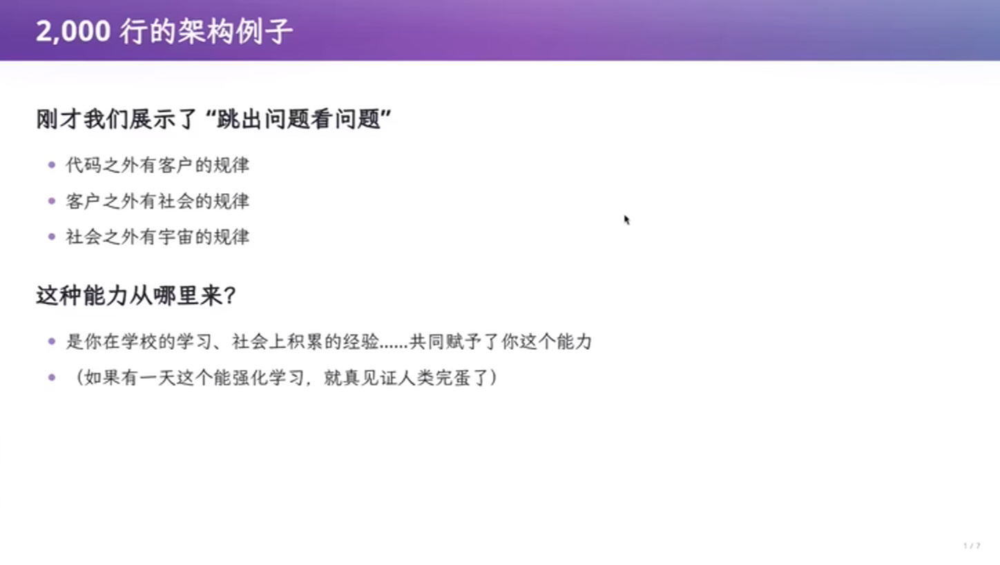
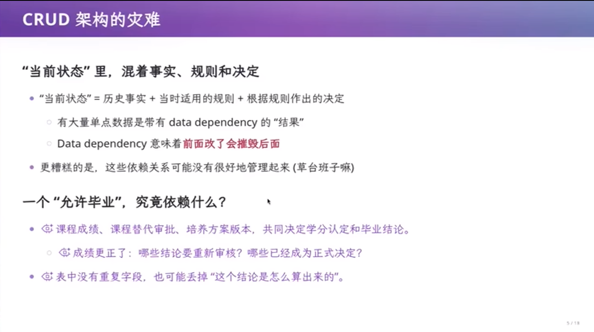
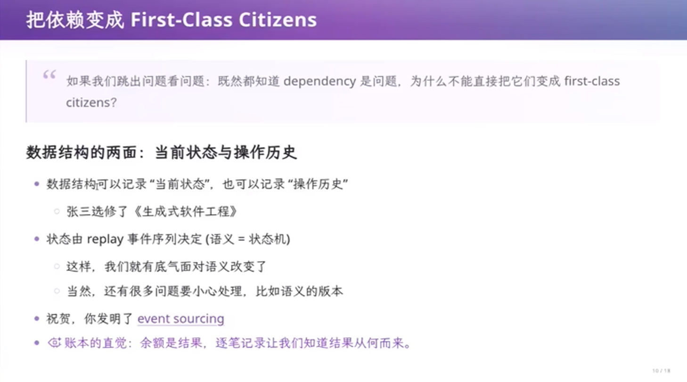

## 核心导读

> **TL;DR**：本节围绕「**复杂性与依赖应该放在哪里**」这一架构核心命题展开——从汉诺塔的四种不同表达说明「表示方式决定难易与可演进性」，经由「跳出问题看问题」的宏观视角与计算图 / Excel 性能优化的工程权衡，最终落到对 **CRUD 架构数据依赖灾难**的剖析，并引出以操作历史为权威记录的 **Event Sourcing** 架构。

### 1. 同一个汉诺塔，四种表达：复杂性放在哪里？

选择一种表示，本质上是在选择**把哪些事情变得容易**，以及在**改需求时哪些知识能够保留**。

| 表达方式 | 核心机制 | 复杂性处理方式 | 特点 / 代价 |
| :--- | :--- | :--- | :--- |
| **数学规律（GPT-6）** | `position + step`，按步号直接映射盘号 | 把递归树压缩成数学规律 | 强依赖汉诺塔自身的特殊结构 |
| **任务栈（DeepSeek）** | LIFO 反序压栈（先压右子任务，先执行左子任务） | 把递归展开成待办事项 | 显式管理尚未完成的工作 |
| **抽象机器（绿导师）** | 调用栈帧 `n / from / to / aux \| pc`，调用压新帧、返回续旧帧 | 把函数执行机制显式化 | 直观理解递归如何被机器执行 |
| **分支与细节（搜索截图）** | 针对 1/2/3 号柱展开为 `case 1 / 2 / 3` | 把对称规则展开成多个分支 | 代码能运行后，仍需要额外解释规则 |

### 2. 架构视角与性能优化的位置

- **跳出问题看问题**（2,000 行的架构例子）：
  - 代码之外有**客户的规律**，客户之外有**社会的规律**，社会之外有**宇宙的规律**。
  - 这种洞察力来自学校学习与社会经验的长期积累。
- **先优化计算图，再决定中间结果放哪里**（以 Excel 为例）：
  - **常量折叠**：固定参数下的定位图案、有限域常量表，在生成时预先算好。
  - **公共子表达式**：相同的纯计算在图中共享节点，避免反复粘贴成长公式。
  - **复用与落盘选择**：公式内复用可用 `LET`；跨公式共享或目标版本不支持 `LET` 时使用辅助单元格（微软 Excel 性能指南亦建议拆解巨型公式、用辅助单元格保存中间结果）。
  - **按真实成本度量**：按依赖关系安排计算，结合复用次数、计算量与公式限制决定内联还是拆格；分别测量**首次完整计算**与**修改输入后的重算时间**，同时观察工作簿体积，避免把缓存成本隐藏起来。

### 3. CRUD 架构的灾难：失控的数据依赖

- **「当前状态」混杂了三类东西**：`当前状态 = 历史事实 + 当时适用的规则 + 根据规则作出的决定`。
- 大量单点数据其实是带有 **data dependency** 的派生「结果」——**前面改了会摧毁后面**，而草台班子往往没有把这些依赖管理起来。
- **典型案例：「允许毕业」究竟依赖什么？**
  - 它由课程成绩、课程替代审批、培养方案版本共同决定。
  - 一旦成绩更正：很难判定哪些结论要重新审核、哪些已成为正式决定；即便数据表中没有重复字段，也会丢掉「**这个结论是怎么算出来的**」。

### 4. 把依赖变成一等公民：Event Sourcing

既然依赖是痛点，跳出问题看问题就是把依赖变成 **First-Class Citizens**。

- **数据结构的两面**：既可以记录「当前状态」，也可以记录「操作历史」（如「张三选修了《生成式软件工程》」）。
- **核心直觉（账本模型）**：余额只是结果，逐笔记录让我们知道结果从何而来；当前状态由 **replay 事件序列**决定（**语义 = 状态机**），从而更有底气面对语义变更（但需小心处理语义版本）。
- **架构流程（历史为本，状态可重建）**：
  1. **写入链路**：`选课请求`（可能被拒绝） → `校验规则 + 并发检查` → `已选课事件`（已接受的事实） → `只追加的事件历史`（权威记录，按顺序保留，如：`1. 张三已选 GSE` → `2. 张三已退 GSE` → `3. 张三已选 OS`）。
  2. **读取与投影链路**：从同一份事件历史经 `投影 / Replay` 生成多种视图（如 `当前选课：OS`、`教师点名册`）；新事件支持增量更新，更新投影后可重算重建。
- **关键工程约束**：
  - 决策事件需保存适用规则与依据，事件格式需**版本化**。
  - 重放只用于重建视图，**不重发通知**，也**不按新规则改写过去的既成决定**。

### 复习速记

- 架构选型的核心追问：**复杂性放在哪里？改需求时哪些知识能保留？**
- 性能优化要分层次：先做计算图级优化（常量折叠、公共子表达式），再结合依赖与实测开销决定缓存 / 拆格策略。
- CRUD 易失控的根源在于用「覆盖写当前状态」抹掉了事实、规则、决定之间的依赖链。
- **Event Sourcing** 用只追加的权威事件日志替代直接覆盖状态，以 `Replay / 投影` 按需衍生多种视图。
- 落地 Event Sourcing 的三条底线：**事件与语义要版本化、重放不重发副作用通知、不用新规则改写历史既成决定**。

---

## 原始笔记与截图

## 不同的架构

